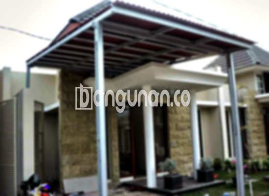

**Jasa Pasang Kanopi Rumah Minimalis di Jayakerta Karawang** – Mencari solusi untuk melindungi area luar rumah dari cuaca ekstrem? Kanopi adalah jawabannya. Bagi Mitra Bangunan di Jayakerta Karawang, memiliki kanopi yang rapi dan kokoh tidak hanya meningkatkan estetika rumah, tapi juga memberikan kenyamanan dan perlindungan optimal dari hujan dan panas. Kami hadir sebagai penyedia jasa pembuatan dan pemasangan kanopi berkualitas dengan harga terjangkau.

Kanopi hadir dalam beragam desain yang dapat disesuaikan dengan gaya arsitektur rumah Anda. Pemilihan model kanopi yang tepat akan menyelaraskan fungsi dan estetika, menciptakan ruang luar yang nyaman dan menarik. Kami menawarkan berbagai pilihan bahan dan desain untuk memenuhi kebutuhan spesifik Anda.



## Keunggulan Menggunakan Jasa Pasang Kanopi Rumah Minimalis di Jayakerta Karawang

Memilih layanan profesional untuk pemasangan kanopi menawarkan sejumlah keuntungan signifikan bagi Anda. Berikut beberapa di antaranya:

### \- Pilihan Model Kanopi yang Beragam

Kami menyediakan beragam pilihan model kanopi rumah yang bisa Anda pilih sesuai selera. Setiap orang memiliki preferensi desain tersendiri, dan kami siap mewujudkannya. Anda bisa memilih model dengan bentuk persegi, persegi panjang, atau desain khusus sesuai kebutuhan Anda.

### \- Bahan Ramah Lingkungan untuk Kanopi di Jayakerta Karawang

Kanopi yang kami gunakan terbuat dari material yang aman dan ramah lingkungan. Ini menjadikan pilihan yang bertanggung jawab bagi Anda dan bumi. Material kanopi juga mudah dibersihkan, sehingga perawatannya menjadi sangat praktis.

### \- Daya Tahan dan Kekuatan Terjamin

Salah satu kelebihan utama kanopi yang kami pasang adalah daya tahan dan kekuatannya. Kami hanya menggunakan bahan-bahan berkualitas tinggi yang mampu bertahan lama menghadapi berbagai kondisi cuaca. Dengan perawatan yang tepat, kanopi ini dapat melindungi properti Anda selama bertahun-tahun.

Anda dapat mengandalkannya untuk perlindungan jangka panjang. Kualitas material dan pengerjaan yang teliti memastikan kanopi tetap kokoh dan berfungsi optimal.

### \- Keamanan dan Kenyamanan Optimal

Kanopi memberikan lapisan perlindungan tambahan bagi area di bawahnya. Baik itu teras depan rumah, carport, atau area taman, kanopi melindungi dari paparan langsung sinar matahari dan hujan. Hal ini menciptakan lingkungan yang lebih nyaman dan aman untuk Anda dan keluarga.

Dengan kanopi, Anda dapat menikmati area luar rumah tanpa khawatir terpapar cuaca buruk.

### \- Harga Kompetitif untuk Kanopi Minimalis di Jayakerta Karawang

Kami menawarkan harga yang kompetitif untuk layanan pemasangan kanopi rumah minimalis di Jayakerta Karawang. Kami percaya bahwa kualitas tidak harus selalu mahal. Kami akan memberikan penawaran harga yang sesuai dengan anggaran Anda tanpa mengorbankan kualitas produk dan layanan.

## Informasi Harga dan Jasa Pemasangan Kanopi Rumah Minimalis di Jayakerta Karawang



Banyak pemilik rumah di Jayakerta Karawang kini memilih untuk memasang kanopi. Penggunaannya sangat beragam, mulai dari melindungi garasi mobil hingga menciptakan area parkir yang teduh, atau sebagai penutup jendela. Pilihan penggunaan kanopi tergantung pada kebutuhan spesifik Anda.

Untuk mendapatkan informasi harga yang akurat dan sesuai dengan kebutuhan Anda, silahkan hubungi kami. Kami akan dengan senang hati memberikan penawaran terbaik.

Harga kanopi rumah dapat bervariasi tergantung pada kualitas material dan desain yang dipilih. Semakin berkualitas material yang digunakan, semakin tinggi pula harganya. Selain itu, harga juga dipengaruhi oleh ukuran kanopi. Semakin luas area yang perlu ditutupi, semakin tinggi biayanya. Pastikan Anda memilih ukuran yang sesuai dengan kebutuhan Anda untuk mendapatkan solusi yang efisien.

Kami menyediakan layanan pemasangan kanopi profesional yang cepat dan efektif. Dengan bantuan tenaga ahli kami, Anda dapat memiliki kanopi yang terpasang dengan rapi dan aman. Dengan demikian, Anda dapat segera menikmati manfaat dari kanopi tersebut.

**Ref by:**  [Kanopi Rumah Minimalis Jayakerta Karawang](https://id.wikipedia.org/wiki/Kanopi)

Mitra Bangunan yang berlokasi di Jayakerta Karawang dan sedang mencari jasa pasang kanopi rumah minimalis berkualitas, jangan ragu untuk menghubungi kami melalui tombol WhatsApp atau Telepon di halaman ini. Kami siap memberikan konsultasi gratis dan membantu Anda menemukan solusi kanopi yang paling sesuai dengan kebutuhan dan anggaran Anda.