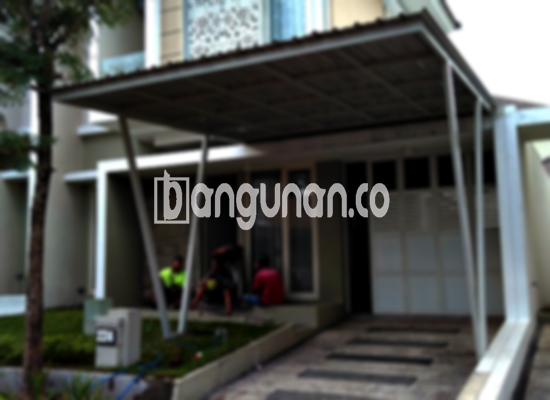

**Jasa Pasang Kanopi Rumah Minimalis di Jelambar Jakarta** – Menciptakan kenyamanan dan perlindungan untuk properti Anda adalah prioritas utama. Kanopi menjadi solusi praktis untuk melindungi teras, garasi, atau area outdoor lainnya di rumah Anda di Jelambar Jakarta. Bagi Mitra Bangunan di Jelambar Jakarta, memilih kanopi yang tepat bukan hanya tentang estetika, tetapi juga fungsi dan ketahanan. Kami hadir sebagai penyedia jasa borongan pembuatan dan pemasangan kanopi yang berkualitas dan terjangkau.

Kami menyediakan beragam pilihan kanopi untuk memenuhi kebutuhan spesifik Anda. Beberapa jenis kanopi yang populer di antaranya baja ringan, galvalum, kaca, dan polycarbonate. Masing-masing material menawarkan karakteristik unik, memungkinkan Anda menyesuaikan kanopi dengan gaya arsitektur rumah dan anggaran yang tersedia.



## Mengapa Memilih Jasa Pasang Kanopi Rumah Minimalis di Jelambar Jakarta?

Bagi Anda yang mempertimbangkan untuk menggunakan jasa pemasangan kanopi, terdapat beberapa keunggulan yang dapat Anda rasakan:

### \- Pilihan Model yang Beragam

Keindahan kanopi tidak hanya terletak pada fungsinya, tetapi juga pada desainnya. Kami menawarkan beragam model kanopi yang dapat Anda pilih sesuai selera. Anda dapat memilih desain persegi, persegi panjang, atau bahkan desain khusus yang disesuaikan dengan preferensi pribadi Anda.

### \- Material Ramah Lingkungan

Kami berkomitmen untuk menyediakan produk yang ramah lingkungan. Bahan-bahan yang kami gunakan tidak berbahaya dan aman bagi lingkungan sekitar Anda. Selain itu, material kanopi kami mudah dibersihkan, sehingga perawatan menjadi lebih praktis.

### \- Ketahanan dan Kekuatan Teruji

Kanopi yang kami pasang dirancang untuk tahan lama dan kuat. Kami menggunakan material berkualitas tinggi yang mampu menahan cuaca ekstrem dan penggunaan sehari-hari. Anda dapat menikmati kanopi yang kokoh dan awet selama bertahun-tahun.

Anda akan melihat sendiri ketahanan kanopi rumah yang dapat bertahan puluhan tahun. Perawatan yang baik akan memperpanjang usia pakainya.

### \- Keamanan Terjamin

Kanopi kami memberikan perlindungan optimal terhadap berbagai kondisi cuaca, seperti sinar matahari yang terik dan hujan deras. Area di bawah kanopi akan terlindungi dengan baik, menciptakan ruang yang nyaman dan aman untuk Anda dan keluarga.

Dengan demikian, Anda dapat menikmati area outdoor rumah Anda tanpa khawatir terpapar cuaca buruk.

### \- Harga Kompetitif

Kami menawarkan harga yang bersaing tanpa mengorbankan kualitas. Kami memahami bahwa setiap anggaran berbeda-beda, sehingga kami menyediakan solusi yang sesuai dengan kebutuhan dan kemampuan finansial Anda.

## Informasi Harga dan Jasa Pemasangan Kanopi di Jelambar Jakarta



Banyak orang saat ini yang telah memanfaatkan manfaat kanopi untuk berbagai keperluan, mulai dari melindungi garasi mobil hingga menutupi jendela dan area parkir. Pilihan penggunaan kanopi sangat bergantung pada kebutuhan spesifik Anda.

Sebagai gambaran, harga kanopi rumah dengan kualitas standar berkisar antara Rp. 450.000 – Rp. 800.000 per meter persegi. Harga dapat bervariasi tergantung pada jenis bahan, kompleksitas desain, dan ukuran kanopi yang Anda pilih. Kami menyarankan Anda untuk berkonsultasi dengan tim kami untuk mendapatkan penawaran harga yang paling akurat.

Faktor-faktor yang memengaruhi harga meliputi kualitas material, ukuran kanopi, dan kompleksitas desain. Semakin tinggi kualitas material dan semakin rumit desainnya, semakin tinggi pula harganya.

Bagi Anda yang ingin memasang kanopi di rumah Anda di Jelambar Jakarta, kami menyediakan layanan pemasangan yang cepat dan efisien. Tim kami yang berpengalaman akan memastikan kanopi terpasang dengan rapi dan kokoh.

Dengan demikian, Anda dapat segera menikmati manfaat kanopi tanpa perlu repot.

**Ref by:**  [Kanopi Rumah Minimalis Jelambar Jakarta](https://id.wikipedia.org/wiki/Kanopi)

Mitra Bangunan yang sedang mencari jasa pasang kanopi di Jelambar Jakarta, jangan ragu untuk menghubungi kami melalui tombol WhatsApp atau Telepon yang tersedia di halaman ini. Kami siap membantu Anda mewujudkan kanopi impian Anda dengan layanan terbaik dan harga yang kompetitif.