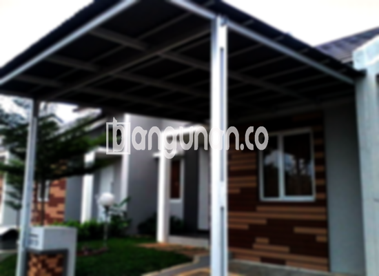

**Jasa Pasang Kanopi Rumah Minimalis di Jembatan Besi Jakarta** – Memiliki area terbuka yang terlindungi dari cuaca ekstrem adalah kebutuhan penting bagi setiap pemilik rumah. Mitra Bangunan di Jembatan Besi Jakarta kini dapat menikmati kenyamanan dan kepraktisan dengan layanan pemasangan kanopi rumah minimalis berkualitas. Kami hadir sebagai solusi tepat untuk melindungi teras, garasi, atau area outdoor Anda dari panas matahari dan hujan.

Untuk bangunan komersial atau hunian, kanopi merupakan elemen vital dalam mempercantik tampilan dan meningkatkan fungsi ruang. Anda dapat memilih berbagai jenis kanopi yang sesuai dengan kebutuhan dan gaya arsitektur rumah Anda. Setiap jenis kanopi menawarkan keunggulan tersendiri dari segi material, kualitas, harga, dan estetika. Pastikan Anda memilih kanopi yang paling sesuai untuk properti Anda di Jembatan Besi Jakarta.



## Keuntungan Menggunakan Jasa Pasang Kanopi Rumah Minimalis di Jembatan Besi Jakarta

Bagi Anda yang mempertimbangkan pemasangan kanopi untuk rumah, terdapat beberapa keunggulan signifikan yang dapat Anda peroleh:

### – Beragam Pilihan Model Kanopi Rumah Minimalis di Jembatan Besi Jakarta

Pilihan model kanopi yang beragam menjadi daya tarik tersendiri. Setiap orang memiliki preferensi unik dalam memilih desain kanopi yang sesuai dengan selera mereka. Anda dapat menemukan model persegi, persegi panjang, atau bentuk lain sesuai keinginan. Dengan pilihan yang luas ini, Anda dapat menyesuaikan kanopi dengan gaya rumah Anda di Jembatan Besi Jakarta.

### – Material Ramah Lingkungan untuk Kanopi Rumah Minimalis di Jembatan Besi Jakarta

Kanopi yang kami pasang menggunakan material yang aman dan tidak berbahaya, sehingga ramah lingkungan. Penggunaan material ini membantu menciptakan lingkungan yang lebih sehat dan berkelanjutan. Selain itu, kanopi mudah dibersihkan dan dirawat, memastikan kebersihan dan keindahan jangka panjang.

### – Daya Tahan dan Kekuatan Kanopi Rumah Minimalis di Jembatan Besi Jakarta

Salah satu keunggulan utama adalah daya tahan dan kekuatannya. Kanopi yang kami pasang menggunakan material berkualitas tinggi, menjadikannya struktur atap yang efisien dan tahan lama. Kekuatan ini memastikan kanopi dapat melindungi properti Anda selama bertahun-tahun, bahkan dalam kondisi cuaca ekstrem.

Anda dapat merasakan sendiri manfaatnya, karena kanopi rumah dapat bertahan puluhan tahun dengan perawatan yang tepat. Perawatan rutin akan membantu mempertahankan kualitas dan memperpanjang umur pakainya.

### – Keamanan Terjamin dengan Kanopi Rumah Minimalis di Jembatan Besi Jakarta

Keamanan adalah prioritas utama. Kanopi yang terpasang dengan baik akan melindungi area di bawahnya dari berbagai elemen cuaca. Kanopi efektif menghalangi sinar matahari langsung dan hujan, menjaga area teras, garasi, atau area lain tetap nyaman dan terlindungi. Keamanan yang terjamin tentu memberikan Anda ketenangan pikiran.

### – Harga Kanopi Rumah Minimalis di Jembatan Besi Jakarta yang Kompetitif

Dalam hal harga, kami menawarkan solusi yang ekonomis dan terjangkau. Meskipun harga bervariasi tergantung pada jenis kanopi yang dipilih dan kualitas materialnya, kami berkomitmen untuk memberikan penawaran terbaik. Perbandingan harga dengan kualitas yang ditawarkan akan membuat Anda menemukan pilihan yang paling sesuai dengan anggaran Anda.

## Informasi Harga dan Jasa Pemasangan Kanopi Rumah Minimalis di Jembatan Besi Jakarta



Banyak pemilik rumah saat ini yang telah memasang kanopi untuk berbagai keperluan, seperti melindungi garasi mobil, area parkir, atau sebagai penutup jendela. Pilihan penggunaan kanopi sangat beragam dan bergantung pada kebutuhan spesifik Anda. Kebutuhan Anda akan menjadi pertimbangan utama dalam proses pemasangan.

Informasi lebih detail mengenai harga tersedia pada tabel berikut, atau Anda dapat menghubungi tim kami untuk mendapatkan penawaran harga yang sesuai dengan kebutuhan Anda di Jembatan Besi Jakarta.

**Ref by:**  [Kanopi Rumah Minimalis Jembatan Besi Jakarta](https://id.wikipedia.org/wiki/Kanopi)

Dengan layanan pemasangan kanopi rumah minimalis yang profesional dan terpercaya, Mitra Bangunan siap membantu Anda menciptakan hunian yang nyaman dan terlindungi. Jangan ragu untuk menghubungi kami melalui tombol WhatsApp atau Telepon yang tersedia di halaman ini untuk konsultasi dan mendapatkan pelayanan terbaik. Kami siap menjawab pertanyaan Anda dan membantu mewujudkan kanopi impian Anda di Jembatan Besi Jakarta.