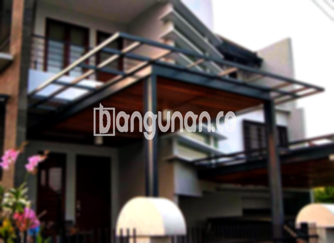

**Jasa Pasang Kanopi Rumah Minimalis di Joglo Jakarta** – Memiliki area luar ruangan yang nyaman dan terlindungi adalah dambaan setiap pemilik rumah di Joglo Jakarta. Kanopi menjadi solusi praktis untuk menciptakan perlindungan dari cuaca ekstrem seperti hujan dan panas, sekaligus mempercantik tampilan fasad rumah Anda. Mitra Bangunan hadir sebagai penyedia jasa pemasangan kanopi rumah minimalis yang terpercaya di Joglo Jakarta, menawarkan solusi terbaik untuk kebutuhan perlindungan dan estetika rumah Anda.

Apakah Anda sedang mencari kanopi untuk garasi, teras, atau area parkir? Kami menyediakan berbagai jenis kanopi dengan desain yang dapat disesuaikan dengan gaya arsitektur rumah Anda. Dengan pengalaman bertahun-tahun, Kami berkomitmen memberikan layanan pemasangan kanopi yang profesional dan berkualitas tinggi.



## Keunggulan Menggunakan Jasa Pasang Kanopi Rumah Minimalis di Joglo Jakarta

Bagi Anda yang mempertimbangkan penggunaan kanopi untuk rumah, berikut adalah beberapa keunggulan yang dapat Anda peroleh:

### – Pilihan Model yang Beragam dari Jasa Pasang Kanopi Rumah Minimalis di Joglo Jakarta

Salah satu hal yang paling menarik dari kanopi adalah keberagaman model yang tersedia. Anda dapat memilih desain yang sesuai dengan selera dan gaya rumah Anda. Baik itu model persegi, persegi panjang, atau bentuk-bentuk modern lainnya, Kami siap mewujudkannya. Setiap orang memiliki preferensi sendiri dalam memilih kanopi rumah sesuai dengan keinginan mereka.  

### – Bahan Baku Ramah Lingkungan dari Jasa Pasang Kanopi Rumah Minimalis di Joglo Jakarta

Kanopi yang Kami gunakan dibuat dari bahan-bahan yang aman dan tidak berbahaya, sehingga ramah lingkungan. Dengan memilih kanopi rumah, Anda turut berkontribusi dalam menjaga kelestarian lingkungan. Selain itu, kanopi juga relatif mudah dibersihkan, memastikan tampilan yang selalu segar dan terawat.

### – Daya Tahan dan Kekokohan dari Jasa Pasang Kanopi Rumah Minimalis di Joglo Jakarta

Salah satu keunggulan utama yang ditawarkan adalah daya tahan dan kekokohannya. Kanopi Kami dibuat dari bahan-bahan berkualitas tinggi, menjamin atap yang efisien dan tahan lama. Kekokohannya juga memastikan perlindungan optimal selama bertahun-tahun. Anda bisa menikmati manfaatnya selama puluhan tahun dengan perawatan yang tepat.

### – Keamanan yang Terjamin dari Jasa Pasang Kanopi Rumah Minimalis di Joglo Jakarta

Keamanan adalah prioritas utama Kami. Kanopi yang Kami pasang akan memberikan perlindungan maksimal bagi area di bawahnya.  Kanopi efektif menghalangi cahaya matahari langsung dan hujan, menciptakan lingkungan yang nyaman dan aman. Dengan demikian, area teras atau garasi Anda akan terlindungi dengan baik dari cuaca ekstrem. 

### – Harga Kompetitif Kanopi Rumah Minimalis di Joglo Jakarta

Kami memahami pentingnya anggaran dalam setiap proyek pembangunan. Oleh karena itu, Kami menawarkan harga yang bersaing untuk setiap jenis kanopi. Harga akan bervariasi tergantung pada bahan dan ukuran yang dipilih. Kami akan memberikan penawaran terbaik sesuai anggaran dan kebutuhan Anda.

## Harga dan Jasa Pemasangan Kanopi Rumah Minimalis di Joglo Jakarta



Banyak orang di Joglo Jakarta yang telah merasakan manfaat memiliki kanopi di rumah mereka. Kanopi sering diaplikasikan untuk garasi mobil, tempat parkir, penutup jendela, atau area outdoor lainnya. Pilihan penggunaan tergantung pada kebutuhan spesifik Anda. 

Untuk informasi harga yang lebih rinci dan sesuai dengan kebutuhan Anda, silakan hubungi tim Kami.  Kami akan dengan senang hati memberikan konsultasi dan penawaran terbaik.

Memilih penyedia jasa pemasangan kanopi yang berpengalaman dan terpercaya akan memastikan proses pemasangan berjalan lancar dan efisien. Dengan menggunakan jasa profesional, Anda dapat langsung menikmati manfaat kanopi rumah Anda tanpa perlu repot.

**Ref by:**  [Kanopi Rumah Minimalis Joglo Jakarta](https://id.wikipedia.org/wiki/Kanopi)

Mitra Bangunan siap membantu Anda mewujudkan kenyamanan dan keamanan rumah impian Anda di Joglo Jakarta. Jangan ragu untuk menghubungi Kami melalui tombol WhatsApp atau Telepon yang tersedia di halaman ini untuk mendapatkan pelayanan terbaik dan solusi kanopi yang sesuai dengan kebutuhan Anda.