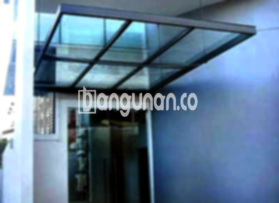

**Jasa Pasang Kanopi Rumah Minimalis di Kademangan** – Mitra Bangunan di Kademangan tentu menginginkan perlindungan optimal untuk teras, garasi, atau area luar rumah lainnya. Kanopi adalah solusi tepat yang tidak hanya melindungi dari cuaca ekstrem, namun juga meningkatkan estetika bangunan. Kami hadir sebagai penyedia jasa pembuatan dan pemasangan kanopi rumah minimalis yang berkualitas dan terjangkau di Kademangan.

Beragam jenis kanopi tersedia untuk memenuhi kebutuhan Anda. Apakah Anda mencari kanopi baja ringan yang ekonomis, kanopi galvalum yang tahan karat, kanopi kaca yang elegan, atau kanopi polycarbonate yang transparan, kami siap mewujudkannya. Pemilihan material yang tepat akan menentukan ketahanan, tampilan, dan biaya kanopi yang Anda inginkan.



## Keunggulan Memilih Jasa Pasang Kanopi Rumah Minimalis di Kademangan

Bagi Anda yang berencana memasang kanopi untuk rumah atau bangunan komersial di Kademangan, ada beberapa keunggulan signifikan yang bisa Anda peroleh melalui layanan kami:

### \- Pilihan Model Kanopi yang Beragam

Kami menawarkan berbagai model kanopi rumah yang dapat Anda pilih sesuai dengan selera dan gaya arsitektur bangunan Anda. Setiap orang memiliki preferensi desain yang unik, dan kami siap membantu mewujudkannya. Anda bisa memilih model persegi, persegi panjang, atau bahkan bentuk custom sesuai kebutuhan.

### \- Bahan Baku Ramah Lingkungan

Kami berkomitmen menggunakan bahan baku yang ramah lingkungan dalam pembuatan kanopi rumah. Hal ini tidak hanya baik untuk lingkungan, tetapi juga memastikan keamanan dan kesehatan Anda. Material yang kami gunakan juga mudah dibersihkan dan dirawat.

### \- Konstruksi Tahan Lama dan Kuat

Salah satu keunggulan utama kanopi yang kami buat adalah ketahanannya. Kami menggunakan bahan-bahan berkualitas tinggi yang terjamin kekuatannya. Dengan perawatan yang baik, kanopi rumah Anda dapat bertahan selama bertahun-tahun.

Anda dapat mengandalkan konstruksi kanopi kami untuk menghadapi berbagai kondisi cuaca. Ketahanan ini merupakan investasi jangka panjang yang akan memberikan manfaat selama bertahun-tahun.

### \- Keamanan dan Kenyamanan Terjamin

Kanopi yang kami pasang memberikan perlindungan optimal dari berbagai elemen cuaca, seperti sinar matahari langsung dan hujan deras. Hal ini menciptakan lingkungan yang lebih nyaman dan aman di area di bawahnya.

Dengan kanopi, Anda dapat menikmati aktivitas di luar ruangan tanpa khawatir terganggu oleh cuaca buruk. Keamanan dan kenyamanan yang terjamin adalah prioritas utama kami.

### \- Harga Bersaing dan Terjangkau di Kademangan

Kami memahami pentingnya anggaran dalam setiap proyek pembangunan. Oleh karena itu, kami menawarkan harga yang kompetitif dan terjangkau untuk semua jenis kanopi rumah minimalis di Kademangan. Kami selalu berusaha memberikan penawaran terbaik tanpa mengorbankan kualitas.

## Informasi Harga dan Jasa Pemasangan Kanopi Rumah Minimalis di Kademangan



Apakah Anda sudah mempertimbangkan untuk memasang kanopi di rumah Anda? Banyak pemilik rumah di Kademangan yang telah merasakan manfaatnya, baik untuk garasi mobil, area parkir, maupun sebagai penutup jendela. Pilihan model dan material disesuaikan dengan kebutuhan Anda.

Harga kanopi rumah sangat bervariasi tergantung pada kualitas material dan kompleksitas desain. Kami menyediakan opsi yang sesuai dengan anggaran dan preferensi Anda.

Harga juga dipengaruhi oleh ukuran kanopi. Semakin besar area yang perlu ditutupi, maka semakin tinggi biayanya. Pastikan Anda mengukur area dengan tepat sebelum memesan kanopi.

Jika Anda membutuhkan pemasangan kanopi untuk gedung komersial atau proyek skala besar, kami siap memberikan layanan profesional dan efisien. Dengan menggunakan jasa pemasangan berpengalaman, Anda akan mendapatkan hasil yang maksimal.

**Ref by:**  [Kanopi Rumah Minimalis Kademangan](https://id.wikipedia.org/wiki/Kanopi)

Mitra Bangunan yang berlokasi di Kademangan, jangan ragu untuk menghubungi kami untuk konsultasi gratis dan penawaran harga terbaik. Kami akan membantu Anda memilih kanopi yang tepat sesuai dengan kebutuhan dan anggaran Anda. Hubungi kami melalui tombol WhatsApp atau Telepon di halaman ini, dan kami siap mewujudkan kenyamanan dan keindahan rumah Anda.