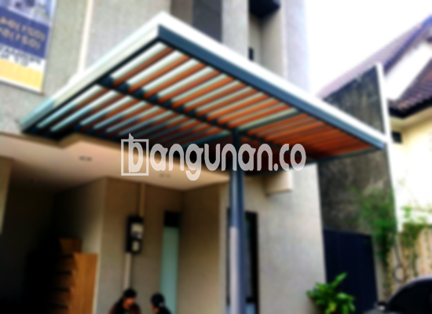

**Jasa Pasang Kanopi Rumah Minimalis di Kalibaru Depok** – Memiliki kanopi berkualitas tinggi bukan lagi sekadar tambahan pada bangunan, melainkan kebutuhan penting bagi Mitra Bangunan di Kalibaru Depok untuk menciptakan kenyamanan dan perlindungan. Kanopi berfungsi sebagai pelindung efektif terhadap berbagai kondisi cuaca, mulai dari terik matahari yang menyengat hingga guyuran hujan deras, sekaligus mempercantik tampilan fasad rumah Anda. Kami hadir sebagai solusi terpercaya dalam menyediakan jasa pemasangan kanopi rumah minimalis yang sesuai dengan preferensi dan anggaran Anda.

Kanopi menawarkan beragam manfaat, seperti melindungi perabot luar ruangan, menjaga suhu ruangan tetap sejuk, dan menciptakan area outdoor yang lebih nyaman untuk bersantai atau menerima tamu. Dengan memilih material dan desain yang tepat, Anda dapat meningkatkan nilai estetika rumah Anda sekaligus memastikan ketahanan dan keamanan bangunan.



## Keunggulan Memilih Jasa Pasang Kanopi Rumah Minimalis di Kalibaru Depok

Bagi Anda yang sedang mempertimbangkan untuk memasang kanopi rumah minimalis, berikut adalah beberapa keunggulan yang akan Anda dapatkan dengan memilih layanan kami di Kalibaru Depok:

### - Ragam Pilihan Model Kanopi yang Sesuai dengan Selera Anda

Kami menawarkan berbagai model kanopi rumah minimalis yang dapat disesuaikan dengan gaya arsitektur dan selera Anda. Anda dapat memilih dari berbagai bentuk, ukuran, dan desain yang tersedia, termasuk model persegi, persegi panjang, melengkung, atau desain khusus sesuai dengan keinginan Anda.

### - Material Berkualitas dan Ramah Lingkungan

Kami hanya menggunakan material berkualitas tinggi yang tahan lama, kokoh, dan ramah lingkungan dalam pembuatan kanopi. Material yang kami gunakan telah teruji kekuatannya dan aman untuk digunakan, sehingga Anda tidak perlu khawatir tentang kualitas dan keamanannya.

### - Pemasangan Profesional dan Berpengalaman

Tim pemasangan kanopi kami terdiri dari tenaga ahli yang berpengalaman dan profesional. Mereka memiliki keterampilan dan pengetahuan yang diperlukan untuk memasang kanopi dengan rapi, aman, dan sesuai dengan standar kualitas yang berlaku.

Anda akan menyaksikan sendiri keahlian kami dalam memastikan pemasangan yang benar dan tahan lama, memberikan ketenangan pikiran bagi Anda. Pemasangan yang tepat akan memastikan kanopi berfungsi optimal selama bertahun-tahun.

### - Perlindungan Optimal dari Cuaca Ekstrem

Kanopi yang kami pasang memberikan perlindungan optimal terhadap berbagai kondisi cuaca ekstrem, seperti panas matahari, hujan deras, angin kencang, dan debu. Dengan begitu, Anda dapat menikmati area outdoor rumah Anda dengan nyaman dan aman, tanpa harus khawatir tentang cuaca yang buruk.

### - Investasi yang Menguntungkan Jangka Panjang

Memasang kanopi rumah minimalis adalah investasi yang menguntungkan dalam jangka panjang. Selain meningkatkan kenyamanan dan estetika rumah, kanopi juga dapat melindungi bangunan dari kerusakan akibat cuaca ekstrem, sehingga menghemat biaya perbaikan di masa depan.

## Harga dan Jasa Pemasangan Kanopi Rumah Minimalis di Kalibaru Depok



Kini semakin banyak warga Kalibaru Depok yang menyadari pentingnya memiliki kanopi untuk melindungi teras, garasi, atau area luar rumah lainnya. Apakah Anda berencana memasang kanopi untuk garasi mobil, tempat parkir, atau sebagai penutup jendela? Pilihan ini sepenuhnya bergantung pada kebutuhan spesifik Anda.

Sebagai gambaran, biaya pemasangan kanopi rumah bervariasi tergantung pada jenis material yang digunakan. Untuk opsi dengan kualitas standar, harga umumnya berkisar antara Rp. 450.000 hingga Rp. 800.000. Namun, perlu diingat bahwa harga ini dapat naik jika Anda menginginkan material dengan kualitas yang lebih tinggi atau desain yang lebih rumit.

Faktor-faktor lain yang memengaruhi harga termasuk ukuran kanopi dan tingkat kesulitan pemasangan. Semakin besar ukuran dan semakin kompleks desainnya, tentu saja biayanya akan lebih tinggi. Oleh karena itu, penting untuk mempertimbangkan anggaran yang tersedia sebelum memutuskan jenis dan ukuran kanopi yang akan dipasang.

Bagi Anda yang membutuhkan bantuan profesional dalam pemasangan kanopi, kami menawarkan jasa pemasangan yang handal dan terpercaya. Tim ahli kami akan memastikan proses pemasangan berjalan lancar dan efisien, sehingga Anda dapat segera menikmati manfaat dari kanopi baru Anda.

Dengan layanan terbaik kami, Mitra Bangunan di Kalibaru Depok dapat menikmati ketenangan dan kenyamanan yang maksimal. Jangan ragu untuk menghubungi kami melalui tombol WhatsApp atau Telepon yang tersedia di halaman ini untuk mendapatkan penawaran harga dan konsultasi gratis.

**Ref by:**  [Kanopi Rumah Minimalis Kalibaru Depok](https://id.wikipedia.org/wiki/Kanopi)