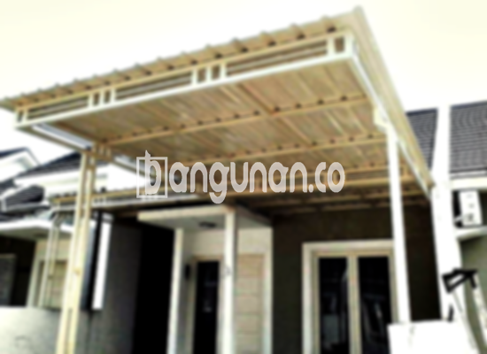

**Jasa Pasang Kanopi Rumah Minimalis di Kalimulya Depok** – Memiliki area luar rumah yang nyaman dan terlindungi adalah dambaan setiap pemilik rumah di Kalimulya Depok. Mitra Bangunan memahami kebutuhan ini dan hadir sebagai solusi terbaik untuk melindungi teras, garasi, atau area lainnya dari cuaca ekstrem. Kami menyediakan jasa pemasangan kanopi rumah minimalis berkualitas dengan harga terjangkau, sehingga Anda dapat menikmati ruang luar rumah yang lebih fungsional dan estetis.

Kanopi tidak hanya berfungsi sebagai pelindung, tetapi juga mempercantik tampilan rumah Anda. Dengan berbagai pilihan model dan material, Anda dapat menemukan kanopi yang sesuai dengan gaya arsitektur dan preferensi pribadi Anda. Kami siap membantu Anda mewujudkan konsep kanopi impian Anda.



## Keunggulan Memilih Jasa Pasang Kanopi Rumah Minimalis di Kalimulya Depok

Bagi Anda yang berencana memasang kanopi untuk rumah atau bangunan lainnya di Kalimulya Depok, ada beberapa keunggulan yang dapat Anda peroleh:

### – Pilihan Model Kanopi yang Beragam

Kami menawarkan berbagai model kanopi rumah yang dapat Anda pilih sesuai dengan selera dan kebutuhan Anda. Setiap orang memiliki preferensi tersendiri dalam memilih kanopi yang sesuai dengan desain rumah mereka. Anda dapat memilih model yang sesuai dengan keinginan Anda, seperti persegi, persegi panjang, atau bahkan desain khusus.

### – Material Berkualitas dan Ramah Lingkungan

Kanopi yang kami gunakan dibuat dari bahan-bahan berkualitas tinggi yang tidak berbahaya dan ramah lingkungan. Penggunaan material yang tepat memastikan kanopi tahan lama dan tidak mencemari lingkungan sekitar. Selain itu, material yang ringan memudahkan proses pemasangan dan perawatan.

### – Konstruksi yang Kuat dan Tahan Lama

Salah satu keunggulan utama dari kanopi yang kami pasang adalah kekuatannya. Kami menggunakan bahan-bahan yang teruji kualitasnya untuk memastikan kanopi tahan terhadap berbagai kondisi cuaca, seperti hujan deras, angin kencang, dan paparan sinar matahari langsung. Dengan perawatan yang tepat, kanopi Anda dapat bertahan selama bertahun-tahun.

Anda dapat melihat sendiri kekuatan kanopi rumah yang dapat bertahan hingga puluhan tahun. Kualitas ini juga dipengaruhi oleh perawatan yang Anda lakukan. Perawatan yang baik akan memperpanjang umur kanopi dan menjaga tampilannya tetap prima.

### – Keamanan dan Kenyamanan Terjamin

Kanopi memberikan perlindungan ekstra pada area di bawahnya. Halaman depan rumah Anda akan terlindungi dari paparan sinar matahari langsung dan hujan, sehingga Anda dapat menikmati ruang luar rumah dengan lebih nyaman dan aman. Keamanan yang terjamin ini tentu menjadi nilai tambah bagi Anda dan keluarga.

### – Harga yang Kompetitif

Kami menawarkan harga yang kompetitif untuk jasa pemasangan kanopi rumah minimalis di Kalimulya Depok. Meskipun harga juga dipengaruhi oleh jenis dan kualitas material yang Anda pilih, kami berkomitmen untuk memberikan penawaran terbaik sesuai dengan anggaran Anda.

## Harga dan Jasa Pemasangan Kanopi Rumah Minimalis di Kalimulya Depok



Banyak orang kini yang mempertimbangkan pemasangan kanopi untuk rumah mereka. Kanopi dapat digunakan untuk berbagai keperluan, seperti melindungi garasi mobil, area parkir, atau sebagai penutup jendela. Semuanya tergantung pada kebutuhan dan preferensi Anda.

Untuk mendapatkan informasi harga terkini dan detail mengenai jasa pemasangan kanopi, silakan hubungi tim kami. Kami akan dengan senang hati memberikan penawaran yang sesuai dengan kebutuhan dan anggaran Anda.

Kami memahami bahwa setiap rumah memiliki karakteristik yang berbeda. Oleh karena itu, kami menawarkan layanan konsultasi gratis untuk membantu Anda menentukan jenis kanopi yang paling sesuai dengan rumah Anda.

Bagi Anda yang berdomisili di Kalimulya Depok dan sekitarnya, jangan ragu untuk menghubungi kami. Kami siap memberikan solusi terbaik untuk kebutuhan kanopi Anda.

**Ref by:**  [Kanopi Rumah Minimalis Kalimulya Depok](https://id.wikipedia.org/wiki/Kanopi)

Mitra Bangunan siap menjadi mitra terpercaya Anda dalam menciptakan hunian yang nyaman dan terlindungi. Hubungi kami melalui tombol WhatsApp atau Telepon yang tersedia di halaman ini untuk konsultasi dan pemesanan kanopi rumah minimalis di Kalimulya Depok. Kami akan dengan senang hati membantu Anda mewujudkan impian memiliki area luar rumah yang fungsional dan estetis.