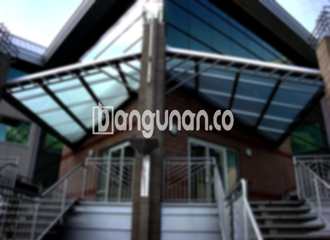

**Jasa Pasang Kanopi Rumah Minimalis di Kalisari Jakarta** – Bagi Mitra Bangunan di Kalisari Jakarta, memiliki kanopi rumah yang kokoh dan estetik adalah investasi yang tepat untuk kenyamanan hunian. Struktur atap ini berfungsi sebagai pelindung optimal dari sengatan matahari dan guyuran hujan, sekaligus menambah nilai visual pada properti Anda. Kami hadir sebagai solusi terpercaya, menyediakan jasa pemasangan kanopi dengan beragam pilihan material dan desain yang dapat disesuaikan dengan preferensi Anda.

Menciptakan ruang luar rumah yang nyaman dan terlindungi adalah prioritas kami. Tim profesional kami siap membantu Anda merencanakan dan memasang kanopi yang ideal, memberikan perlindungan jangka panjang dan meningkatkan kualitas hidup Anda. Prioritas kami adalah memastikan kepuasan Anda dengan hasil akhir yang berkualitas tinggi dan sesuai harapan.



## Memilih Jasa Pasang Kanopi Rumah Minimalis di Kalisari Jakarta: Keuntungan yang Anda Dapatkan

Bagi Anda yang mempertimbangkan pemasangan kanopi, memanfaatkan jasa profesional menawarkan sejumlah manfaat signifikan. Berikut adalah beberapa alasan mengapa memilih layanan kami adalah pilihan yang tepat:

### \- Beragam Pilihan Model Kanopi yang Tersedia

Kami menyediakan berbagai variasi model kanopi rumah yang bisa Anda pilih sesuai dengan selera dan gaya arsitektur rumah Anda. Mulai dari desain sederhana hingga yang lebih kompleks, kami memiliki opsi yang sesuai dengan kebutuhan Anda. Pilihan meliputi bentuk persegi, persegi panjang, dan desain khusus sesuai permintaan.

### \- Penggunaan Material Ramah Lingkungan dan Berkualitas Tinggi

Kami berkomitmen untuk menggunakan material yang ramah lingkungan dalam setiap proyek pemasangan kanopi. Material ini tidak hanya aman bagi kesehatan, tetapi juga membantu mengurangi dampak negatif terhadap lingkungan sekitar. Selain itu, material yang kami gunakan juga mudah dibersihkan, menjaga kanopi Anda tetap bersih dan terawat.

### \- Durabilitas dan Kekuatan Kanopi yang Terjamin

Kekuatan dan ketahanan adalah prioritas utama dalam pemasangan kanopi. Kami menggunakan bahan-bahan berkualitas tinggi yang tahan terhadap cuaca ekstrem dan korosi. Dengan perawatan yang tepat, kanopi Anda akan awet dan memberikan perlindungan optimal selama bertahun-tahun.

Dengan kanopi yang awet, Anda tidak perlu khawatir tentang perbaikan atau penggantian dalam waktu dekat. Keawetan ini sangat bergantung pada perawatan rutin yang Anda lakukan. Perawatan yang baik akan memastikan kualitas dan performa kanopi tetap terjaga.

### \- Keamanan dan Kenyamanan yang Lebih Baik

Keamanan adalah aspek penting yang kami perhatikan dalam pemasangan kanopi. Struktur kanopi yang kuat dan stabil akan melindungi area di bawahnya dari bahaya seperti jatuhnya benda atau paparan sinar matahari langsung. Hal ini menciptakan lingkungan yang aman dan nyaman bagi Anda dan keluarga.

Dengan kanopi yang terpasang dengan benar, Anda dapat menikmati ruang luar rumah Anda tanpa khawatir terhadap cuaca yang tidak menentu. Kanopi yang efektif dapat menghalangi hujan deras, sinar matahari yang terik, dan bahkan debu serta kotoran.

### \- Investasi dengan Harga yang Terjangkau

Kami memahami bahwa anggaran adalah pertimbangan penting dalam setiap proyek pembangunan atau renovasi. Oleh karena itu, kami menawarkan harga yang kompetitif dan transparan untuk layanan pemasangan kanopi. Kami akan memberikan penawaran harga yang jelas dan detail, sehingga Anda dapat merencanakan anggaran dengan lebih baik. 

## Informasi Harga dan Proses Pemasangan Kanopi Rumah Minimalis di Kalisari Jakarta



Banyak penghuni rumah di Kalisari Jakarta yang telah merasakan manfaat memiliki kanopi. Aplikasi kanopi sangat beragam, mulai dari melindungi garasi mobil, menciptakan area parkir yang teduh, hingga memberikan naungan di teras depan. Pilihan jenis kanopi sepenuhnya bergantung pada kebutuhan dan preferensi Anda.

Untuk mengetahui perkiraan biaya dan proses pemasangan yang lebih rinci, silakan hubungi tim kami. Kami akan dengan senang hati memberikan konsultasi gratis dan membantu Anda merencanakan proyek kanopi yang sesuai dengan anggaran dan kebutuhan Anda.

Biaya pemasangan kanopi dipengaruhi oleh beberapa faktor, termasuk jenis material yang dipilih, ukuran area yang akan ditutupi, serta kompleksitas desain. Kami menawarkan berbagai opsi material dengan rentang harga yang bervariasi, memungkinkan Anda memilih solusi yang paling sesuai dengan anggaran Anda.

Jika Anda membutuhkan pemasangan kanopi untuk properti komersial seperti ruko atau toko, kami juga dapat membantu. Tim kami berpengalaman dalam menangani proyek-proyek skala besar dan memastikan hasil yang optimal. Dengan memilih jasa pemasangan profesional, Anda dapat menghemat waktu dan tenaga serta mendapatkan hasil yang berkualitas tinggi.

**Ref by:**  [Kanopi Rumah Minimalis Kalisari Jakarta](https://id.wikipedia.org/wiki/Kanopi)

Mitra Bangunan yang sedang mencari jasa pasang kanopi rumah minimalis di Kalisari Jakarta, segera hubungi kami melalui tombol WhatsApp atau Telepon yang tersedia di halaman ini. Kami siap membantu Anda menciptakan ruang luar rumah yang nyaman, aman, dan estetis. Jangan ragu untuk berkonsultasi dengan tim kami untuk mendapatkan solusi terbaik sesuai kebutuhan Anda.