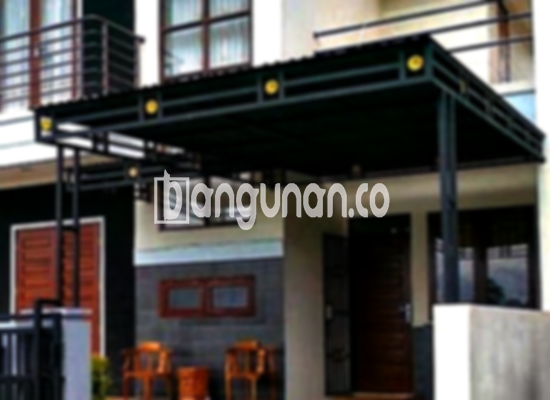

**Jasa Pasang Kanopi Rumah Minimalis di Kamal Muara Jakarta** – Memiliki area luar ruangan yang nyaman dan terlindungi adalah prioritas utama bagi Mitra Bangunan di Kamal Muara Jakarta. Kanopi menjadi solusi ideal untuk melindungi teras, garasi, atau area terbuka lainnya dari cuaca ekstrem, sekaligus menambah nilai estetika rumah Anda. Kami hadir sebagai penyedia jasa pemasangan kanopi rumah minimalis yang terpercaya, menawarkan solusi terbaik untuk kebutuhan perlindungan dan keindahan hunian Anda.

Untuk mewujudkan kanopi impian, Anda dapat memilih dari beragam pilihan yang tersedia di pasaran atau memesan desain khusus sesuai dengan preferensi Anda. Berbagai jenis kanopi rumah menawarkan keunggulan masing-masing, baik dari segi material, kualitas, maupun harga. Pastikan Anda memilih opsi yang paling sesuai dengan kebutuhan dan anggaran Anda.



## Keunggulan Menggunakan Jasa Pasang Kanopi Rumah Minimalis di Kamal Muara Jakarta

Bagi Anda yang mempertimbangkan penggunaan kanopi untuk bangunan seperti rumah atau ruko, terdapat beberapa keunggulan signifikan yang dapat Anda peroleh:

### \- Pilihan Model yang Beragam dari Jasa Pasang Kanopi Rumah Minimalis di Kamal Muara Jakarta

Salah satu pertimbangan utama dalam memilih kanopi adalah model yang tersedia. Kami menawarkan berbagai macam type kanopi rumah yang bisa Anda pilih untuk diaplikasikan. Setiap orang memiliki selera berbeda dalam memilih desain kanopi yang diinginkan. Anda dapat memilih model yang sesuai dengan preferensi Anda, seperti persegi, persegi panjang, dan lain sebagainya.

### \- Material Ramah Lingkungan dari Jasa Pasang Kanopi Rumah Minimalis di Kamal Muara Jakarta

Kanopi yang kami gunakan dibuat dari bahan-bahan yang aman dan tidak berbahaya, sehingga ramah lingkungan. Penggunaan kanopi akan memberikan kontribusi positif terhadap kelestarian lingkungan. Selain itu, kanopi sangat mudah dibersihkan, sehingga tidak memerlukan perawatan yang rumit.

### \- Ketahanan dan Kekuatan Jasa Pasang Kanopi Rumah Minimalis di Kamal Muara Jakarta

Keunggulan utama yang ditawarkan adalah daya tahan dan kekuatan material. Hal ini karena kami hanya menggunakan bahan-bahan berkualitas tinggi, menjadikannya solusi atap yang efisien. Kekokohannya juga akan bertahan lama, bahkan hingga puluhan tahun.

Anda dapat membuktikan sendiri bahwa kanopi rumah dapat bertahan lama. Daya tahannya akan semakin meningkat dengan perawatan yang baik.

### \- Keamanan yang Terjamin dari Jasa Pasang Kanopi Rumah Minimalis di Kamal Muara Jakarta

Keamanan adalah aspek penting yang kami prioritaskan. Halaman depan rumah atau ruko yang berada di bawah kanopi akan terlindungi dari berbagai elemen cuaca. Keamanan yang terjamin akan memberikan Anda ketenangan dan kenyamanan dalam menggunakan kanopi. 

Kanopi dapat melindungi dari paparan langsung sinar matahari dan hujan. Dengan demikian, area di bawah kanopi akan terlindungi secara optimal. Keamanan yang terjamin akan memberikan Anda kepercayaan diri yang tinggi saat menggunakan kanopi.

### \- Harga Ekonomis Kanopi Rumah Minimalis di Kamal Muara Jakarta

Selain kualitas dan keamanan, kami juga menawarkan harga yang kompetitif untuk kanopi rumah minimalis di Kamal Muara Jakarta. Harga tentu saja bervariasi tergantung pada jenis kanopi yang dipilih. Semakin tinggi kualitasnya, tentu saja harga akan semakin meningkat. 

## Harga dan Jasa Pemasangan Kanopi Rumah Minimalis di Kamal Muara Jakarta



Banyak orang di Kamal Muara Jakarta yang telah merasakan manfaat memiliki kanopi di rumah mereka. Kanopi dapat diaplikasikan untuk berbagai keperluan, seperti melindungi garasi mobil, area parkir, atau sebagai penutup jendela. Semuanya tergantung pada kebutuhan spesifik Anda.

Untuk informasi lebih detail mengenai harga, Anda dapat melihat tabel harga yang tersedia atau menghubungi tim kami untuk mendapatkan penawaran terbaik.

Penting untuk diingat bahwa harga juga dipengaruhi oleh beberapa faktor, seperti kualitas bahan dan ukuran kanopi. Kami menyediakan berbagai pilihan kanopi dengan kualitas dan harga yang berbeda, sehingga Anda dapat memilih yang paling sesuai dengan anggaran Anda. Semakin besar ukuran yang dibutuhkan, tentu saja harganya akan semakin tinggi. Pastikan Anda memilih ukuran yang sesuai dengan kebutuhan Anda.

Bagi Anda yang membutuhkan pemasangan kanopi, kami menyediakan jasa pemasangan profesional yang cepat dan efisien. Dengan menggunakan jasa pemasangan, Anda dapat langsung menikmati manfaat kanopi tanpa perlu repot.

Itulah informasi lengkap mengenai Jasa Pasang Kanopi Rumah Minimalis di Kamal Muara Jakarta. Mitra Bangunan yang sedang mencari solusi perlindungan dan keindahan untuk hunian Anda, jangan ragu untuk menghubungi kami melalui tombol WhatsApp atau Telepon di halaman ini. Kami siap memberikan layanan dan harga terbaik untuk Anda.

**Ref by:**  [Kanopi Rumah Minimalis Kamal Muara Jakarta](https://id.wikipedia.org/wiki/Kanopi)