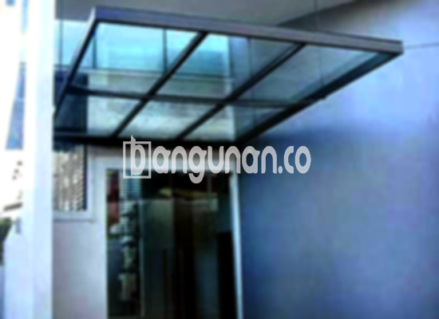

**Jasa Pasang Kanopi Rumah Minimalis di Kampung Melayu Jakarta** – Memiliki area terbuka yang nyaman dan terlindungi adalah kebutuhan penting bagi setiap keluarga di Kampung Melayu Jakarta. Mitra Bangunan memahami kebutuhan ini dan hadir sebagai solusi terbaik untuk melindungi teras, garasi, atau area depan rumah Anda dari panas matahari dan hujan. Kami menyediakan jasa pemasangan kanopi rumah minimalis dengan kualitas terjamin dan harga terjangkau.

Tentu saja, pemilihan kanopi yang tepat tidak hanya soal estetika, tetapi juga fungsi dan ketahanan. Anda bisa menemukan berbagai jenis kanopi yang sesuai dengan gaya rumah dan anggaran Anda. Setiap jenis memiliki keunggulan unik, mulai dari bahan yang digunakan hingga ketahanan terhadap cuaca. Pastikan Anda memilih kanopi yang paling optimal untuk kebutuhan Anda.



## Keuntungan Mempercayakan Jasa Pasang Kanopi Rumah Minimalis di Kampung Melayu Jakarta

Bagi Anda yang berencana memasang kanopi untuk rumah di Kampung Melayu Jakarta, ada sejumlah keuntungan yang bisa Anda dapatkan:

### \- Pilihan Model Kanopi yang Beragam

Kami menawarkan beragam model kanopi rumah yang dapat Anda pilih sesuai dengan selera dan desain rumah Anda. Setiap orang memiliki preferensi tersendiri dalam memilih kanopi. Anda bisa memilih berbagai bentuk seperti persegi, persegi panjang, atau desain khusus lainnya yang sesuai dengan keinginan Anda.

### \- Bahan Baku Ramah Lingkungan

Kanopi yang kami gunakan dibuat dari bahan-bahan yang tidak berbahaya dan ramah lingkungan. Penggunaan material yang bertanggung jawab ini memberikan kontribusi positif bagi kelestarian lingkungan sekitar. Selain itu, kanopi kami mudah dibersihkan, sehingga perawatannya menjadi sangat praktis.

### \- Ketahanan dan Kekuatan Teruji

Salah satu keunggulan utama kanopi kami adalah daya tahan dan kekuatannya. Bahan-bahan berkualitas yang kami gunakan memastikan kanopi dapat berfungsi sebagai atap yang efisien dan tahan lama. Bahkan, kanopi kami dapat bertahan selama puluhan tahun dengan perawatan yang tepat.

Anda dapat membuktikan sendiri kualitasnya. Dengan perawatan yang baik, kanopi rumah Anda akan tetap awet dan kokoh selama bertahun-tahun.

### \- Keamanan dan Kenyamanan Terjamin

Keamanan merupakan prioritas utama kami. Kanopi yang kami pasang memberikan perlindungan optimal bagi area di bawahnya dari berbagai elemen cuaca, seperti sinar matahari dan hujan. Dengan demikian, Anda dan keluarga dapat merasa nyaman dan aman saat berada di area tersebut.

Kanopi juga dapat melindungi perabot rumah tangga dari kerusakan akibat paparan sinar matahari dan air hujan.

### \- Harga yang Kompetitif

Kami memahami bahwa anggaran adalah pertimbangan penting bagi setiap pemilik rumah. Oleh karena itu, kami menawarkan harga yang kompetitif dan terjangkau untuk semua jenis kanopi rumah minimalis di Kampung Melayu Jakarta. Harga akan bervariasi tergantung pada jenis bahan dan ukuran kanopi yang Anda pilih.

## Informasi Harga dan Jasa Pemasangan Kanopi Rumah Minimalis di Kampung Melayu Jakarta



Apakah Anda sudah mempertimbangkan untuk memasang kanopi di rumah Anda? Banyak pemilik rumah di Kampung Melayu Jakarta yang telah merasakan manfaatnya. Kanopi dapat digunakan untuk berbagai keperluan, seperti melindungi garasi mobil, area parkir, atau sebagai penutup jendela. Pilihan ada di tangan Anda, sesuaikan dengan kebutuhan spesifik Anda.

Untuk mendapatkan informasi harga yang akurat, silakan lihat tabel harga yang tersedia **Ref by:**  [Kanopi Rumah Minimalis Kampung Melayu Jakarta](https://id.wikipedia.org/wiki/Kanopi) atau hubungi tim kami untuk konsultasi dan penawaran harga terbaik.

Penting untuk diingat bahwa harga kanopi rumah dapat bervariasi tergantung pada beberapa faktor, termasuk kualitas bahan, ukuran, dan kompleksitas desain. Kami selalu berusaha memberikan penawaran harga yang transparan dan sesuai dengan anggaran Anda.

Jika Anda menginginkan proses pemasangan yang cepat dan efisien, Anda dapat mempercayakan pekerjaan ini kepada penyedia jasa pemasangan kanopi profesional seperti kami. Kami akan memastikan kanopi terpasang dengan benar dan sesuai dengan standar keamanan yang berlaku.

Demikian informasi mengenai jasa pasang kanopi rumah minimalis di Kampung Melayu Jakarta yang dapat kami sampaikan. Jangan ragu untuk menghubungi kami melalui tombol WhatsApp atau Telepon di halaman ini untuk konsultasi dan pemesanan. Mitra Bangunan siap membantu Anda menciptakan hunian yang lebih nyaman dan terlindungi! Terima kasih.