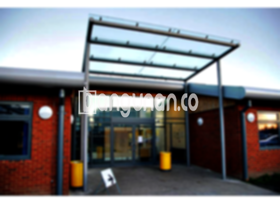

**Jasa Pasang Kanopi Rumah Minimalis di Kampung Tengah Jakarta** – Memiliki area terbuka yang terlindungi dari cuaca ekstrem adalah kebutuhan penting bagi setiap rumah. Mitra Bangunan di Kampung Tengah Jakarta tidak perlu lagi mencari solusi yang rumit. Kami menyediakan layanan pembuatan dan pemasangan kanopi berkualitas, dengan desain minimalis yang sedang populer, serta harga yang terjangkau untuk hunian Anda.

Kanopi bukan hanya sekadar pelengkap bangunan, melainkan investasi cerdas untuk kenyamanan dan keamanan properti Anda. Kami memahami bahwa setiap rumah memiliki karakter unik, itulah sebabnya kami menawarkan beragam pilihan desain dan material untuk menyesuaikan dengan gaya arsitektur dan anggaran Anda.



## Keunggulan Memilih Jasa Pasang Kanopi Rumah Minimalis di Kampung Tengah Jakarta

Bagi Anda yang mempertimbangkan memasang kanopi untuk rumah, ada beberapa keuntungan signifikan yang bisa Anda dapatkan dengan memilih layanan kami:

### \- Pilihan Model Kanopi yang Beragam

Kami menawarkan beragam model kanopi yang bisa Anda pilih sesuai selera dan kebutuhan. Setiap orang memiliki preferensi desain yang berbeda, dan kami berkomitmen untuk mewujudkannya. Anda dapat memilih antara model persegi, persegi panjang, atau desain khusus yang disesuaikan dengan gaya rumah Anda.

### \- Material Ramah Lingkungan untuk Kanopi Anda

Kami menggunakan material yang aman dan ramah lingkungan dalam pembuatan kanopi. Hal ini tidak hanya menjaga kesehatan penghuni rumah, tetapi juga berkontribusi pada kelestarian lingkungan. Selain itu, material yang kami gunakan mudah dibersihkan, sehingga Anda tidak perlu khawatir akan kotoran yang membandel.

### \- Kanopi Kuat dan Tahan Lama

Salah satu keunggulan utama kanopi yang kami pasang adalah kekuatannya. Kami hanya menggunakan material berkualitas tinggi yang mampu menahan cuaca ekstrem dan memberikan perlindungan optimal. Konstruksi yang kokoh memastikan kanopi Anda akan bertahan lama, bahkan hingga bertahun-tahun.

Anda dapat mengandalkan kanopi rumah kami untuk melindungi properti Anda dari berbagai kondisi cuaca. Dengan perawatan yang tepat, kanopi akan tetap dalam kondisi prima selama bertahun-tahun.

### \- Keamanan dan Kenyamanan Terjamin

Kanopi memberikan lapisan perlindungan tambahan bagi area di bawahnya. Anda dan keluarga dapat menikmati waktu di luar ruangan tanpa khawatir terpapar sinar matahari langsung atau hujan. Keamanan yang terjamin ini akan meningkatkan kenyamanan Anda dalam beraktivitas di sekitar rumah.

Kanopi kami dirancang untuk memberikan perlindungan maksimal terhadap cuaca ekstrem, menciptakan ruang yang aman dan nyaman untuk Anda.

### \- Harga Kompetitif dan Terjangkau

Kami menawarkan harga yang kompetitif tanpa mengorbankan kualitas. Kami percaya bahwa setiap orang berhak mendapatkan kanopi berkualitas dengan harga yang sesuai dengan anggaran mereka. Kami menjamin harga yang kami berikan adalah yang terbaik di Kampung Tengah Jakarta.

## Informasi Harga dan Layanan Pemasangan Kanopi Rumah Minimalis di Kampung Tengah Jakarta



Banyak pemilik rumah di Kampung Tengah Jakarta yang kini menyadari pentingnya memiliki kanopi. Kanopi sering diaplikasikan untuk melindungi garasi, area parkir, teras, atau jendela rumah. Pilihan penggunaan kanopi sepenuhnya tergantung kebutuhan Anda.

Untuk mendapatkan penawaran harga yang lebih akurat, Anda dapat menghubungi tim kami. Harga kanopi rumah bervariasi tergantung pada jenis material, ukuran, dan kompleksitas desain. Kami akan memberikan estimasi harga yang jelas dan transparan sebelum memulai pekerjaan.

Faktor-faktor yang memengaruhi harga kanopi meliputi kualitas material, model kanopi, serta ukuran dan kompleksitas desain. Memilih penyedia jasa pemasangan yang berpengalaman juga akan memastikan hasil yang memuaskan.

Jika Anda membutuhkan pemasangan kanopi yang cepat dan efisien, kami siap membantu. Tim profesional kami akan memastikan proses pemasangan berjalan lancar dan sesuai dengan harapan Anda.

**Ref by:**  [Kanopi Rumah Minimalis Kampung Tengah Jakarta](https://id.wikipedia.org/wiki/Kanopi)

Dengan layanan **Jasa Pasang Kanopi Rumah Minimalis di Kampung Tengah Jakarta** dari kami, Anda akan mendapatkan solusi terbaik untuk perlindungan dan keindahan properti Anda. Jangan ragu untuk menghubungi kami melalui tombol WhatsApp atau Telepon di halaman ini untuk berkonsultasi dan mendapatkan penawaran harga terbaik. Kami siap membantu Mitra Bangunan di Kampung Tengah Jakarta menciptakan hunian yang nyaman dan aman.