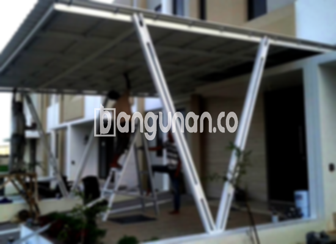

**Jasa Pasang Kanopi Rumah Minimalis di Kanigoro** – Mencari solusi perlindungan optimal untuk area teras atau garasi rumah Anda di Kanigoro? Kanopi adalah investasi cerdas yang tidak hanya melindungi dari cuaca ekstrem, tetapi juga menambah nilai estetika hunian Anda. Mitra Bangunan di Kanigoro siap mewujudkan kanopi impian Anda dengan layanan yang profesional dan terpercaya.

Kami mengkhususkan diri dalam pembuatan dan pemasangan berbagai jenis kanopi rumah yang dirancang untuk memenuhi kebutuhan spesifik Anda. Dengan pengalaman dan keahlian yang mumpuni, kami memastikan setiap detail pekerjaan dilaksanakan dengan sempurna, memberikan Anda ketenangan pikiran dan kepuasan maksimal.



## Mengapa Memilih Jasa Pasang Kanopi Rumah Minimalis di Kanigoro?

Bagi Anda yang mempertimbangkan pemasangan kanopi, ada beberapa keunggulan signifikan yang bisa Anda dapatkan dengan mempercayakan pekerjaan ini pada ahlinya di Kanigoro.

### \- Pilihan Desain Kanopi yang Beragam

Kami menawarkan berbagai macam desain kanopi yang bisa Anda sesuaikan dengan gaya arsitektur rumah dan preferensi pribadi Anda. Anda dapat memilih dari berbagai bentuk, ukuran, dan bahan untuk menciptakan tampilan yang harmonis dan sesuai dengan visi Anda. Beberapa pilihan desain populer termasuk persegi, persegi panjang, lengkung, dan lainnya.

### \- Material Ramah Lingkungan dan Berkualitas

Kami menggunakan bahan-bahan yang tidak hanya berkualitas tinggi tetapi juga ramah lingkungan. Hal ini mencerminkan komitmen kami terhadap keberlanjutan dan kesehatan lingkungan di sekitar Kanigoro. Bahan-bahan yang kami gunakan mudah dibersihkan dan dirawat, memastikan kanopi Anda tetap terlihat prima selama bertahun-tahun.

### \- Ketahanan dan Kekuatan Teruji

Salah satu keunggulan utama kanopi yang kami pasang adalah daya tahan dan kekuatannya. Material berkualitas memastikan kanopi mampu menahan berbagai kondisi cuaca ekstrem, seperti hujan deras, terik matahari, dan angin kencang. Investasi ini akan memberikan perlindungan jangka panjang untuk rumah Anda.

Anda dapat mengandalkan kanopi kami untuk bertahan puluhan tahun dengan perawatan yang tepat. Perawatan rutin akan membantu mempertahankan kualitas dan memperpanjang umur pakainya.

### \- Keamanan dan Kenyamanan Terjamin

Keamanan adalah prioritas utama kami. Kanopi yang kami pasang dirancang untuk memberikan perlindungan maksimal bagi area di bawahnya, baik dari sinar matahari langsung maupun hujan. Ini menciptakan ruang yang nyaman dan aman untuk Anda dan keluarga menikmati waktu di luar ruangan.

Kanopi kami dapat melindungi teras, garasi, atau area luar ruangan lainnya secara optimal. Dengan keamanan yang terjamin, Anda dapat merasa tenang dan nyaman saat menggunakan ruang tersebut.

### \- Solusi Ekonomis untuk Perlindungan Rumah

Kami memahami pentingnya anggaran dalam setiap proyek. Oleh karena itu, kami menawarkan solusi kanopi yang ekonomis tanpa mengorbankan kualitas. Kami menyediakan berbagai pilihan material dan desain yang sesuai dengan anggaran Anda, memberikan Anda nilai terbaik untuk investasi Anda.

## Informasi Harga dan Jasa Pemasangan Kanopi Rumah Minimalis di Kanigoro



Makin banyak pemilik rumah di Kanigoro yang menyadari manfaat memiliki kanopi. Pemasangan kanopi sangat populer untuk melindungi garasi mobil, area parkir, jendela, dan area lainnya dari cuaca ekstrem. Pilihan penggunaan sangat bergantung pada kebutuhan spesifik Anda.

Untuk memberikan gambaran, harga kanopi rumah dengan kualitas standar berkisar antara Rp. 450.000 – Rp. 800.000. Harga ini dapat bervariasi tergantung pada jenis material yang Anda pilih, ukuran kanopi, dan kompleksitas desain. 

Beberapa faktor yang memengaruhi harga termasuk kualitas material, luas area yang ditutupi, serta tambahan fitur seperti sistem drainase. Pastikan Anda memilih ukuran yang sesuai dengan kebutuhan Anda agar mendapatkan hasil yang optimal.

Jika Anda ingin memasang kanopi untuk rumah Anda, kami sarankan untuk menggunakan jasa pemasangan profesional. Dengan bantuan tenaga ahli, proses pemasangan akan lebih cepat, efisien, dan menghasilkan hasil yang rapi dan tahan lama.

Demikianlah informasi yang dapat kami sampaikan mengenai Jasa Pasang Kanopi Rumah Minimalis di Kanigoro. Jangan ragu untuk berkonsultasi dengan tim kami dan dapatkan penawaran terbaik sesuai kebutuhan Anda. Mitra Bangunan siap membantu Anda menciptakan hunian yang nyaman dan terlindungi.

**Ref by:**  [Kanopi Rumah Minimalis Kanigoro](https://id.wikipedia.org/wiki/Kanopi)