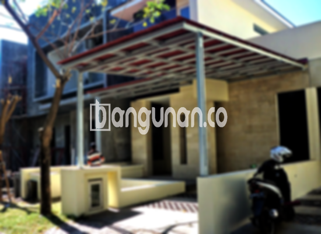

**Jasa Pasang Kanopi Rumah Minimalis di Karang Anyar Jakarta** – Memiliki area luar ruangan yang nyaman dan terlindungi merupakan impian setiap pemilik rumah. Mitra Bangunan di Karang Anyar Jakarta tidak perlu lagi khawatir mencari solusi praktis untuk melindungi teras, garasi, atau area belakang rumah dari cuaca ekstrem. Kami hadir sebagai penyedia jasa pembuatan dan pemasangan kanopi rumah minimalis yang berkualitas dan terjangkau.

Kanopi bukan hanya berfungsi sebagai pelindung dari hujan dan panas, tetapi juga dapat meningkatkan estetika bangunan Anda. Dengan desain yang tepat, kanopi dapat menyatu harmonis dengan gaya arsitektur rumah, menciptakan tampilan yang lebih menarik dan modern.



## Mengapa Memilih Jasa Pasang Kanopi Rumah Minimalis di Karang Anyar Jakarta?

Bagi Anda yang mempertimbangkan untuk memasang kanopi, terdapat beberapa keunggulan utama yang bisa Anda dapatkan dengan memilih layanan kami di Karang Anyar Jakarta:

### – Pilihan Model Kanopi yang Beragam

Kami menyediakan beragam model kanopi rumah yang dapat Anda pilih sesuai dengan selera dan kebutuhan Anda. Anda dapat memilih desain persegi, persegi panjang, atau bentuk custom yang sesuai dengan gaya bangunan Anda.

### – Material Berkualitas dan Ramah Lingkungan

Kami menggunakan material berkualitas tinggi yang tahan lama dan ramah lingkungan. Bahan-bahan ini memastikan kanopi Anda tidak hanya kokoh, tetapi juga aman bagi kesehatan keluarga dan lingkungan sekitar. Selain itu, kanopi kami mudah dibersihkan dan dirawat.

### – Konstruksi Kuat dan Tahan Lama

Kanopi yang kami buat dirancang dengan konstruksi yang kuat dan tahan lama. Kami menggunakan material yang berkualitas dan teknik pemasangan yang tepat untuk memastikan kanopi Anda dapat bertahan dalam berbagai kondisi cuaca.

Anda dapat mengandalkan kanopi rumah untuk melindungi area properti Anda selama bertahun-tahun. Perawatan yang tepat akan semakin memperpanjang usia pakainya.

### – Keamanan dan Kenyamanan Terjamin

Kanopi kami memberikan perlindungan optimal terhadap hujan, panas matahari, dan debu. Dengan demikian, Anda dan keluarga dapat menikmati area luar ruangan dengan nyaman dan aman, tanpa khawatir terganggu oleh cuaca.

### – Solusi Terjangkau untuk Kebutuhan Anda

Kami menawarkan harga yang kompetitif dan terjangkau untuk semua jenis kanopi rumah minimalis. Kami memahami pentingnya anggaran dalam setiap proyek pembangunan, oleh karena itu kami berusaha memberikan solusi terbaik tanpa mengorbankan kualitas.

## Informasi Harga dan Layanan Pemasangan Kanopi Rumah Minimalis di Karang Anyar Jakarta



Banyak orang di Karang Anyar Jakarta yang telah merasakan manfaat memiliki kanopi di rumah mereka. Kanopi sering digunakan untuk melindungi garasi mobil, area parkir, teras, atau jendela dari cuaca buruk. Pilihan penggunaan kanopi tergantung pada kebutuhan spesifik Anda.

Untuk mengetahui informasi lebih detail mengenai biaya dan layanan pemasangan kanopi, silakan hubungi tim kami. Kami akan dengan senang hati memberikan konsultasi gratis dan penawaran harga yang sesuai dengan kebutuhan Anda.

Kami siap membantu Anda menciptakan area luar ruangan yang nyaman dan terlindungi dengan kanopi rumah minimalis berkualitas tinggi. Pastikan Anda memilih ukuran dan desain yang tepat untuk memaksimalkan manfaat kanopi Anda.

**Ref by:**  [Kanopi Rumah Minimalis Karang Anyar Jakarta](https://id.wikipedia.org/wiki/Kanopi)

Jadi, bagi Mitra Bangunan yang sedang mencari jasa pasang kanopi di Karang Anyar Jakarta, jangan ragu untuk menghubungi kami melalui tombol WhatsApp atau Telepon yang tersedia di halaman ini. Kami siap memberikan solusi terbaik untuk kebutuhan kanopi rumah Anda.