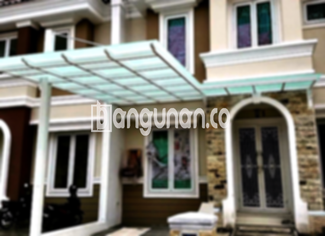

**Jasa Pasang Kanopi Rumah Minimalis di Karanganyar** – Bagi Mitra Bangunan di Karanganyar, menciptakan ruang luar rumah yang nyaman dan terlindungi adalah prioritas utama. Kanopi adalah solusi ideal untuk melindungi teras, garasi, atau area luar ruangan lainnya dari panas matahari dan hujan. Kami menghadirkan layanan pembuatan dan pemasangan kanopi rumah minimalis berkualitas tinggi dengan harga yang kompetitif, dirancang untuk memenuhi kebutuhan dan gaya hidup Anda.

Pentingnya kanopi sebagai pelengkap bangunan semakin terasa di era modern ini. Tidak hanya berfungsi sebagai naungan, kanopi juga memberikan sentuhan estetika yang mempercantik tampilan rumah Anda. Kami menawarkan beragam pilihan material dan desain yang bisa disesuaikan dengan preferensi Anda.



## Keunggulan Memilih Jasa Pasang Kanopi Rumah Minimalis di Karanganyar

Bagi Anda yang sedang mempertimbangkan pemasangan kanopi untuk rumah atau bangunan komersial di Karanganyar, memahami keunggulannya adalah langkah yang tepat. Berikut adalah beberapa manfaat utama yang bisa Anda dapatkan:

### – Ragam Pilihan Model Kanopi Rumah Minimalis di Karanganyar

Kami memahami bahwa setiap orang memiliki selera yang berbeda. Oleh karena itu, kami menyediakan berbagai pilihan model kanopi rumah minimalis di Karanganyar yang dapat Anda pilih sesuai dengan gaya arsitektur dan preferensi pribadi. Mulai dari desain sederhana dan elegan hingga model yang lebih modern dan inovatif, kami memiliki solusi yang tepat untuk Anda. Anda dapat memilih bentuk kanopi yang paling sesuai dengan kebutuhan dan anggaran Anda.

### – Material Ramah Lingkungan untuk Kanopi Rumah Minimalis di Karanganyar

Kami berkomitmen untuk menggunakan material yang ramah lingkungan dalam setiap proyek pemasangan kanopi. Bahan-bahan yang kami pilih tidak hanya berkualitas tinggi namun juga aman bagi kesehatan Anda dan lingkungan sekitar. Dengan menggunakan kanopi rumah minimalis dari kami, Anda turut berkontribusi dalam menjaga kelestarian alam. Selain itu, material yang kami gunakan juga mudah dibersihkan, sehingga Anda tidak perlu repot dalam perawatannya.

### – Kanopi Rumah Minimalis di Karanganyar: Konstruksi Tahan Lama dan Kokoh

Kualitas dan ketahanan adalah prioritas utama kami. Kanopi rumah minimalis yang kami pasang terbuat dari material berkualitas tinggi yang tahan terhadap cuaca ekstrem dan memiliki kekuatan struktural yang baik. Kami menjamin kanopi Anda akan bertahan lama dan memberikan perlindungan optimal selama bertahun-tahun. Ketahanan ini juga dipengaruhi oleh perawatan rutin yang Anda lakukan.

Anda dapat mengandalkan kanopi rumah minimalis kami untuk memberikan perlindungan jangka panjang bagi properti Anda. Konstruksi yang kokoh dan material yang tahan lama akan memastikan kanopi tetap berfungsi dengan baik meskipun terpapar sinar matahari, hujan, atau angin kencang.

### – Keamanan dan Kenyamanan yang Terjamin dengan Kanopi Rumah Minimalis di Karanganyar

Kanopi memberikan perlindungan ekstra terhadap area di bawahnya, menciptakan ruang yang lebih aman dan nyaman untuk Anda dan keluarga. Dengan kanopi, Anda dapat menikmati area luar rumah Anda tanpa khawatir terkena panas matahari langsung atau terganggu oleh hujan. Area tersebut menjadi lebih ideal untuk bersantai, bermain, atau mengadakan acara bersama keluarga dan teman.

### – Harga Terjangkau untuk Kanopi Rumah Minimalis di Karanganyar

Kami menyadari bahwa harga adalah faktor penting dalam setiap keputusan pembelian. Oleh karena itu, kami menawarkan harga yang kompetitif dan terjangkau untuk semua jenis kanopi rumah minimalis di Karanganyar. Kami percaya bahwa setiap orang berhak mendapatkan kanopi berkualitas tanpa harus mengeluarkan biaya yang mahal.

## Detail Harga dan Jasa Pemasangan Kanopi Rumah Minimalis di Karanganyar



Pemasangan kanopi menjadi semakin populer di kalangan pemilik rumah di Karanganyar. Banyak orang menyadari manfaatnya dalam melindungi rumah dari cuaca ekstrem dan meningkatkan nilai estetika properti. Kanopi dapat dipasang di berbagai area, seperti garasi, teras, carport, atau bahkan di depan toko.

Rentang harga kanopi rumah minimalis bervariasi tergantung pada beberapa faktor, seperti jenis material, ukuran, desain, dan tingkat kesulitan pemasangan. Sebagai gambaran umum, harga dapat berkisar mulai dari Rp. 450.000 hingga Rp. 800.000 untuk kualitas standar. Harga mungkin akan lebih tinggi jika Anda memilih material yang lebih premium atau desain yang lebih kompleks. Untuk mendapatkan penawaran harga yang tepat, Anda dapat menghubungi kami untuk konsultasi gratis.

Selain harga material, biaya pemasangan juga perlu diperhitungkan. Kami menawarkan layanan pemasangan profesional yang dilakukan oleh tim yang berpengalaman dan terlatih. Dengan menggunakan jasa kami, Anda tidak perlu khawatir tentang kualitas pemasangan dan keamanan kanopi.

Kami juga menyediakan berbagai pilihan material kanopi, seperti baja ringan, galvalum, kaca, dan polycarbonate. Setiap material memiliki kelebihan dan kekurangan masing-masing. Baja ringan dikenal karena kekuatannya dan harganya yang terjangkau. Galvalum tahan terhadap karat dan memiliki umur pakai yang panjang. Kaca memberikan tampilan yang elegan dan modern, sedangkan polycarbonate ringan dan tahan benturan.

**Ref by:**  [Kanopi Rumah Minimalis Karanganyar](https://id.wikipedia.org/wiki/Kanopi)

Mitra Bangunan yang berlokasi di Karanganyar dan sedang mencari solusi untuk melindungi serta mempercantik properti Anda, jangan ragu untuk menghubungi kami. Kami siap membantu Anda memilih kanopi rumah minimalis yang paling sesuai dengan kebutuhan dan anggaran Anda. Hubungi kami sekarang juga melalui tombol WhatsApp atau Telepon yang tersedia di situs web kami untuk mendapatkan penawaran terbaik dan layanan konsultasi gratis.