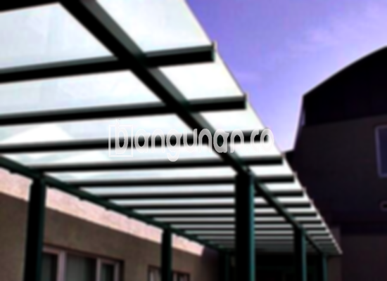

**Jasa Pasang Kanopi Rumah Minimalis di Karangbahagia Bekasi** – Memiliki area luar rumah yang nyaman dan terlindungi adalah dambaan setiap pemilik hunian di Karangbahagia Bekasi. Kanopi hadir sebagai solusi praktis untuk melindungi teras, carport, atau halaman dari cuaca ekstrem, dan Mitra Bangunan siap mewujudkannya untuk Anda. Dengan berbagai pilihan desain dan material, kami memberikan perlindungan optimal sekaligus meningkatkan estetika rumah Anda.

Kanopi bukan hanya sekadar atap pelindung; ia merupakan elemen penting dalam menciptakan ruang luar yang fungsional dan nyaman. Baik untuk melindungi kendaraan dari sengatan matahari dan hujan, atau menciptakan area bersantai yang teduh, kanopi dapat disesuaikan dengan kebutuhan dan gaya arsitektur rumah Anda.



## Keunggulan Memilih Jasa Pasang Kanopi Rumah Minimalis di Karangbahagia Bekasi

Menggunakan jasa profesional untuk pemasangan kanopi memberikan banyak keuntungan bagi Anda. Berikut beberapa di antaranya:

### \- Pilihan Desain yang Beragam

Kami menawarkan beragam model kanopi rumah yang dapat Anda pilih sesuai preferensi estetika Anda. Setiap orang memiliki selera unik dalam memilih desain kanopi yang sesuai dengan gaya rumah mereka. Anda dapat memilih antara bentuk persegi, persegi panjang, atau desain khusus lainnya yang sesuai dengan keinginan Anda.

### \- Material Ramah Lingkungan

Material yang kami gunakan dalam pembuatan kanopi ramah lingkungan dan aman bagi kesehatan Anda serta keluarga. Kanopi yang terbuat dari material berkualitas tidak hanya tahan lama tetapi juga tidak menghasilkan zat berbahaya yang dapat mencemari lingkungan.

### \- Konstruksi yang Kuat dan Tahan Lama

Kanopi yang kami pasang dirancang untuk tahan terhadap berbagai kondisi cuaca dan memberikan perlindungan jangka panjang. Dengan menggunakan material berkualitas tinggi dan teknik pemasangan yang tepat, kanopi Anda akan tetap kokoh dan awet selama bertahun-tahun.

Anda dapat mengandalkan kualitas kanopi kami yang dirancang untuk bertahan puluhan tahun. Perawatan yang tepat akan semakin memperpanjang umur pakainya, memastikan investasi Anda memberikan manfaat maksimal.

### \- Keamanan dan Kenyamanan Optimal

Kanopi memberikan perlindungan yang aman dan nyaman bagi area di bawahnya. Kanopi dapat menghalangi sinar matahari langsung dan hujan, sehingga menciptakan ruang yang teduh dan nyaman untuk bersantai atau beraktivitas di luar ruangan.

Dengan perlindungan yang terjamin, Anda dapat menikmati area luar rumah Anda tanpa khawatir terpapar cuaca ekstrem. Kanopi adalah solusi ideal untuk menciptakan lingkungan luar ruangan yang aman dan nyaman bagi keluarga Anda.

### \- Harga Kompetitif untuk Kualitas Terbaik

Kami menawarkan harga yang bersaing untuk setiap layanan pemasangan kanopi rumah minimalis di Karangbahagia Bekasi. Harga akan bervariasi tergantung pada jenis kanopi yang dipilih dan kompleksitas pemasangan.

## Informasi Harga dan Jasa Pemasangan Kanopi Rumah Minimalis di Karangbahagia Bekasi



Banyak warga Karangbahagia Bekasi yang kini memilih memasang kanopi untuk berbagai kebutuhan, mulai dari melindungi kendaraan di garasi hingga menciptakan ruang santai yang nyaman di teras. Pilihan material dan desain yang beragam memungkinkan Anda mendapatkan kanopi yang sesuai dengan anggaran dan gaya rumah Anda.

Harga kanopi rumah bervariasi, tetapi Anda bisa mendapatkan opsi berkualitas dengan harga yang terjangkau. Untuk mendapatkan penawaran terbaik dan informasi lebih lanjut mengenai biaya pemasangan di Karangbahagia Bekasi, silakan hubungi tim kami.

Harga juga sangat dipengaruhi oleh kualitas material yang digunakan. Setiap jenis kanopi memiliki karakteristik dan harga yang berbeda. Selain itu, ukuran kanopi juga berpengaruh terhadap harga; semakin besar dimensinya, semakin tinggi biayanya. Pastikan Anda memilih ukuran yang sesuai dengan kebutuhan Anda agar mendapatkan hasil yang optimal.

Bagi Anda yang ingin memasang kanopi untuk rumah di Karangbahagia Bekasi, kami siap membantu Anda dengan layanan pemasangan yang cepat, efisien, dan profesional. Dengan bantuan tenaga ahli kami, Anda dapat menikmati kanopi yang terpasang dengan rapi dan aman.

**Ref by:**  [Kanopi Rumah Minimalis Karangbahagia Bekasi](https://id.wikipedia.org/wiki/Kanopi)

Semoga informasi mengenai jasa pasang kanopi rumah minimalis di Karangbahagia Bekasi ini bermanfaat bagi Anda, Mitra Bangunan. Jangan ragu untuk menghubungi kami melalui tombol WhatsApp atau Telepon di halaman ini untuk konsultasi gratis dan penawaran terbaik. Kami siap membantu Anda menciptakan area luar rumah yang nyaman dan terlindungi.