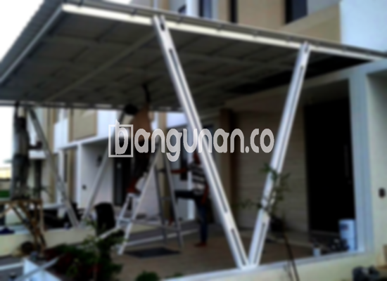

**Jasa Pasang Kanopi Rumah Minimalis di Karangpawitan** – Perlindungan optimal untuk teras atau garasi rumah Anda di Karangpawitan adalah prioritas utama. Mitra Bangunan paham betul kebutuhan tersebut dan hadir sebagai solusi tepat dengan menyediakan jasa pemasangan kanopi berkualitas dan terjangkau. Kanopi tidak hanya melindungi dari cuaca ekstrem seperti hujan dan panas, tetapi juga meningkatkan nilai estetika properti Anda. Dengan beragam desain yang tersedia, kami siap menciptakan kanopi minimalis yang sesuai dengan gaya rumah impian Anda.

Memilih kanopi yang tepat melibatkan pertimbangan berbagai faktor, mulai dari material yang digunakan hingga model dan harga. Anda dapat menjelajahi berbagai opsi di toko bangunan terdekat atau memilih layanan pemasangan profesional seperti yang kami tawarkan. Setiap jenis kanopi memiliki keunggulan tersendiri, dan kami siap membantu Anda menentukan yang paling sesuai dengan kebutuhan Anda.



## Manfaat Menggunakan Jasa Pasang Kanopi Rumah Minimalis di Karangpawitan

Bagi Anda yang berencana memasang kanopi untuk rumah atau ruko di Karangpawitan, berikut adalah beberapa keuntungan yang bisa Anda nikmati:

### \- Tersedia Berbagai Pilihan Model dari Jasa Pasang Kanopi Rumah Minimalis di Karangpawitan

Salah satu daya tarik utama dari kanopi adalah keragaman model yang ditawarkan. Kami menyediakan berbagai opsi desain untuk memenuhi selera masing-masing klien. Anda bisa memilih model yang paling sesuai dengan gaya arsitektur rumah Anda, mulai dari yang sederhana hingga modern. Pilihan yang tersedia mencakup bentuk persegi, persegi panjang, dan lainnya.

### \- Material yang Ramah Lingkungan dari Jasa Pasang Kanopi Rumah Minimalis di Karangpawitan

Kami berkomitmen menggunakan bahan-bahan yang aman dan ramah lingkungan dalam setiap pemasangan kanopi. Penggunaan material berkelanjutan ini tidak hanya melindungi lingkungan, tetapi juga memastikan kesehatan Anda dan keluarga. Selain itu, kanopi yang kami pasang mudah dibersihkan dan dirawat.

### \- Kanopi Kuat dan Tahan Lama dari Jasa Pasang Kanopi Rumah Minimalis di Karangpawitan

Kekuatan dan daya tahan adalah aspek penting yang perlu dipertimbangkan. Kanopi yang kami pasang terbuat dari bahan berkualitas tinggi yang mampu menahan berbagai kondisi cuaca ekstrem. Dengan perawatan yang tepat, kanopi ini dapat bertahan puluhan tahun.

Anda dapat merasakan sendiri kualitas dan keawetan yang kami tawarkan. Perawatan rutin yang baik akan membantu memperpanjang umur pakai kanopi Anda secara signifikan.

### \- Keamanan Optimal dari Jasa Pasang Kanopi Rumah Minimalis di Karangpawitan

Keamanan merupakan prioritas utama kami. Kanopi yang kami pasang memberikan perlindungan optimal terhadap berbagai elemen cuaca, seperti sinar matahari yang terik dan hujan lebat. Dengan demikian, area di bawahnya akan terlindungi dengan sempurna, menciptakan ruang yang nyaman dan aman untuk Anda dan keluarga.

### \- Investasi Terjangkau dengan Harga Kanopi Rumah Minimalis di Karangpawitan

Kami memahami pentingnya anggaran dalam setiap proyek pembangunan. Oleh karena itu, kami menawarkan harga yang kompetitif untuk semua jenis kanopi rumah minimalis. Harga akan bervariasi tergantung pada kualitas bahan, kompleksitas desain, dan ukuran kanopi yang Anda pilih.

## Informasi Lengkap Mengenai Harga dan Jasa Pemasangan Kanopi Rumah Minimalis di Karangpawitan



Banyak masyarakat Karangpawitan yang kini telah menggunakan kanopi untuk mempercantik dan melindungi properti mereka. Kanopi sering digunakan untuk melindungi garasi mobil, area parkir, atau sebagai penutup jendela. Pilihan penggunaan sangat bergantung pada kebutuhan spesifik Anda.

Kisaran harga untuk kanopi rumah minimalis berkualitas sedang berkisar antara Rp. 450.000 hingga Rp. 800.000. Namun, harga tersebut dapat meningkat jika Anda menginginkan bahan dengan kualitas premium atau desain yang lebih kompleks. 

Selain kualitas bahan, faktor lain yang memengaruhi harga termasuk ukuran kanopi. Semakin luas area yang perlu ditutupi, semakin tinggi biaya yang diperlukan. Oleh karena itu, penting untuk memilih ukuran yang tepat sesuai kebutuhan Anda. Untuk pemasangan yang praktis dan efisien, Anda bisa mempercayakan pekerjaan ini kepada penyedia jasa profesional seperti kami.

**Ref by:**  [Kanopi Rumah Minimalis Karangpawitan](https://id.wikipedia.org/wiki/Kanopi)

Dengan layanan pemasangan profesional yang kami tawarkan, Anda dapat menikmati kanopi yang terpasang dengan rapi dan aman. Percayakan kebutuhan kanopi rumah Anda pada ahlinya. Mitra Bangunan siap memberikan solusi terbaik untuk menciptakan hunian yang nyaman dan terlindungi di Karangpawitan. Hubungi kami melalui tombol WhatsApp atau Telepon yang tersedia di halaman ini untuk konsultasi gratis dan penawaran harga khusus.