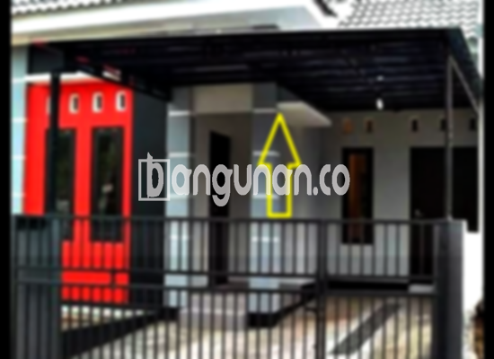

**Jasa Pasang Kanopi Rumah Minimalis di Karangtengah Tangerang** – Menciptakan kenyamanan dan perlindungan bagi properti Anda adalah prioritas utama. Kanopi bukan lagi sekadar pelengkap estetika, melainkan kebutuhan penting untuk melindungi teras, garasi, atau area outdoor lainnya dari cuaca ekstrem. Mitra Bangunan hadir sebagai solusi terpercaya untuk pemasangan kanopi berkualitas di Karangtengah Tangerang, memberikan perlindungan optimal dan sentuhan modern pada hunian Anda. 

Ada beragam model kanopi rumah yang tersedia, masing-masing dengan keunggulan unik. Memilih yang paling sesuai dengan kebutuhan dan gaya arsitektur rumah Anda adalah kunci utama. Kami siap membantu Anda menemukan kanopi yang tepat, baik dari segi material, kualitas, maupun harga.



## Keunggulan Mempercayakan Pemasangan Kanopi Rumah Minimalis di Karangtengah Tangerang Kepada Kami

Memilih layanan pemasangan kanopi profesional menawarkan banyak keuntungan bagi Anda. Berikut adalah beberapa alasan mengapa Anda harus mempertimbangkan jasa kami:

### \- Pilihan Model Kanopi yang Beragam

Kami menawarkan beragam pilihan model kanopi rumah yang dapat disesuaikan dengan preferensi Anda. Setiap orang memiliki selera yang berbeda dalam memilih kanopi, dan kami menyediakan berbagai bentuk seperti persegi, persegi panjang, dan desain lainnya yang dapat Anda pilih sesuai keinginan. 

### \- Material Ramah Lingkungan

Kami menggunakan material yang ramah lingkungan dalam pembuatan kanopi. Ini tidak hanya berkontribusi pada keberlanjutan lingkungan, tetapi juga memastikan kanopi mudah dibersihkan dan dirawat. Dengan kanopi yang mudah dirawat, Anda dapat menjaga tampilan rumah tetap segar dan menarik.

### \- Ketahanan dan Kekuatan Teruji

Kanopi yang kami pasang terbuat dari bahan berkualitas tinggi, menjamin ketahanan dan kekuatan yang optimal. Ini berarti kanopi akan berfungsi sebagai perlindungan yang efektif selama bertahun-tahun. Keawetan kanopi juga bergantung pada perawatan yang baik, namun dengan material berkualitas, Anda dapat yakin akan daya tahan yang panjang.

### \- Keamanan yang Terjamin

Kanopi memberikan lapisan perlindungan tambahan terhadap elemen cuaca seperti sinar matahari dan hujan. Hal ini menciptakan lingkungan yang lebih aman dan nyaman di bawahnya, baik untuk area parkir, teras, atau area bermain anak.  Keamanan yang terjamin ini tentu menjadi nilai tambah bagi kenyamanan keluarga Anda.

### \- Harga Kompetitif dan Terjangkau

Kami menawarkan harga yang kompetitif dan terjangkau untuk layanan pemasangan kanopi rumah minimalis di Karangtengah Tangerang. Harga akan bervariasi tergantung pada model, material, dan ukuran kanopi yang Anda pilih. Kami selalu berusaha memberikan penawaran terbaik tanpa mengorbankan kualitas.

## Informasi Harga dan Layanan Pemasangan Kanopi Rumah Minimalis di Karangtengah Tangerang



Banyak pemilik rumah di Karangtengah Tangerang yang kini mengaplikasikan kanopi untuk berbagai keperluan – melindungi kendaraan di garasi, menciptakan area parkir yang teduh, atau sekadar mempercantik tampilan teras.  Fleksibilitas ini menjadikan kanopi sebagai investasi yang cerdas untuk properti Anda.

Untuk informasi lebih detail mengenai rentang harga, kami sarankan Anda untuk melihat tabel harga yang tersedia **Ref by:**  [Kanopi Rumah Minimalis Karangtengah Tangerang](https://id.wikipedia.org/wiki/Kanopi) atau menghubungi tim kami untuk mendapatkan penawaran khusus. Harga akan disesuaikan berdasarkan detail proyek Anda.

Kami memahami bahwa setiap rumah memiliki kebutuhan yang unik. Oleh karena itu, kami menyediakan layanan pemasangan kanopi yang disesuaikan dengan spesifikasi dan anggaran Anda. Dengan tenaga ahli yang berpengalaman, pemasangan akan dilakukan secara cepat, efisien, dan profesional. 

Bagi Mitra Bangunan yang sedang mempertimbangkan untuk memasang kanopi rumah minimalis di Karangtengah Tangerang, jangan ragu untuk menghubungi kami melalui tombol WhatsApp atau Telepon yang tersedia di halaman ini. Kami siap memberikan konsultasi gratis dan membantu Anda menemukan solusi yang tepat untuk kebutuhan perlindungan dan keindahan hunian Anda.