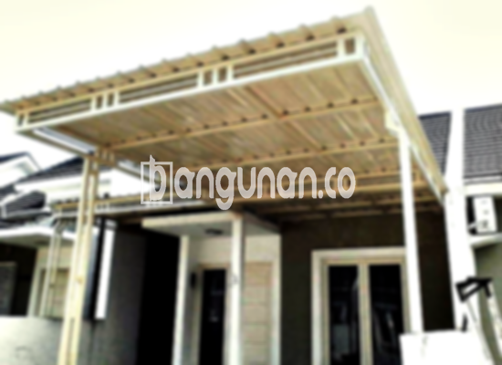

**Jasa Pasang Kanopi Rumah Minimalis di Karangtengah** – Memiliki area luar rumah yang nyaman dan terlindungi adalah impian setiap pemilik rumah. Mitra Bangunan di Karangtengah tidak perlu lagi khawatir mencari solusi terbaik. Kami hadir sebagai penyedia jasa pemasangan kanopi rumah minimalis yang berkualitas dan terjangkau, memberikan perlindungan optimal dari cuaca ekstrem dan mempercantik tampilan hunian Anda.

Kanopi adalah elemen penting dalam desain eksterior rumah modern. Lebih dari sekadar pelindung, kanopi berperan dalam meningkatkan estetika properti Anda. Dengan berbagai pilihan desain dan material, Anda dapat menyesuaikan kanopi agar selaras dengan gaya arsitektur rumah Anda.



## Keunggulan Memilih Jasa Pasang Kanopi Rumah Minimalis di Karangtengah

Ada banyak alasan mengapa Anda harus mempertimbangkan penggunaan jasa pasang kanopi rumah minimalis di Karangtengah. Berikut adalah beberapa keunggulan utamanya:

### – Beragam Pilihan Model dari Jasa Pasang Kanopi Rumah Minimalis di Karangtengah

Kami menawarkan beragam model kanopi rumah untuk memenuhi selera dan kebutuhan Anda. Pilihan desain meliputi persegi, persegi panjang, melengkung, dan masih banyak lagi. Anda dapat memilih model yang paling sesuai dengan gaya arsitektur rumah Anda dan preferensi pribadi.

### – Material Ramah Lingkungan dari Jasa Pasang Kanopi Rumah Minimalis di Karangtengah

Kami hanya menggunakan material berkualitas tinggi dan ramah lingkungan dalam pembuatan kanopi. Hal ini memastikan kanopi Anda tidak hanya tahan lama tetapi juga aman bagi kesehatan Anda dan keluarga. Material yang digunakan juga mudah dibersihkan, sehingga perawatannya sangat praktis.

### – Ketahanan dan Kekuatan Jasa Pasang Kanopi Rumah Minimalis di Karangtengah

Kanopi yang kami pasang terbuat dari material yang kuat dan tahan terhadap berbagai kondisi cuaca. Dengan perawatan yang tepat, kanopi dapat bertahan hingga bertahun-tahun tanpa kehilangan kualitasnya. Investasi ini memberikan perlindungan jangka panjang bagi rumah Anda.

Anda dapat mengandalkan kekuatan dan daya tahannya, dibangun dari material premium yang tahan terhadap perubahan cuaca ekstrem. Ketahanan ini akan memberikan manfaat jangka panjang bagi properti Anda.

### – Keamanan yang Terjamin dari Jasa Pasang Kanopi Rumah Minimalis di Karangtengah

Kanopi kami memberikan perlindungan optimal terhadap berbagai elemen cuaca, seperti sinar matahari, hujan, dan angin kencang. Dengan demikian, area di bawah kanopi, seperti teras, garasi, atau carport, akan tetap nyaman dan aman digunakan sepanjang tahun.

Kanopi menciptakan lingkungan yang aman dan nyaman di bawahnya, melindungi Anda dan keluarga dari paparan langsung elemen cuaca. Perlindungan ini sangat penting untuk kenyamanan dan keamanan sehari-hari.

### – Harga Kompetitif untuk Kanopi Rumah Minimalis di Karangtengah

Kami menawarkan harga yang kompetitif tanpa mengorbankan kualitas. Anda akan mendapatkan kanopi rumah minimalis yang berkualitas tinggi dengan harga yang sesuai dengan anggaran Anda. Kami percaya bahwa setiap orang berhak mendapatkan perlindungan yang berkualitas untuk rumah mereka.

## Harga dan Jasa Pemasangan Kanopi Rumah Minimalis di Karangtengah



Banyak orang saat ini telah mengaplikasikan kanopi di rumah mereka. Penggunaannya bervariasi, mulai dari melindungi garasi mobil, area parkir, hingga sebagai penutup jendela. Semua itu tergantung pada kebutuhan spesifik Anda.

Untuk informasi harga lebih lanjut, silakan lihat tabel berikut atau hubungi tim kami untuk penawaran khusus yang disesuaikan dengan kebutuhan Anda. Kami akan dengan senang hati membantu Anda menemukan solusi kanopi yang paling tepat.

Apakah Anda sedang mempertimbangkan untuk memasang kanopi? Memilih penyedia jasa pemasangan yang terpercaya akan memastikan proses pemasangan berjalan lancar dan menghasilkan kanopi yang berkualitas. Kami berkomitmen untuk memberikan layanan terbaik dan hasil yang memuaskan bagi setiap pelanggan.

Dengan pengalaman yang luas dan tim yang profesional, kami dapat menyelesaikan proyek pemasangan kanopi dengan cepat dan efisien. Anda dapat mengandalkan kami untuk memberikan solusi yang sesuai dengan kebutuhan dan harapan Anda.

**Ref by:**  [Kanopi Rumah Minimalis Karangtengah](https://id.wikipedia.org/wiki/Kanopi)

Semoga informasi ini bermanfaat bagi Mitra Bangunan yang sedang mencari jasa pemasang kanopi di Karangtengah. Jangan ragu untuk menghubungi kami melalui tombol WhatsApp atau Telepon yang tersedia di halaman ini untuk mendapatkan konsultasi gratis dan penawaran terbaik. Kami siap membantu Anda menciptakan rumah yang lebih nyaman dan terlindungi!