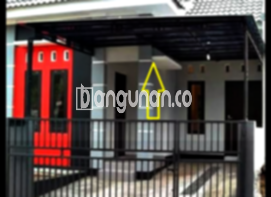

**Jasa Pasang Kanopi Rumah Minimalis di Kartini Jakarta** – Menciptakan kenyamanan dan perlindungan bagi hunian Anda adalah prioritas utama. Bagi Mitra Bangunan di Kartini Jakarta, kanopi menjadi solusi praktis untuk melindungi teras, garasi, atau area terbuka lainnya dari cuaca ekstrem. Kami hadir sebagai penyedia jasa borongan pembuatan dan pemasangan kanopi berkualitas dengan harga terjangkau.

Kanopi kini menjadi elemen penting dalam desain rumah modern. Tidak hanya berfungsi sebagai pelindung, kanopi juga mempercantik tampilan fasad rumah Anda. Dengan berbagai pilihan material dan desain, Anda dapat menyesuaikan kanopi dengan gaya arsitektur rumah Anda.



## Keunggulan Menggunakan Jasa Pasang Kanopi Rumah Minimalis di Kartini Jakarta

Bagi Anda yang berencana memasang kanopi untuk rumah atau bangunan lainnya, terdapat beberapa kelebihan yang bisa Anda dapatkan, yaitu:

### – Pilihan Model yang Beragam dari Jasa Pasang Kanopi Rumah Minimalis di Kartini Jakarta

Kami menawarkan beragam model kanopi yang bisa Anda pilih. Setiap orang memiliki preferensi desain tersendiri, dan kami siap mewujudkannya. Anda dapat memilih kanopi dengan bentuk persegi, persegi panjang, atau desain khusus sesuai keinginan Anda.

### – Bahan Ramah Lingkungan dari Jasa Pasang Kanopi Rumah Minimalis di Kartini Jakarta

Kanopi yang kami gunakan dibuat dari bahan-bahan yang tidak berbahaya, sehingga ramah lingkungan. Penggunaan material yang tepat juga membuat kanopi mudah dibersihkan dan dirawat.

### – Ketahanan dan Kekokohan dari Jasa Pasang Kanopi Rumah Minimalis di Kartini Jakarta

Keunggulan utama kanopi yang kami pasang adalah kekokohan dan ketahanannya. Kami hanya menggunakan bahan material berkualitas tinggi yang mampu bertahan lama. Dengan perawatan yang tepat, kanopi Anda akan awet hingga bertahun-tahun.

Anda akan merasakan sendiri kualitasnya, karena kanopi rumah dapat bertahan hingga puluhan tahun. Perawatan rutin tentu akan memperpanjang umur pakainya dan menjaga kualitasnya tetap optimal.

### – Keamanan yang Terjamin dari Jasa Pasang Kanopi Rumah Minimalis di Kartini Jakarta

Kanopi memberikan perlindungan maksimal terhadap area di bawahnya, seperti teras atau garasi. Kanopi melindungi dari paparan langsung sinar matahari dan hujan, menciptakan lingkungan yang lebih aman dan nyaman. Keamanan yang terjamin ini akan memberikan Anda ketenangan pikiran.

### – Harga Kompetitif untuk Kanopi Rumah Minimalis di Kartini Jakarta

Harga yang terjangkau adalah salah satu keunggulan utama yang kami tawarkan. Kami memahami bahwa setiap orang memiliki anggaran yang berbeda, sehingga kami menawarkan berbagai pilihan kanopi dengan harga yang sesuai dengan kebutuhan Anda. 

## Harga dan Jasa Pemasangan Kanopi Rumah Minimalis di Kartini Jakarta



Banyak orang kini menggunakan kanopi untuk berbagai keperluan, seperti melindungi garasi mobil, area parkir, atau sebagai penutup jendela. Penggunaannya sangat fleksibel dan dapat disesuaikan dengan kebutuhan Anda. Kami siap membantu Anda memilih dan memasang kanopi yang tepat untuk properti Anda di Kartini Jakarta.

Untuk informasi harga lebih rinci dan penawaran terbaik, silakan hubungi tim kami. Kami akan memberikan estimasi biaya berdasarkan jenis material, ukuran, dan kompleksitas pemasangan.

Kami juga menyediakan jasa pemasangan kanopi untuk ruko dan bangunan komersial lainnya. Dengan menggunakan jasa profesional, proses pemasangan akan lebih cepat dan efisien. Anda dapat segera menikmati manfaat kanopi setelah pemasangan selesai.

Demikian pembahasan mengenai Jasa Pasang Kanopi Rumah Minimalis di Kartini Jakarta. Mitra Bangunan yang mencari solusi perlindungan dan keindahan untuk properti mereka, hubungi kami sekarang melalui tombol WhatsApp atau Telepon di halaman ini. Kami siap memberikan pelayanan dan harga terbaik untuk Anda.

**Ref by:**  [Kanopi Rumah Minimalis Kartini Jakarta](https://id.wikipedia.org/wiki/Kanopi)