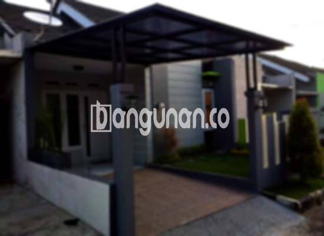

**Jasa Pasang Kanopi Rumah Minimalis di Kayu Putih Jakarta** – Mencari solusi untuk melindungi teras, garasi, atau area depan rumah dari cuaca ekstrem di Kayu Putih Jakarta? Mitra Bangunan hadir sebagai penyedia jasa pemasangan kanopi rumah minimalis yang andal dan terjangkau. Dengan kanopi yang tepat, Anda dapat menikmati ruang luar yang nyaman sepanjang tahun.

Kanopi bukan sekadar pelindung cuaca, tetapi juga elemen penting dalam desain eksterior rumah Anda. Pemilihan material dan desain yang sesuai akan meningkatkan estetika bangunan sekaligus memberikan fungsi perlindungan optimal.



## Mengapa Memilih Jasa Pasang Kanopi Rumah Minimalis di Kayu Putih Jakarta?

Mempercayakan pemasangan kanopi pada profesional akan memberikan banyak keuntungan. Berikut adalah beberapa keunggulan yang akan Anda dapatkan dengan menggunakan jasa kami di Kayu Putih Jakarta:

### \- Pilihan Model Kanopi yang Beragam

Kami menawarkan beragam model kanopi rumah yang dapat Anda sesuaikan dengan gaya arsitektur dan preferensi pribadi. Anda dapat memilih dari berbagai desain, termasuk persegi, persegi panjang, melengkung, atau bahkan desain khusus sesuai permintaan.

### \- Material Ramah Lingkungan dan Berkualitas

Kami mengutamakan penggunaan material yang ramah lingkungan dan berkualitas tinggi. Hal ini memastikan kanopi tidak hanya tahan lama, tetapi juga aman bagi Anda dan keluarga. Material yang kami gunakan mudah dibersihkan dan dirawat.

### \- Konstruksi Kuat dan Tahan Lama

Kanopi yang kami pasang dirancang untuk tahan terhadap berbagai kondisi cuaca. Dengan material berkualitas dan teknik pemasangan yang tepat, Anda dapat yakin bahwa kanopi akan memberikan perlindungan optimal selama bertahun-tahun. Anda akan merasakan manfaatnya dalam jangka panjang.

### \- Keamanan dan Kenyamanan Terjamin

Kanopi memberikan perlindungan dari paparan sinar matahari langsung dan hujan deras, sehingga menciptakan ruang yang lebih aman dan nyaman. Anda dapat menikmati waktu bersama keluarga di teras tanpa khawatir terganggu oleh cuaca.

### \- Investasi yang Terjangkau

Kami menawarkan solusi kanopi rumah minimalis dengan harga yang kompetitif. Anda akan mendapatkan kualitas terbaik tanpa harus menguras anggaran.

## Harga dan Jasa Pemasangan Kanopi Rumah Minimalis di Kayu Putih Jakarta



Banyak warga Kayu Putih Jakarta yang telah mempercayakan kebutuhan kanopi rumah mereka kepada kami. Kanopi dapat diaplikasikan untuk berbagai keperluan, mulai dari melindungi garasi mobil, menciptakan area parkir yang teduh, hingga mempercantik tampilan jendela dan teras.

Untuk informasi lebih lanjut mengenai harga dan penawaran terbaik, konsultasikan kebutuhan Anda kepada tim kami. Kami siap memberikan solusi yang sesuai dengan anggaran dan preferensi Anda.

Kami memahami bahwa setiap rumah memiliki kebutuhan yang berbeda. Itulah mengapa kami menawarkan layanan konsultasi gratis untuk membantu Anda menentukan jenis dan desain kanopi yang paling tepat.

Bagi Anda yang berdomisili di Kayu Putih Jakarta dan sekitarnya, jangan ragu untuk menghubungi kami. Kami akan memberikan layanan pemasangan kanopi yang cepat, efisien, dan profesional.

**Ref by:**  [Kanopi Rumah Minimalis Kayu Putih Jakarta](https://id.wikipedia.org/wiki/Kanopi)

Mitra Bangunan siap membantu Anda menciptakan hunian yang lebih nyaman dan terlindungi dengan kanopi rumah minimalis yang berkualitas. Segera hubungi kami melalui tombol WhatsApp atau Telepon di halaman ini, dan dapatkan penawaran terbaik untuk proyek kanopi Anda di Kayu Putih Jakarta.