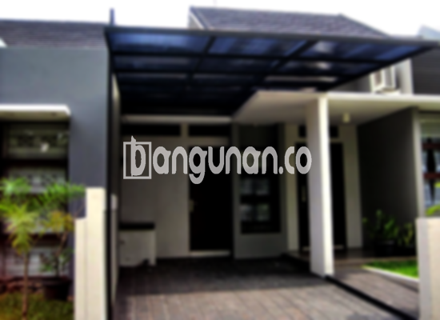

**Jasa Pasang Kanopi Rumah Minimalis di Keagungan Jakarta** – Memiliki area luar ruangan yang nyaman dan terlindungi adalah impian setiap pemilik rumah di Keagungan Jakarta. Kanopi hadir sebagai solusi praktis untuk melindungi teras, garasi, atau area depan rumah dari berbagai kondisi cuaca. Mitra Bangunan memahami kebutuhan ini dan hadir sebagai penyedia jasa pemasangan kanopi rumah minimalis yang terpercaya di Keagungan Jakarta.

Kanopi bukan hanya sekadar pelindung dari hujan dan panas, tetapi juga meningkatkan estetika rumah Anda. Dengan desain yang tepat, kanopi dapat menjadi elemen penting dalam menciptakan tampilan rumah yang lebih modern dan menarik. Kami menawarkan beragam pilihan kanopi untuk memenuhi gaya dan anggaran Anda.



## Keuntungan Memilih Jasa Pasang Kanopi Rumah Minimalis di Keagungan Jakarta

Bagi Anda yang berencana memasang kanopi untuk hunian, ada beberapa keuntungan signifikan yang bisa didapatkan:

### – Pilihan Model Kanopi yang Beragam

Kami menyediakan berbagai macam model kanopi rumah yang dapat Anda pilih sesuai dengan selera dan kebutuhan. Setiap orang memiliki preferensi desain yang berbeda, dan kami siap mewujudkannya. Anda dapat memilih dari berbagai bentuk, seperti persegi, persegi panjang, atau model custom lainnya.

### – Bahan Ramah Lingkungan untuk Kanopi Rumah

Kami menggunakan bahan-bahan berkualitas yang tidak berbahaya, sehingga ramah lingkungan. Penggunaan kanopi rumah akan berkontribusi pada lingkungan yang lebih sehat. Selain itu, kanopi kami mudah dibersihkan, sehingga Anda tidak perlu khawatir tentang perawatan yang rumit.

### – Kanopi Kuat dan Tahan Lama

Salah satu keunggulan utama kanopi kami adalah ketahanan dan kekuatannya. Kami menggunakan material berkualitas tinggi yang mampu bertahan dalam berbagai kondisi cuaca. Kanopi buatan kami dapat bertahan selama puluhan tahun dengan perawatan yang tepat.

Anda dapat merasakan sendiri kualitasnya. Investasi pada kanopi yang awet akan memberikan manfaat jangka panjang bagi rumah Anda.

### – Keamanan Optimal dengan Kanopi Rumah

Keamanan adalah prioritas utama kami. Kanopi kami memberikan perlindungan optimal terhadap berbagai elemen cuaca, seperti sinar matahari dan hujan. Area di bawah kanopi akan terlindungi dengan sempurna, sehingga Anda dapat merasa aman dan nyaman saat beraktivitas di luar ruangan.

Kanopi kami juga membantu mencegah kerusakan pada perabotan dan lantai akibat paparan langsung terhadap cuaca.

### – Harga Kanopi Rumah Minimalis yang Terjangkau di Keagungan Jakarta

Kami menawarkan harga yang kompetitif dan terjangkau untuk semua jenis kanopi rumah minimalis. Harga akan bervariasi tergantung pada tipe kanopi, bahan yang digunakan, dan ukuran yang Anda pilih. Kami selalu berusaha memberikan penawaran terbaik tanpa mengorbankan kualitas.

## Informasi Harga dan Jasa Pemasangan Kanopi Rumah Minimalis di Keagungan Jakarta



Banyak pemilik rumah di Keagungan Jakarta yang kini menggunakan kanopi untuk berbagai keperluan, mulai dari melindungi garasi mobil, area parkir, hingga sebagai penutup jendela. Semuanya tergantung pada kebutuhan spesifik Anda.

Untuk mendapatkan informasi harga yang akurat dan sesuai dengan kebutuhan Anda, kami sarankan untuk melihat tabel harga yang tersedia **Ref by:**  [Kanopi Rumah Minimalis Keagungan Jakarta](https://id.wikipedia.org/wiki/Kanopi) atau menghubungi tim kami untuk konsultasi gratis. Kami akan membantu Anda memilih kanopi yang paling sesuai dengan anggaran dan preferensi Anda.

Kami menyediakan layanan pemasangan kanopi profesional dan berpengalaman. Tim kami akan memastikan proses pemasangan berjalan lancar dan efisien. Dengan menggunakan jasa pemasangan profesional, Anda dapat menghemat waktu dan tenaga, serta mendapatkan hasil yang optimal.

Dengan demikian, setiap sudut rumah Anda di Keagungan Jakarta dapat terlindungi dengan sempurna, memberikan kenyamanan dan keindahan yang maksimal. Segera wujudkan impian Anda memiliki kanopi rumah minimalis berkualitas dengan layanan dari kami.

Mitra Bangunan siap membantu Anda mewujudkan hunian yang nyaman dan terlindungi dengan kanopi rumah minimalis terbaik di Keagungan Jakarta. Jangan ragu untuk menghubungi kami melalui tombol WhatsApp atau Telepon di halaman ini untuk mendapatkan penawaran khusus dan layanan konsultasi gratis.