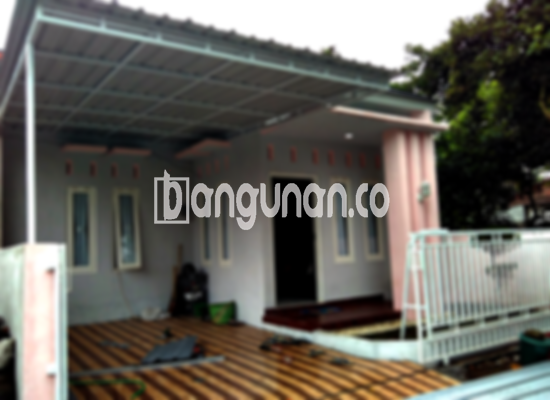

**Jasa Pasang Kanopi Rumah Minimalis di Kebayoran Jakarta** – Memiliki area luar ruangan yang nyaman dan terlindungi adalah kebutuhan penting bagi Mitra Bangunan di Kebayoran Jakarta. Kanopi menjadi solusi efektif untuk menghalau panas matahari dan hujan, mempercantik tampilan rumah, serta menambah nilai estetika properti Anda. Kami hadir sebagai penyedia jasa borongan pembuatan dan pemasangan kanopi berkualitas dengan harga terjangkau, siap membantu mewujudkan kenyamanan hunian yang Anda impikan.

Dengan beragam pilihan material dan desain, Anda dapat menemukan kanopi yang sesuai dengan gaya arsitektur rumah dan anggaran yang tersedia. Apakah Anda membutuhkan pelindung untuk teras, garasi, atau area taman, kami memiliki solusi yang tepat untuk setiap kebutuhan.



## Mengapa Memilih Jasa Pasang Kanopi Rumah Minimalis di Kebayoran Jakarta?

Bagi Anda yang mempertimbangkan untuk memasang kanopi, berikut adalah beberapa keunggulan yang dapat Anda peroleh dengan mempercayakan pekerjaan ini kepada kami:

### \- Pilihan Model Kanopi yang Beragam

Kami menawarkan berbagai model kanopi rumah yang dapat Anda pilih sesuai dengan preferensi pribadi dan desain rumah Anda. Mulai dari model sederhana hingga yang lebih kompleks, Anda memiliki kebebasan untuk menentukan tampilan kanopi yang paling sesuai. Tersedia opsi seperti persegi, persegi panjang, melengkung, dan desain khusus lainnya.

### \- Material Ramah Lingkungan dan Berkualitas

Kami hanya menggunakan material dasar kanopi yang berkualitas tinggi dan ramah lingkungan. Hal ini tidak hanya memastikan ketahanan dan umur panjang kanopi, tetapi juga berkontribusi pada pelestarian lingkungan. Material yang ringan juga mempermudah proses pemasangan dan perawatan.

### \- Konstruksi Tahan Lama dan Kokoh

Kanopi yang kami pasang dirancang untuk tahan lama dan kokoh. Dengan menggunakan material berkualitas dan teknik pemasangan yang benar, kanopi dapat bertahan selama bertahun-tahun, bahkan dalam kondisi cuaca ekstrem sekalipun. Investasi ini akan memberikan perlindungan jangka panjang bagi properti Anda.

Anda akan melihat sendiri bagaimana kanopi rumah dapat bertahan puluhan tahun dengan perawatan yang tepat. Kekuatan dan keawetannya menjadi nilai tambah yang signifikan.

### \- Keamanan dan Kenyamanan Terjamin

Kanopi berfungsi sebagai pelindung yang efektif dari berbagai elemen cuaca, seperti sinar matahari langsung dan hujan deras. Hal ini menciptakan lingkungan yang lebih aman dan nyaman di area di bawahnya. Anda dan keluarga dapat menikmati waktu di luar ruangan tanpa khawatir terpapar cuaca buruk.

Kanopi melindungi teras, garasi, atau area outdoor lainnya, sehingga Anda dapat memaksimalkan penggunaan ruang terbuka dengan nyaman dan aman.

### \- Harga Kompetitif dan Terjangkau

Kami menawarkan harga yang kompetitif dan terjangkau untuk semua jenis kanopi rumah. Meskipun kami mengutamakan kualitas, kami tetap berkomitmen untuk memberikan harga yang sesuai dengan anggaran Anda. Kami menjamin tidak ada biaya tersembunyi dan transparansi dalam setiap transaksi.

## Informasi Harga dan Jasa Pemasangan Kanopi Rumah Minimalis di Kebayoran Jakarta



Semakin banyak orang di Kebayoran Jakarta yang menyadari pentingnya memiliki kanopi untuk melindungi dan mempercantik rumah mereka. Kanopi banyak diaplikasikan untuk garasi mobil, area parkir, penutup jendela, teras depan, dan berbagai area outdoor lainnya. Semua tergantung pada kebutuhan dan preferensi Anda.

Untuk mendapatkan informasi harga yang lebih detail dan sesuai dengan kebutuhan spesifik Anda, sebaiknya Anda menghubungi kami. Kami akan memberikan penawaran harga yang transparan dan akurat.

Harga kanopi juga dipengaruhi oleh beberapa faktor, seperti kualitas material, ukuran kanopi, dan kompleksitas desain. Semakin tinggi kualitas material dan semakin besar ukuran kanopi, maka harganya akan semakin tinggi. Kami menawarkan berbagai pilihan material dan desain agar sesuai dengan anggaran Anda.

Bagi Anda yang ingin memasang kanopi dengan cepat dan efisien, kami menyediakan jasa pemasangan profesional. Tim kami yang berpengalaman akan memastikan proses pemasangan berjalan lancar dan sesuai dengan standar kualitas yang tinggi.

Itulah informasi penting mengenai Jasa Pasang Kanopi Rumah Minimalis di Kebayoran Jakarta. Mitra Bangunan yang membutuhkan kanopi berkualitas dan pemasangan profesional, jangan ragu untuk menghubungi kami melalui tombol WhatsApp atau Telepon di halaman ini. Kami siap memberikan solusi terbaik dan pelayanan yang memuaskan.

**Ref by:**  [Kanopi Rumah Minimalis Kebayoran Jakarta](https://id.wikipedia.org/wiki/Kanopi)