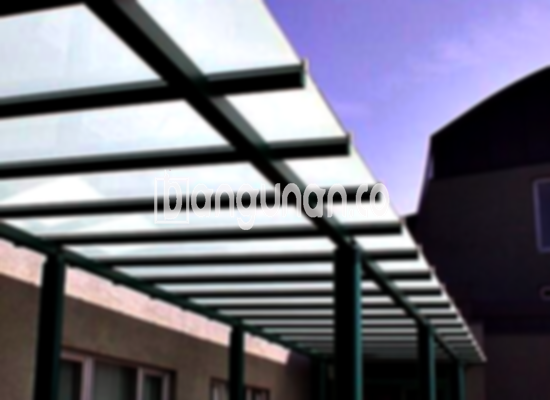

**Jasa Pasang Kanopi Rumah Minimalis di Kebon Baru Jakarta** – Memiliki area luar ruangan yang nyaman dan terlindungi adalah impian banyak pemilik rumah. Mitra Bangunan di Kebon Baru Jakarta tidak perlu lagi khawatir mencari solusi terbaik untuk menciptakan ruang yang ideal tersebut. Kami hadir sebagai penyedia jasa pembuatan dan pemasangan kanopi yang berkualitas dan terjangkau untuk hunian Anda. Percayakan kebutuhan kanopi Anda kepada ahlinya, dan nikmati kenyamanan serta perlindungan maksimal.

Memilih kanopi yang tepat untuk rumah atau bangunan Anda adalah keputusan penting. Banyak sekali pilihan yang tersedia, masing-masing dengan keunggulan dan karakteristik unik. Pertimbangkan faktor-faktor seperti material, desain, dan fungsi yang Anda inginkan sebelum memutuskan. Dengan kanopi yang sesuai, Anda dapat meningkatkan nilai estetika properti Anda sekaligus memberikan perlindungan dari cuaca ekstrem.



## Mengapa Memilih Jasa Pasang Kanopi Rumah Minimalis di Kebon Baru Jakarta?

Bagi Anda yang berencana memasang kanopi untuk rumah atau bangunan di Kebon Baru Jakarta, ada beberapa keunggulan yang bisa Anda dapatkan dengan mempercayakan pekerjaan ini kepada profesional:

### \- Desain Kanopi yang Beragam dan Sesuai Kebutuhan

Kami menawarkan beragam model kanopi yang dapat Anda sesuaikan dengan gaya arsitektur dan kebutuhan Anda. Pilihan desain meliputi persegi, persegi panjang, melengkung, atau bahkan desain khusus sesuai permintaan. Anda dapat memilih bentuk dan ukuran yang paling optimal untuk menciptakan tampilan yang harmonis dengan bangunan Anda.

### \- Material Berkualitas dan Ramah Lingkungan

Kami hanya menggunakan material berkualitas tinggi yang ramah lingkungan untuk pembuatan kanopi. Material-material ini dipilih karena ketahanannya terhadap cuaca, kemudahan perawatannya, dan kontribusinya terhadap keberlanjutan lingkungan. Kanopi yang kami pasang tidak hanya kuat dan tahan lama, tetapi juga aman bagi kesehatan Anda dan keluarga.

### \- Konstruksi Kokoh dan Tahan Lama

Keunggulan utama dari kanopi yang kami pasang adalah konstruksi yang kokoh dan tahan lama. Kami menggunakan teknik pemasangan yang tepat dan material yang teruji kualitasnya untuk memastikan kanopi dapat bertahan terhadap berbagai kondisi cuaca ekstrem, seperti hujan deras, angin kencang, dan paparan sinar matahari langsung.

Anda dapat mengandalkan kanopi kami untuk memberikan perlindungan optimal selama bertahun-tahun. Dengan perawatan yang tepat, kanopi akan tetap berfungsi dengan baik dan mempertahankan penampilannya yang menarik.

### \- Keamanan dan Kenyamanan Terjamin

Kanopi yang kami pasang tidak hanya memberikan perlindungan dari cuaca, tetapi juga meningkatkan keamanan dan kenyamanan area di bawahnya. Kanopi dapat melindungi halaman depan rumah Anda dari panas matahari yang berlebihan, menciptakan suasana yang lebih sejuk dan nyaman untuk bersantai atau menerima tamu.

Selain itu, kanopi juga dapat melindungi perabotan outdoor dari kerusakan akibat paparan sinar matahari dan hujan. Dengan demikian, Anda dapat menikmati area luar ruangan Anda tanpa khawatir terhadap kerusakan atau ketidaknyamanan.

### \- Harga Kompetitif dan Terjangkau

Kami memahami pentingnya anggaran dalam setiap proyek pembangunan. Oleh karena itu, kami menawarkan harga yang kompetitif dan terjangkau untuk semua layanan pemasangan kanopi kami di Kebon Baru Jakarta. Kami akan memberikan penawaran harga yang transparan dan sesuai dengan anggaran Anda.

## Informasi Harga dan Jasa Pemasangan Kanopi Rumah Minimalis di Kebon Baru Jakarta



Banyak orang saat ini yang memilih untuk memasang kanopi di rumah mereka. Penggunaan kanopi dapat ditemukan di berbagai area, seperti garasi mobil, area parkir, atau sebagai penutup teras. Pemilihan lokasi pemasangan kanopi tergantung pada kebutuhan dan preferensi masing-masing pemilik rumah.

Untuk dapat memperkirakan biaya pemasangan kanopi, perlu diketahui bahwa harga berkisar pada beberapa faktor. Bermacam-macam model kanopi rumah yang ada di pasaran tentu akan mempengaruhi harga akhir yang Anda bayar. Semakin kompleks desain dan jenis material yang digunakan, maka harga akan semakin tinggi.

Selain desain dan material, ukuran kanopi juga menjadi salah satu faktor penentu harga. Kanopi yang lebih besar akan membutuhkan lebih banyak material dan tenaga kerja, sehingga biaya pemasangannya juga akan lebih mahal. Pastikan Anda memilih ukuran yang sesuai dengan kebutuhan Anda dan mempertimbangkan anggaran yang tersedia.

Bagi Anda yang ingin memasang kanopi untuk rumah, kami menyarankan untuk menggunakan jasa pemasangan profesional. Dengan mempercayakan pekerjaan ini kepada ahlinya, Anda dapat memastikan bahwa kanopi dipasang dengan benar dan aman. Selain itu, jasa pemasangan profesional juga dapat memberikan saran dan rekomendasi yang tepat sesuai dengan kebutuhan Anda.

Itulah beberapa informasi yang dapat kami sampaikan mengenai Jasa Pasang Kanopi Rumah Minimalis di Kebon Baru Jakarta. Mitra Bangunan siap melayani Anda dalam mewujudkan kanopi impian Anda. Jangan ragu untuk menghubungi kami melalui tombol WhatsApp atau Telepon di halaman ini untuk konsultasi gratis dan penawaran terbaik.

**Ref by:**  [Kanopi Rumah Minimalis Kebon Baru Jakarta](https://id.wikipedia.org/wiki/Kanopi)