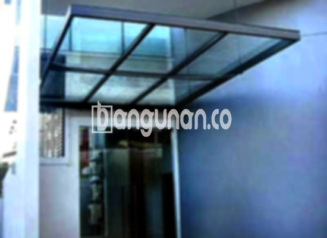

**Jasa Pasang Kanopi Rumah Minimalis di Kebon Jeruk Jakarta** – Memiliki area luar ruangan yang terlindungi dari cuaca ekstrem merupakan kebutuhan penting bagi setiap rumah. Mitra Bangunan di Kebon Jeruk Jakarta hadir sebagai solusi ideal untuk menciptakan kenyamanan dan keindahan pada hunian Anda dengan layanan pemasangan kanopi berkualitas. Kami menawarkan beragam pilihan kanopi yang sesuai dengan gaya dan anggaran Anda.

Bagi Anda yang berencana memperindah dan melindungi teras, garasi, atau area lainnya, kanopi adalah investasi yang tepat. Memilih kanopi yang sesuai tidak hanya meningkatkan estetika rumah, tetapi juga memberikan perlindungan maksimal dari panas matahari dan hujan. Ada banyak sekali jenis kanopi yang tersedia di pasaran, masing-masing memiliki keunggulan tersendiri dalam hal material, harga, dan desain. Pastikan Anda memilih kanopi yang paling sesuai dengan kebutuhan dan preferensi Anda.



## Keunggulan Menggunakan Jasa Pasang Kanopi Rumah Minimalis di Kebon Jeruk Jakarta

Bagi Anda yang sedang mempertimbangkan penggunaan kanopi untuk hunian, berikut adalah beberapa keunggulan yang dapat Anda peroleh:

### \- Pilihan Model yang Beragam dari Jasa Pasang Kanopi Rumah Minimalis di Kebon Jeruk Jakarta

Kami memahami bahwa setiap orang memiliki selera yang berbeda. Oleh karena itu, kami menyediakan berbagai macam model kanopi rumah yang dapat Anda pilih sesuai keinginan. Anda dapat memilih bentuk kanopi yang paling sesuai dengan gaya arsitektur rumah Anda, seperti persegi, persegi panjang, atau desain custom lainnya.

### \- Bahan Baku Ramah Lingkungan dari Jasa Pasang Kanopi Rumah Minimalis di Kebon Jeruk Jakarta

Kami berkomitmen untuk menyediakan produk yang ramah lingkungan. Kanopi rumah yang kami gunakan dibuat dari bahan-bahan yang aman dan tidak berbahaya. Ini memastikan bahwa Anda tidak hanya mendapatkan perlindungan optimal, tetapi juga berkontribusi pada kelestarian lingkungan. Selain itu, material yang kami gunakan mudah dibersihkan dan dirawat.

### \- Ketahanan dan Kekuatan Teruji dari Jasa Pasang Kanopi Rumah Minimalis di Kebon Jeruk Jakarta

Salah satu keunggulan utama kanopi kami adalah daya tahan dan kekuatannya. Kami hanya menggunakan material berkualitas tinggi yang tahan terhadap berbagai kondisi cuaca. Sebuah kanopi yang terawat dengan baik dapat bertahan selama bertahun-tahun, menjadikannya investasi yang cerdas bagi rumah Anda. Perawatan rutin akan semakin memperpanjang umur pakainya.

Anda dapat mengandalkan kualitas kanopi kami untuk memberikan perlindungan jangka panjang bagi properti Anda. Kekuatan materialnya mampu menahan beban angin kencang dan hujan deras, sehingga Anda dapat merasa tenang dan nyaman.

### \- Keamanan Optimal dari Jasa Pasang Kanopi Rumah Minimalis di Kebon Jeruk Jakarta

Keamanan adalah prioritas utama kami. Dengan memasang kanopi, Anda dapat menciptakan area yang aman dan terlindungi di bawahnya. Kanopi kami efektif menghalangi sinar matahari langsung dan hujan, sehingga Anda dapat menikmati area luar ruangan Anda tanpa khawatir terganggu oleh cuaca buruk.

Dengan perlindungan yang terjamin, Anda dapat memanfaatkan area di bawah kanopi untuk berbagai aktivitas, seperti bersantai, berkumpul bersama keluarga, atau bahkan area bermain anak-anak.

### \- Harga Kompetitif untuk Kanopi Rumah Minimalis di Kebon Jeruk Jakarta

Kami percaya bahwa kualitas tidak harus mahal. Anda akan mendapatkan harga yang bersaing tanpa mengorbankan kualitas. Tentu saja, harga akan bervariasi tergantung pada jenis kanopi yang Anda pilih dan tingkat kompleksitas pemasangan. Untuk detail harga, silakan lihat tabel berikut.

## Harga dan Jasa Pemasangan Kanopi Rumah Minimalis di Kebon Jeruk Jakarta



Banyak pemilik rumah di Kebon Jeruk Jakarta yang sudah merasakan manfaat memiliki kanopi. Kanopi dapat digunakan untuk berbagai keperluan, seperti melindungi garasi mobil, area parkir, atau jendela rumah. Pilihan penggunaan sangat fleksibel, bergantung pada kebutuhan spesifik Anda.

Untuk mendapatkan penawaran harga yang akurat, hubungi tim kami melalui tombol WhatsApp atau Telepon di halaman ini. Kami akan dengan senang hati memberikan informasi lebih lanjut mengenai berbagai pilihan kanopi yang kami tawarkan.

Apakah Anda sedang mencari kanopi baja ringan, galvalum, kaca, atau polycarbonate? Kami memiliki semuanya! Setiap jenis kanopi memiliki karakteristik dan keunggulan masing-masing. Kanopi baja ringan dikenal ringan dan mudah dipasang, sementara kanopi kaca memberikan kesan mewah dan modern. Kanopi polycarbonate menawarkan kombinasi kekuatan dan estetika yang menarik.

Pemasangan kanopi yang profesional sangat penting untuk memastikan keamanan dan ketahanannya. Gunakan saja penyedia jasa pemasangan kanopi berpengalaman seperti kami. Dengan menggunakan jasa pemasangan profesional, Anda dapat menghemat waktu dan tenaga, serta memastikan bahwa kanopi terpasang dengan benar dan aman.

Demikianlah informasi yang dapat kami sampaikan mengenai Jasa Pasang Kanopi Rumah Minimalis di Kebon Jeruk Jakarta. Mitra Bangunan siap membantu Anda mewujudkan area luar ruangan yang nyaman, terlindungi, dan indah. Jangan ragu untuk menghubungi kami melalui tombol WhatsApp atau Telepon di halaman ini agar kami dapat memberikan layanan dan harga terbaik untuk Anda. 

**Ref by:**  [Kanopi Rumah Minimalis Kebon Jeruk Jakarta](https://id.wikipedia.org/wiki/Kanopi)