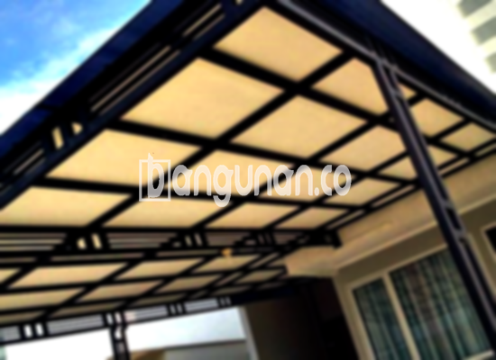

**Jasa Pasang Kanopi Rumah Minimalis di Kebon Kelapa Jakarta** – Memiliki area luar rumah yang nyaman dan terlindungi adalah dambaan setiap pemilik properti. Mitra Bangunan di Kebon Kelapa Jakarta hadir sebagai solusi bagi Anda yang menginginkan kanopi berkualitas dengan harga terjangkau. Kami menyediakan layanan pemasangan kanopi untuk berbagai kebutuhan, mulai dari garasi, teras, hingga area parkir.

Banyak sekali pilihan model kanopi rumah yang tersedia di pasaran. Masing-masing memiliki keunggulan tersendiri dari segi material, kualitas, dan desain. Pastikan Anda memilih kanopi yang paling sesuai dengan kebutuhan dan gaya arsitektur rumah Anda. 



## Keunggulan Menggunakan Jasa Pasang Kanopi Rumah Minimalis di Kebon Kelapa Jakarta

Ada beberapa keuntungan utama yang bisa Anda dapatkan dengan menggunakan jasa pasang kanopi profesional di Kebon Kelapa Jakarta, di antaranya:

### – Pilihan Model Kanopi yang Beragam

Kami menawarkan berbagai macam model kanopi yang dapat Anda pilih sesuai selera. Anda bisa memilih desain yang sesuai dengan gaya rumah Anda, seperti persegi, persegi panjang, atau bahkan bentuk custom sesuai keinginan.

### – Material Ramah Lingkungan

Kanopi yang kami gunakan terbuat dari material berkualitas dan ramah lingkungan. Dengan menggunakan kanopi, Anda berkontribusi pada pelestarian lingkungan. Selain itu, permukaannya mudah dibersihkan, sehingga selalu terlihat bersih dan rapi.

### – Ketahanan dan Kekuatan Terjamin

Salah satu keunggulan utama kanopi kami adalah ketahanannya. Material berkualitas tinggi memastikan kanopi dapat bertahan lama bahkan dalam kondisi cuaca ekstrem. Anda bisa mengandalkan kanopi ini untuk melindungi properti Anda selama bertahun-tahun.

Dengan perawatan yang tepat, kanopi rumah Anda dapat bertahan selama puluhan tahun. Kami siap memberikan panduan perawatan agar kualitas kanopi tetap terjaga.

### – Keamanan yang Optimal

Kanopi memberikan perlindungan ekstra bagi area di bawahnya. Kanopi melindungi dari paparan sinar matahari langsung dan hujan lebat, menjaga penghuni dan barang-barang Anda tetap aman dan nyaman. 

Dengan demikian, Anda dapat menikmati area luar ruangan tanpa khawatir dengan perubahan cuaca.

### – Harga yang Kompetitif

Kami menawarkan harga yang bersaing untuk jasa pasang kanopi rumah minimalis di Kebon Kelapa Jakarta. Meskipun demikian, kami tidak mengorbankan kualitas material dan pengerjaan. Anda akan mendapatkan kanopi yang berkualitas dengan harga yang terjangkau.

## Harga dan Jasa Pemasangan Kanopi Rumah Minimalis di Kebon Kelapa Jakarta



Banyak pemilik rumah di Kebon Kelapa Jakarta yang telah merasakan manfaat menggunakan kanopi. Penggunaannya sangat bervariasi, mulai dari melindungi garasi mobil, menciptakan area parkir yang teduh, hingga mempercantik tampilan jendela. Semua tergantung pada kebutuhan spesifik Anda.

Harga kanopi rumah bervariasi tergantung pada jenis material, ukuran, dan desain yang dipilih. Informasi lebih detail mengenai perkiraan harga bisa Anda temukan pada tabel harga berikut ini atau dengan menghubungi tim kami untuk mendapatkan penawaran khusus.

Harga juga dipengaruhi oleh beberapa faktor seperti kualitas material, kompleksitas desain, dan luas area yang akan ditutupi. Untuk memastikan Anda mendapatkan penawaran yang paling akurat, kami sarankan untuk berkonsultasi langsung dengan tim kami.

Dengan menggunakan jasa pemasangan kanopi profesional, Anda dapat menghemat waktu dan tenaga. Proses pemasangan akan dilakukan dengan cepat dan efisien, sehingga Anda dapat segera menikmati manfaat kanopi baru Anda.

**Ref by:**  [Kanopi Rumah Minimalis Kebon Kelapa Jakarta](https://id.wikipedia.org/wiki/Kanopi)

Mitra Bangunan siap membantu Anda mewujudkan hunian yang nyaman dan terlindungi dengan kanopi berkualitas. Hubungi kami melalui tombol WhatsApp atau Telepon di halaman ini untuk mendapatkan konsultasi gratis dan penawaran harga terbaik untuk jasa pasang kanopi rumah minimalis di Kebon Kelapa Jakarta. Jangan ragu untuk bertanya, kami siap memberikan solusi terbaik untuk kebutuhan Anda.