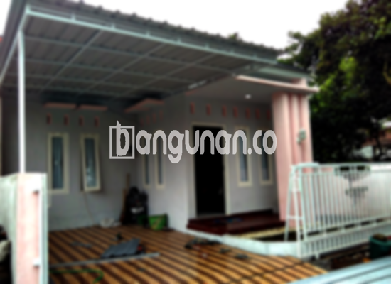

**Jasa Pasang Kanopi Rumah Minimalis di Kebon Manggis Jakarta** – Memiliki area luar ruangan yang nyaman dan terlindungi adalah dambaan setiap pemilik rumah. Mitra Bangunan di Kebon Manggis Jakarta hadir sebagai solusi terbaik untuk mewujudkan keinginan tersebut. Kami menyediakan layanan pembuatan dan pemasangan kanopi rumah minimalis yang berkualitas, tahan lama, dan tentu saja, terjangkau. Dengan kanopi yang tepat, Anda dapat menikmati ruang terbuka tanpa khawatir terpapar cuaca ekstrem.



## Keunggulan Memilih Jasa Pasang Kanopi Rumah Minimalis di Kebon Manggis Jakarta

Bagi Anda yang berencana memasang kanopi untuk hunian, terdapat sejumlah manfaat yang bisa Anda dapatkan. Berikut ini beberapa keunggulan utama yang kami tawarkan:

### \- Pilihan Model Kanopi yang Beragam

Kami memahami bahwa setiap orang memiliki preferensi desain yang berbeda. Oleh karena itu, kami menyediakan berbagai macam model kanopi rumah yang dapat Anda pilih sesuai dengan selera dan gaya arsitektur rumah Anda. Anda dapat memilih kanopi dengan bentuk persegi, persegi panjang, atau desain khusus lainnya yang sesuai dengan kebutuhan Anda.

### \- Material Ramah Lingkungan untuk Kanopi Berkualitas

Kami berkomitmen untuk menyediakan produk yang tidak hanya berkualitas tetapi juga ramah lingkungan. Material yang kami gunakan dalam pembuatan kanopi adalah bahan-bahan yang aman dan tidak berbahaya, sehingga Anda dapat merasa tenang dan nyaman saat menggunakannya. Selain itu, kanopi kami juga mudah dibersihkan, sehingga perawatan menjadi lebih praktis.

### \- Kekuatan dan Ketahanan Jangka Panjang

Salah satu nilai lebih yang Anda dapatkan adalah keawetan dan kekokohan kanopi kami. Kami hanya menggunakan material berkualitas tinggi yang tahan terhadap berbagai kondisi cuaca ekstrem. Dengan perawatan yang tepat, kanopi buatan kami dapat bertahan hingga puluhan tahun, menjadikannya investasi yang cerdas untuk rumah Anda.

### \- Keamanan Terjamin untuk Keluarga Anda

Keamanan merupakan prioritas utama kami. Kanopi yang kami pasang mampu melindungi area di bawahnya dari paparan langsung sinar matahari dan hujan. Hal ini menciptakan lingkungan yang aman dan nyaman bagi keluarga Anda, terutama saat beraktivitas di luar ruangan.

### \- Harga yang Kompetitif dan Terjangkau

Kami percaya bahwa kualitas tidak harus mahal. Kami menawarkan harga yang kompetitif dan terjangkau untuk semua jenis kanopi rumah minimalis. Harga akan bervariasi tergantung pada jenis material, ukuran, dan desain yang Anda pilih.

## Informasi Harga dan Jasa Pemasangan Kanopi Rumah Minimalis di Kebon Manggis Jakarta



Banyak pemilik rumah di Kebon Manggis Jakarta yang kini menyadari pentingnya memiliki kanopi. Kanopi dapat digunakan untuk berbagai keperluan, seperti melindungi garasi mobil, menciptakan area parkir yang teduh, atau sekadar mempercantik tampilan rumah. Pilihan ada di tangan Anda.

Untuk mendapatkan penawaran harga yang sesuai dengan kebutuhan Anda, silakan konsultasikan langsung dengan tim kami. Kami akan memberikan informasi detail mengenai harga dan jenis material yang paling cocok untuk rumah Anda.

**Ref by:**  [Kanopi Rumah Minimalis Kebon Manggis Jakarta](https://id.wikipedia.org/wiki/Kanopi)

Mitra Bangunan siap membantu Anda dalam mewujudkan hunian yang nyaman dan terlindungi. Jangan ragu untuk menghubungi kami melalui tombol WhatsApp atau Telepon yang tersedia di halaman ini untuk mendapatkan layanan pemasangan kanopi rumah minimalis terbaik di Kebon Manggis Jakarta. Kami akan dengan senang hati memberikan solusi yang sesuai dengan kebutuhan dan anggaran Anda.