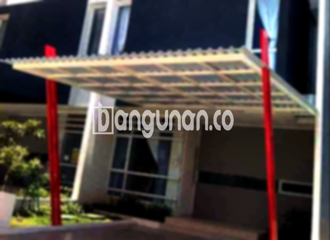

**Jasa Pasang Kanopi Rumah Minimalis di Kebon Pedes Bogor** – Menciptakan kenyamanan dan perlindungan pada area luar rumah adalah prioritas utama bagi banyak pemilik properti. Di Kebon Pedes Bogor, kanopi hadir sebagai solusi ideal untuk melindungi teras, garasi, atau area parkir dari cuaca ekstrem. Mitra Bangunan memahami kebutuhan ini dan menawarkan jasa pemasangan kanopi rumah minimalis berkualitas dengan harga terjangkau.

Memilih kanopi yang tepat tidak hanya mempercantik tampilan rumah Anda, tetapi juga meningkatkan fungsionalitasnya. Dengan beragam pilihan desain dan material, kami siap membantu Anda mewujudkan kanopi impian.



## Keunggulan Memilih Jasa Pasang Kanopi Rumah Minimalis di Kebon Pedes Bogor

Bagi Anda yang berencana memasang kanopi, berikut adalah beberapa keunggulan yang bisa Anda dapatkan dengan mempercayakan pekerjaan ini kepada profesional di Kebon Pedes Bogor:

### \- Variasi Model yang Luas

Kami menyediakan beragam model kanopi rumah yang dapat Anda sesuaikan dengan gaya arsitektur dan preferensi pribadi. Mulai dari desain sederhana hingga modern, Anda dapat memilih bentuk, ukuran, dan warna yang paling sesuai dengan kebutuhan Anda. Tersedia pilihan model persegi, persegi panjang, lengkung, dan lain sebagainya.

### \- Material Ramah Lingkungan dan Berkualitas

Kami hanya menggunakan material berkualitas tinggi yang ramah lingkungan dalam pembuatan kanopi. Bahan-bahan ini tidak hanya tahan lama, tetapi juga aman bagi kesehatan Anda dan keluarga. Selain itu, material yang kami gunakan mudah dibersihkan, sehingga perawatan kanopi menjadi lebih praktis.

### \- Konstruksi Kuat dan Tahan Lama

Kanopi yang kami pasang dirancang untuk tahan terhadap berbagai kondisi cuaca ekstrem, termasuk hujan deras, angin kencang, dan paparan sinar matahari langsung. Kami menggunakan teknik konstruksi yang kuat dan presisi untuk memastikan kanopi Anda berumur panjang dan tidak mudah rusak.

Anda dapat mengandalkan kanopi rumah untuk bertahan puluhan tahun dengan perawatan yang tepat. Pemeliharaan rutin akan menjaga kualitas dan penampilannya tetap optimal.

### \- Keamanan dan Kenyamanan yang Terjamin

Kanopi memberikan perlindungan optimal terhadap cuaca buruk, sehingga Anda dan keluarga dapat menikmati area luar rumah dengan lebih nyaman dan aman. Kanopi melindungi dari sengatan matahari dan hujan lebat, menciptakan suasana yang menyenangkan untuk bersantai atau berkumpul bersama.

### \- Harga Kompetitif dan Terjangkau

Kami menawarkan harga yang kompetitif dan terjangkau untuk jasa pemasangan kanopi rumah minimalis di Kebon Pedes Bogor. Harga akan disesuaikan dengan jenis material, ukuran, dan kompleksitas desain yang Anda pilih.

## Informasi Harga dan Jasa Pemasangan Kanopi Rumah Minimalis di Kebon Pedes Bogor



Banyak pemilik rumah di Kebon Pedes Bogor yang telah merasakan manfaat memiliki kanopi. Kanopi dapat digunakan untuk berbagai keperluan, seperti melindungi kendaraan di garasi, menyediakan area bermain yang teduh bagi anak-anak, atau menciptakan ruang outdoor yang nyaman untuk bersantai.

Untuk memberikan gambaran, harga kanopi rumah bervariasi tergantung pada kualitas material dan kompleksitas desain. Beberapa faktor yang memengaruhi harga antara lain:

*   **Jenis material:** Baja ringan, galvalum, kaca, dan polycarbonate memiliki harga yang berbeda-beda.
*   **Ukuran kanopi:** Semakin besar ukuran kanopi, semakin tinggi biayanya.
*   **Kompleksitas desain:** Desain yang rumit atau khusus akan membutuhkan biaya tambahan.

Kami menyediakan layanan konsultasi gratis untuk membantu Anda menentukan jenis dan ukuran kanopi yang paling sesuai dengan kebutuhan dan anggaran Anda.

Bagi Anda yang ingin memasang kanopi di rumah, kami merekomendasikan untuk menggunakan jasa pemasangan profesional. Tim ahli kami akan memastikan proses pemasangan berjalan lancar dan menghasilkan kanopi yang kokoh, aman, dan estetis.

Dengan pengalaman bertahun-tahun di bidang ini, kami berkomitmen untuk memberikan layanan terbaik kepada setiap pelanggan di Kebon Pedes Bogor. Hubungi kami segera melalui tombol WhatsApp atau Telepon di halaman ini untuk mendapatkan penawaran terbaik dan layanan yang memuaskan. Mitra Bangunan siap menjadi mitra Anda dalam menciptakan hunian yang nyaman dan terlindungi.

**Ref by:**  [Kanopi Rumah Minimalis Kebon Pedes Bogor](https://id.wikipedia.org/wiki/Kanopi)