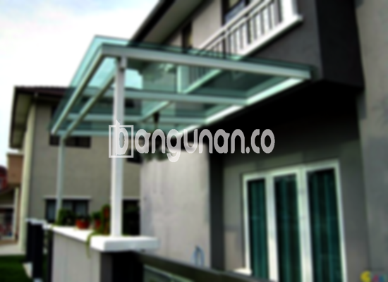

**Jasa Pasang Kanopi Rumah Minimalis di KebonPala Jakarta** – Memiliki area luar ruangan yang terlindungi dari cuaca ekstrem adalah impian bagi setiap pemilik rumah. Mitra Bangunan di KebonPala Jakarta kini dapat mewujudkan impian tersebut dengan mudah. Kami menyediakan jasa pemasangan kanopi rumah minimalis berkualitas, memberikan perlindungan optimal sekaligus mempercantik tampilan hunian Anda. 

Kanopi bukan sekadar pelindung dari hujan dan panas, namun juga elemen penting dalam desain eksterior rumah Anda. Dengan berbagai pilihan material dan desain, kami siap membantu Anda menemukan kanopi yang paling sesuai dengan gaya arsitektur dan anggaran Anda.



## Mengapa Memilih Jasa Pasang Kanopi Rumah Minimalis di KebonPala Jakarta?

Bagi Anda yang mempertimbangkan penggunaan kanopi untuk rumah, berikut adalah beberapa keuntungan yang dapat Anda peroleh:

### \- Pilihan Model Kanopi yang Beragam

Kami menyediakan beragam model kanopi rumah yang dapat Anda pilih sesuai dengan preferensi Anda. Setiap orang memiliki selera unik dalam menentukan desain kanopi ideal untuk rumah mereka. Anda dapat memilih dari berbagai bentuk, seperti persegi, persegi panjang, atau desain khusus sesuai dengan kebutuhan Anda.

### \- Material Ramah Lingkungan

Kanopi yang kami gunakan dibuat dari material yang ramah lingkungan. Hal ini menjadikan kanopi pilihan yang bertanggung jawab dan berkelanjutan untuk hunian Anda. Selain itu, material yang digunakan umumnya mudah dibersihkan, sehingga perawatan kanopi menjadi lebih praktis.

### \- Konstruksi Tahan Lama dan Kokoh 

Salah satu keunggulan utama kanopi yang kami pasang adalah daya tahan dan kekokohannya. Kami hanya menggunakan material berkualitas tinggi yang mampu bertahan terhadap berbagai kondisi cuaca ekstrem. Investasi pada kanopi yang kokoh menjamin perlindungan optimal untuk rumah Anda selama bertahun-tahun.

Anda dapat mengandalkan kanopi rumah kami untuk bertahan lama dengan perawatan yang tepat. Dengan perawatan rutin, kanopi Anda dapat menjadi investasi jangka panjang yang berharga.

### \- Keamanan dan Kenyamanan Terjamin

Kanopi memberikan lapisan perlindungan tambahan untuk area di bawahnya, seperti teras, garasi, atau area bermain anak. Perlindungan ini tidak hanya melindungi Anda dari hujan dan panas, tetapi juga memberikan rasa aman dan nyaman. 

Dengan kanopi, Anda dapat menikmati area luar ruangan rumah Anda tanpa khawatir terpapar cuaca buruk. Keamanan yang terjamin akan membuat Anda merasa lebih nyaman dan rileks.

### \- Harga Kompetitif untuk Kanopi Rumah Minimalis di KebonPala Jakarta

Kami menawarkan harga yang kompetitif untuk berbagai jenis kanopi rumah minimalis. Harga akan bervariasi tergantung pada material, ukuran, dan kompleksitas desain yang Anda pilih. 

## Informasi Harga dan Jasa Pemasangan Kanopi Rumah Minimalis di KebonPala Jakarta



Banyak pemilik rumah di KebonPala Jakarta yang kini menggunakan kanopi untuk meningkatkan kenyamanan dan nilai estetika rumah mereka. Kanopi sering digunakan untuk melindungi garasi mobil, area parkir, atau sebagai penutup jendela. Pemanfaatan kanopi sangat fleksibel dan dapat disesuaikan dengan kebutuhan Anda. 

Untuk informasi harga yang lebih detail, silakan lihat tabel harga yang tersedia atau hubungi tim kami untuk mendapatkan penawaran khusus. Kami akan dengan senang hati membantu Anda menemukan solusi kanopi yang paling sesuai dengan anggaran Anda.

Kami memahami bahwa setiap rumah memiliki kebutuhan yang berbeda. Itulah mengapa kami menawarkan layanan konsultasi gratis untuk membantu Anda menentukan jenis kanopi yang paling tepat untuk rumah Anda. Dengan bantuan tenaga ahli kami, Anda dapat membuat keputusan yang tepat dan mendapatkan hasil yang memuaskan.

**Ref by:**  [Kanopi Rumah Minimalis KebonPala Jakarta](https://id.wikipedia.org/wiki/Kanopi)

Mitra Bangunan yang berlokasi di KebonPala Jakarta dan sedang mencari jasa pemasangan kanopi rumah minimalis berkualitas, jangan ragu untuk menghubungi kami melalui tombol WhatsApp atau Telepon di halaman ini. Kami siap memberikan layanan terbaik dan membantu Anda mewujudkan hunian impian Anda.