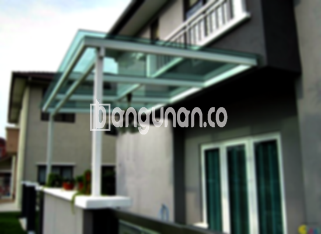

**Jasa Pasang Kanopi Rumah Minimalis di Kedaung Depok** – Memiliki area luar rumah yang nyaman dan terlindungi adalah dambaan setiap pemilik rumah di Kedaung Depok. Mitra Bangunan memahami kebutuhan ini dan hadir sebagai solusi tepat untuk melindungi teras, garasi, atau area lainnya dari cuaca ekstrem. Kami menyediakan jasa pemasangan kanopi rumah minimalis dengan kualitas terjamin dan harga yang bersaing.

Kanopi tidak hanya berfungsi sebagai pelindung, tetapi juga mempercantik tampilan rumah Anda. Dengan desain yang modern dan minimalis, kanopi dapat meningkatkan nilai estetika properti Anda secara signifikan. Kami siap membantu Anda memilih dan memasang kanopi yang paling sesuai dengan gaya arsitektur rumah Anda di Kedaung Depok.



## Keunggulan Memilih Jasa Pasang Kanopi Rumah Minimalis di Kedaung Depok

Bagi Anda yang mempertimbangkan untuk memasang kanopi di rumah, berikut adalah beberapa keuntungan yang bisa Anda dapatkan:

### \- Pilihan Model Kanopi yang Beragam

Kami menawarkan berbagai model kanopi yang dapat Anda sesuaikan dengan selera dan kebutuhan Anda.  Anda dapat memilih dari berbagai bentuk, seperti persegi, persegi panjang, atau desain khusus sesuai permintaan. Setiap model memiliki daya tarik tersendiri, memungkinkan Anda menemukan kanopi yang sempurna untuk melengkapi tampilan rumah di Kedaung Depok.

### \- Material Berkualitas dan Ramah Lingkungan

Kami hanya menggunakan material berkualitas tinggi yang tahan lama dan ramah lingkungan. Bahan-bahan ini tidak hanya memastikan kekuatan dan keawetan kanopi, tetapi juga mengurangi dampak negatif terhadap lingkungan.  Anda dapat merasa tenang mengetahui bahwa kanopi Anda berkontribusi pada gaya hidup yang lebih berkelanjutan.

### \- Ketahanan dan Kekuatan Terjamin

Kanopi yang kami pasang dirancang untuk tahan terhadap berbagai kondisi cuaca ekstrem, seperti hujan deras, terik matahari, dan angin kencang. Material berkualitas dan teknik pemasangan yang tepat memastikan kanopi Anda tetap kokoh dan memberikan perlindungan maksimal selama bertahun-tahun. Anda akan mendapatkan investasi jangka panjang yang bernilai.

Anda dapat mengandalkan ketahanan kanopi rumah kami, yang bisa bertahan hingga puluhan tahun dengan perawatan yang tepat. Perawatan rutin akan membantu menjaga kualitas dan memperpanjang umur pakainya.

### \- Keamanan dan Kenyamanan Optimal

Kanopi memberikan perlindungan ekstra bagi area di bawahnya, melindungi Anda dan keluarga dari paparan langsung sinar matahari dan hujan. Dengan demikian, Anda dapat menikmati waktu lebih banyak di luar ruangan tanpa khawatir terhadap kondisi cuaca. Kanopi menciptakan ruang yang aman dan nyaman untuk bersantai, bermain, atau berkumpul bersama keluarga.

### \- Harga Kompetitif dan Terjangkau

Kami menawarkan harga yang kompetitif dan terjangkau tanpa mengorbankan kualitas.  Kami percaya bahwa setiap orang berhak mendapatkan kanopi berkualitas tinggi tanpa harus mengeluarkan biaya yang berlebihan. Kami selalu berusaha memberikan penawaran terbaik kepada pelanggan kami di Kedaung Depok.

## Informasi Harga dan Jasa Pemasangan Kanopi Rumah Minimalis di Kedaung Depok



Banyak orang saat ini yang telah menerapkan kanopi di rumah mereka, baik untuk garasi mobil, area parkir, atau sebagai penutup jendela. Pilihan penggunaan kanopi sangat beragam, tergantung pada kebutuhan spesifik Anda. Kami siap membantu Anda menentukan jenis kanopi yang paling sesuai dengan kebutuhan dan anggaran Anda di Kedaung Depok.

Untuk mendapatkan informasi harga yang lebih detail, silakan lihat tabel harga yang tersedia **Ref by:**  [Kanopi Rumah Minimalis Kedaung Depok](https://id.wikipedia.org/wiki/Kanopi) atau hubungi tim kami untuk konsultasi gratis.  Kami akan memberikan penawaran khusus yang disesuaikan dengan ukuran dan jenis kanopi yang Anda inginkan.

Harga kanopi rumah dapat bervariasi tergantung pada beberapa faktor, seperti kualitas material, kompleksitas desain, dan ukuran area yang akan ditutupi. Kami selalu memberikan transparansi harga dan menghindari biaya tersembunyi. 

Jika Anda menginginkan pemasangan kanopi yang cepat dan efisien, gunakan jasa pemasangan profesional dari Kami. Dengan tenaga ahli yang berpengalaman, proses pemasangan akan berjalan lancar dan menghasilkan hasil yang memuaskan.

Itulah informasi mengenai Jasa Pasang Kanopi Rumah Minimalis di Kedaung Depok yang dapat kami sampaikan. Mitra Bangunan siap membantu Anda menciptakan hunian yang nyaman dan terlindungi dengan kanopi berkualitas tinggi. Jangan ragu untuk menghubungi kami melalui tombol WhatsApp atau Telepon di halaman ini untuk konsultasi dan penawaran terbaik. Terima kasih.