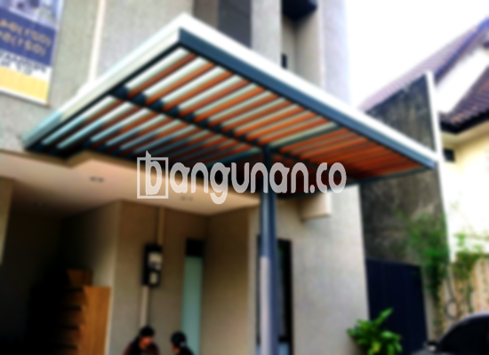

**Jasa Pasang Kanopi Rumah Minimalis di Kedung Halang Bogor** – Mitra Bangunan yang ingin menciptakan area luar rumah yang nyaman dan terlindungi di Kedung Halang Bogor, tidak perlu lagi ragu. Kanopi adalah solusi tepat untuk melindungi teras, garasi, atau area lainnya dari cuaca ekstrem. Kami menyediakan layanan pembuatan dan pemasangan kanopi berkualitas dengan harga yang kompetitif. 

Memilih kanopi yang tepat untuk rumah Anda adalah investasi yang cerdas. Ada beragam jenis kanopi yang tersedia, masing-masing dengan kelebihan dan kekurangannya. Pertimbangkan kebutuhan Anda, gaya arsitektur rumah, dan anggaran yang tersedia sebelum membuat keputusan.



## Keunggulan Memilih Jasa Pasang Kanopi Rumah Minimalis di Kedung Halang Bogor

Bagi Anda yang berencana menggunakan kanopi untuk hunian, terdapat sejumlah manfaat yang bisa Anda rasakan, antara lain:

### \- Pilihan Model Kanopi yang Beragam

Salah satu daya tarik utama kanopi adalah variasi model yang tersedia. Anda dapat memilih desain yang sesuai dengan selera dan gaya rumah Anda. Beberapa pilihan model kanopi yang populer termasuk persegi, persegi panjang, dan bentuk custom sesuai keinginan Anda.

### \- Bahan Ramah Lingkungan dari Jasa Pasang Kanopi Rumah Minimalis di Kedung Halang Bogor

Kanopi yang kami gunakan terbuat dari bahan-bahan yang tidak berbahaya dan ramah lingkungan. Ini memberikan Anda ketenangan pikiran karena Anda berkontribusi pada pelestarian lingkungan. Selain itu, material ini juga mudah dibersihkan, sehingga perawatan kanopi menjadi sangat praktis.

### \- Daya Tahan dan Kekuatan Terjamin dari Jasa Pasang Kanopi Rumah Minimalis di Kedung Halang Bogor

Kualitas adalah prioritas utama kami. Kanopi yang kami pasang dibuat dari bahan berkualitas tinggi yang tahan lama dan kokoh. Dengan perawatan yang tepat, kanopi ini dapat bertahan selama bertahun-tahun, memberikan perlindungan optimal bagi rumah Anda di Kedung Halang Bogor.

Anda akan merasakan sendiri bahwa kanopi rumah dapat bertahan lama. Keawetan ini juga dipengaruhi oleh perawatan yang dilakukan, jika Anda dapat merawatnya dengan baik, maka kanopi akan memiliki mutu yang tahan lama.

### \- Keamanan yang Optimal dari Jasa Pasang Kanopi Rumah Minimalis di Kedung Halang Bogor

Keamanan adalah aspek penting yang kami perhatikan. Kanopi memberikan perlindungan maksimal terhadap sinar matahari, hujan, dan elemen cuaca lainnya. Hal ini menciptakan lingkungan yang lebih aman dan nyaman di bawah kanopi, baik untuk area teras, garasi, maupun area lainnya.

Dengan kanopi, Anda tidak perlu khawatir lagi tentang paparan langsung sinar matahari atau hujan. Area di bawah kanopi akan terlindungi dengan baik. Keamanan yang terjamin ini tentu akan membuat Anda merasa nyaman dalam menggunakan kanopi.

### \- Harga Ekonomis untuk Kanopi Rumah Minimalis di Kedung Halang Bogor

Kami memahami bahwa anggaran adalah pertimbangan penting. Oleh karena itu, kami menawarkan harga yang kompetitif dan terjangkau untuk kanopi rumah minimalis di Kedung Halang Bogor. Harga akan bervariasi tergantung pada jenis kanopi yang dipilih dan ukuran yang dibutuhkan.

## Harga dan Proses Pemasangan Kanopi Rumah Minimalis di Kedung Halang Bogor



Apakah Anda sudah mempertimbangkan untuk memasang kanopi di rumah Anda? Banyak orang saat ini yang memilih untuk memasang kanopi di rumah mereka. Kanopi dapat digunakan untuk berbagai keperluan, seperti melindungi garasi mobil, area parkir, atau bahkan sebagai penutup jendela. Semua tergantung pada kebutuhan spesifik Anda.

Untuk mendapatkan informasi lebih detail mengenai harga dan layanan pemasangan, silakan hubungi tim kami. Kami akan memberikan penawaran terbaik yang sesuai dengan anggaran dan kebutuhan Anda.

Bagi Anda yang ingin memasang kanopi untuk bangunan komersial, kami juga menyediakan layanan pemasangan profesional. Dengan menggunakan jasa pemasangan, proses akan menjadi lebih cepat dan efisien. Anda dapat langsung menikmati manfaat dari kanopi yang telah terpasang.

**Ref by:**  [Kanopi Rumah Minimalis Kedung Halang Bogor](https://id.wikipedia.org/wiki/Kanopi)

Demikianlah pembahasan lengkap mengenai jasa pasang kanopi rumah minimalis di Kedung Halang Bogor. Mitra Bangunan yang sedang mencari solusi perlindungan optimal untuk rumah atau bisnisnya, jangan ragu untuk menghubungi kami melalui tombol WhatsApp atau Telepon di halaman ini. Kami siap memberikan pelayanan terbaik dan membantu Anda menemukan kanopi yang sempurna untuk kebutuhan Anda.