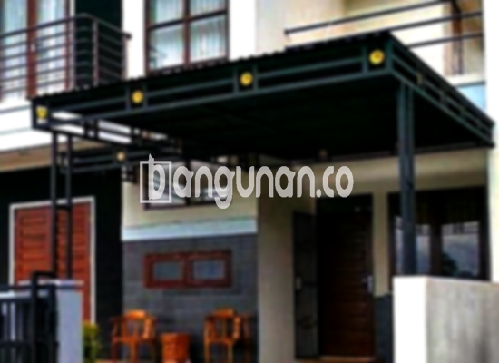

**Jasa Pasang Kanopi Rumah Minimalis di Kedung Jaya Bogor** – Mitra Bangunan yang ingin memiliki perlindungan optimal untuk rumah atau bisnisnya di Kedung Jaya Bogor, tidak perlu lagi kesulitan mencari solusi yang tepat. Kanopi adalah investasi cerdas untuk menciptakan ruang luar yang nyaman dan terlindungi dari cuaca ekstrem, baik hujan maupun terik matahari. Kami hadir sebagai penyedia jasa pemasangan kanopi minimalis yang siap mewujudkan tampilan rumah Anda semakin modern dan fungsional.

Kami memahami betul kebutuhan akan kanopi berkualitas tinggi dengan desain yang sesuai selera. Oleh karena itu, kami menawarkan beragam pilihan kanopi rumah dengan model yang dapat Anda sesuaikan dengan kebutuhan dan anggaran. Dengan berbagai tipe kanopi yang tersedia, Anda dapat menemukan solusi ideal untuk meningkatkan nilai estetika dan kenyamanan properti Anda.



## Keunggulan Memilih Jasa Pasang Kanopi Rumah Minimalis di Kedung Jaya Bogor

Bagi Anda yang mempertimbangkan penggunaan kanopi untuk rumah, ruko, atau area komersial lainnya di Kedung Jaya Bogor, berikut adalah beberapa manfaat utama yang dapat Anda peroleh:

### \- Variasi Model Kanopi yang Luas

Pilihan model kanopi sangat beragam, memungkinkan Anda menyesuaikan desain dengan gaya arsitektur dan preferensi pribadi. Mulai dari model persegi, persegi panjang, hingga desain khusus lainnya, kami siap mewujudkan konsep kanopi impian Anda. Anda dapat berkonsultasi dengan tim kami untuk mendapatkan rekomendasi model yang paling sesuai dengan kebutuhan Anda.

### \- Material Ramah Lingkungan untuk Kanopi Rumah

Kami mengutamakan penggunaan material yang ramah lingkungan dalam pembuatan kanopi. Dengan memilih kanopi kami, Anda turut berkontribusi dalam menjaga kelestarian lingkungan. Material yang digunakan juga mudah dibersihkan, memastikan kanopi Anda tetap terlihat bersih dan terawat sepanjang waktu.

### \- Daya Tahan dan Kekuatan Terjamin

Salah satu keunggulan utama kanopi yang kami pasang adalah daya tahan dan kekuatannya. Kami menggunakan material berkualitas tinggi yang tahan terhadap cuaca ekstrem dan memiliki umur pakai yang panjang. Dengan perawatan yang tepat, kanopi Anda dapat bertahan selama bertahun-tahun tanpa perlu khawatir akan kerusakan.

Anda akan merasakan sendiri kualitasnya, karena kanopi rumah kami dirancang untuk tahan lama, bahkan berpotensi bertahan selama beberapa dekade. Ketahanan ini tentu saja bergantung pada perawatan rutin yang Anda lakukan.

### \- Keamanan dan Perlindungan Optimal

Kanopi memberikan perlindungan ekstra terhadap area di bawahnya, seperti teras, garasi, atau area parkir. Kanopi melindungi dari paparan langsung sinar matahari dan hujan, menciptakan lingkungan yang lebih nyaman dan aman. Dengan demikian, Anda dan keluarga dapat menikmati waktu di luar ruangan tanpa harus khawatir dengan kondisi cuaca.

### \- Investasi dengan Harga Terjangkau di Kedung Jaya Bogor

Kami menawarkan solusi kanopi rumah minimalis di Kedung Jaya Bogor dengan harga yang kompetitif. Harga akan bervariasi tergantung pada jenis material, ukuran, dan kompleksitas desain. Namun, kami berkomitmen untuk memberikan penawaran terbaik sesuai dengan anggaran Anda. 

## Informasi Harga dan Jasa Pemasangan Kanopi Rumah Minimalis di Kedung Jaya Bogor



Banyak pemilik rumah di Kedung Jaya Bogor mulai menyadari pentingnya kanopi untuk meningkatkan fungsionalitas dan estetika properti mereka. Kanopi seringkali digunakan untuk melindungi garasi mobil, area parkir, teras, atau bahkan jendela rumah. Pilihan aplikasi kanopi sangat tergantung pada kebutuhan dan preferensi masing-masing pemilik rumah.

Sebagai gambaran, harga kanopi rumah dengan kualitas standar berkisar antara Rp 450.000 hingga Rp 800.000 per meter persegi. Harga dapat meningkat seiring dengan peningkatan kualitas material dan kompleksitas desain.

Faktor-faktor yang memengaruhi harga meliputi jenis material yang dipilih, luas area yang akan ditutupi, dan tingkat kesulitan pemasangan. Pastikan Anda memilih ukuran dan desain yang sesuai dengan kebutuhan Anda untuk mendapatkan penawaran harga yang akurat.

Bagi Anda yang tidak memiliki waktu atau keahlian untuk memasang kanopi sendiri, kami menyediakan layanan pemasangan profesional yang cepat dan efisien. Dengan mempercayakan pemasangan kepada ahli, Anda dapat memastikan kanopi terpasang dengan benar dan aman. Anda bisa memanfaatkan layanan [Pemasangan kanopi](/jasa-pasang-kanopi-rumah-minimalis-di-balumbang-jaya-bogor/) dari tim kami.

Itulah informasi penting mengenai Jasa Pasang Kanopi Rumah Minimalis di Kedung Jaya Bogor yang dapat kami sampaikan. Jangan ragu untuk berkonsultasi dengan tim kami guna mendapatkan solusi kanopi yang paling sesuai dengan kebutuhan dan anggaran Anda. Mitra Bangunan, hubungi kami melalui tombol WhatsApp atau Telepon yang tersedia di halaman ini untuk mendapatkan layanan dan penawaran terbaik.

**Ref by:**  [Kanopi Rumah Minimalis Kedung Jaya Bogor](https://id.wikipedia.org/wiki/Kanopi)