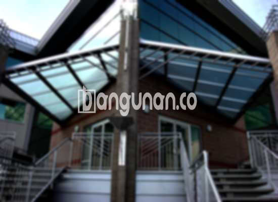

**Jasa Pasang Kanopi Rumah Minimalis di Kedung Waringin Bogor** – Memiliki area luar rumah yang nyaman dan terlindungi adalah dambaan setiap pemilik rumah di Kedung Waringin Bogor. Kanopi adalah solusi praktis untuk menciptakan kenyamanan tersebut, melindungi teras, carport, atau bahkan area bermain anak dari cuaca ekstrem. Mitra Bangunan hadir sebagai penyedia jasa pemasangan kanopi rumah minimalis yang terpercaya di Kedung Waringin Bogor, menawarkan solusi perlindungan dan estetika yang sesuai dengan kebutuhan Anda.

Kanopi bukan sekadar atap tambahan; ia adalah investasi untuk meningkatkan kualitas hidup dan nilai properti Anda. Dengan berbagai pilihan desain dan material, Anda dapat menyesuaikan kanopi dengan gaya arsitektur rumah dan preferensi pribadi.



## Keuntungan Menggunakan Jasa Pasang Kanopi Rumah Minimalis di Kedung Waringin Bogor

Bagi Anda yang mempertimbangkan pemasangan kanopi untuk rumah, terdapat sejumlah keuntungan yang bisa Anda peroleh:

### - Variasi Model yang Luas dari Jasa Pasang Kanopi Rumah Minimalis di Kedung Waringin Bogor

Pilihan model kanopi sangat beragam, memungkinkan Anda menemukan desain yang paling sesuai dengan selera dan gaya rumah Anda. Anda dapat memilih dari berbagai bentuk seperti persegi, persegi panjang, atau desain khusus yang unik. Dengan demikian, kanopi tidak hanya berfungsi sebagai perlindungan, tetapi juga sebagai elemen dekoratif yang mempercantik tampilan rumah Anda.

### - Material Ramah Lingkungan dari Jasa Pasang Kanopi Rumah Minimalis di Kedung Waringin Bogor

Kami hanya menggunakan material yang aman dan tidak berbahaya bagi lingkungan. Hal ini menunjukkan komitmen kami terhadap keberlanjutan dan kesehatan. Pemilihan material yang tepat juga memastikan kanopi mudah dibersihkan dan dirawat, sehingga tahan lama dan selalu terlihat menarik.

### - Daya Tahan dan Kekuatan Teruji dari Jasa Pasang Kanopi Rumah Minimalis di Kedung Waringin Bogor

Kanopi yang kami pasang dirancang untuk tahan lama dan kokoh. Kami menggunakan material berkualitas tinggi yang mampu menahan berbagai kondisi cuaca ekstrem. Kekuatan ini memastikan investasi Anda terlindungi dan memberikan manfaat jangka panjang.

Anda dapat mengandalkan kanopi kediaman Anda untuk bertahan selama bertahun-tahun. Perawatan yang tepat akan semakin memperpanjang usia pakainya dan mempertahankan kualitasnya.

### - Keamanan Optimal dari Jasa Pasang Kanopi Rumah Minimalis di Kedung Waringin Bogor

Kanopi memberikan perlindungan sempurna terhadap berbagai elemen cuaca seperti sinar matahari langsung dan hujan deras. Hal ini menciptakan lingkungan yang lebih aman dan nyaman di area luar rumah Anda. Anda dapat menikmati waktu di teras atau garasi tanpa khawatir terpapar cuaca buruk.

Dengan adanya kanopi, area di bawahnya terlindungi dengan baik, sehingga Anda dapat lebih leluasa menggunakan ruang tersebut untuk berbagai kegiatan.

### - Harga yang Kompetitif untuk Kanopi Rumah Minimalis di Kedung Waringin Bogor

Kami menawarkan solusi yang terjangkau tanpa mengorbankan kualitas. Kami memahami bahwa setiap anggaran berbeda, sehingga kami berusaha memberikan penawaran terbaik sesuai kebutuhan Anda. 

## Harga dan Jasa Pemasangan Kanopi Rumah Minimalis di Kedung Waringin Bogor



Banyak pemilik rumah di Kedung Waringin Bogor kini menyadari pentingnya kanopi untuk meningkatkan kenyamanan dan fungsionalitas rumah mereka. Kanopi sering digunakan untuk melindungi garasi mobil, area parkir, jendela, dan area outdoor lainnya. Pemilihan penggunaan kanopi sangat bergantung pada kebutuhan spesifik Anda.

Untuk informasi lebih lanjut mengenai penawaran harga, silakan lihat tabel harga yang tersedia **Ref by:**  [Kanopi Rumah Minimalis Kedung Waringin Bogor](https://id.wikipedia.org/wiki/Kanopi) atau hubungi kami untuk konsultasi gratis. Kami akan dengan senang hati membantu Anda menemukan solusi kanopi yang paling sesuai dengan anggaran dan kebutuhan Anda.

Harga kanopi juga dipengaruhi oleh faktor-faktor seperti jenis material, kompleksitas desain, dan luas area yang akan ditutupi. Kami selalu memberikan transparansi harga dan memastikan Anda mendapatkan nilai terbaik untuk investasi Anda.

Mempercayakan pemasangan kanopi kepada jasa profesional seperti kami akan menghemat waktu dan tenaga Anda. Kami memiliki tim yang berpengalaman dan peralatan yang lengkap untuk memastikan proses pemasangan berjalan lancar dan efisien.

Dengan begitu, Anda dapat segera menikmati manfaat kanopi baru Anda tanpa perlu repot. 

Mitra Bangunan siap membantu Anda menciptakan ruang luar rumah yang nyaman, terlindungi, dan indah di Kedung Waringin Bogor. Jangan ragu untuk menghubungi kami melalui tombol WhatsApp atau Telepon di halaman ini untuk mendapatkan layanan terbaik dan harga yang sesuai dengan anggaran Anda.