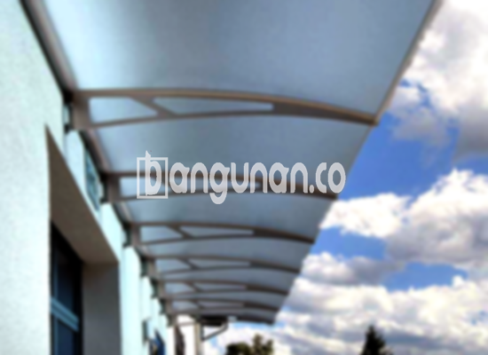

**Jasa Pasang Kanopi Rumah Minimalis di Kelapa Gading Jakarta** – Mitra Bangunan yang ingin melindungi teras, garasi, atau area lain di Kelapa Gading Jakarta dari cuaca panas dan hujan? Kanopi adalah solusi tepat yang semakin populer. Kanopi tidak hanya memberikan perlindungan, tetapi juga meningkatkan estetika rumah Anda. Kami menyajikan solusi pembuatan dan pemasangan kanopi yang sesuai dengan kebutuhan dan anggaran Anda.

Memilih kanopi yang tepat memerlukan pertimbangan berbagai faktor. Anda bisa menemukan beragam jenis kanopi dengan keunggulan masing-masing. Mulai dari material, kualitas, hingga harga, pastikan Anda memilih kanopi yang paling sesuai dengan preferensi dan kebutuhan Anda.



## Keunggulan Menggunakan Jasa Pasang Kanopi Rumah Minimalis di Kelapa Gading Jakarta

Bagi Anda yang berencana memasang kanopi untuk rumah atau bangunan lainnya di Kelapa Gading Jakarta, ada sejumlah keunggulan yang bisa Anda dapatkan, antara lain:

### \- Pilihan Model Kanopi yang Beragam

Keberagaman model merupakan salah satu daya tarik utama. Anda dapat memilih berbagai tipe kanopi yang sesuai dengan gaya arsitektur rumah Anda. Setiap orang memiliki selera yang berbeda, dan kami menyediakan beragam pilihan model seperti persegi, persegi panjang, dan lainnya.

### \- Material Ramah Lingkungan

Kami mengutamakan penggunaan material yang ramah lingkungan dalam pembuatan kanopi. Hal ini memastikan kanopi tidak hanya melindungi Anda dari cuaca, tetapi juga berkontribusi pada kelestarian lingkungan. Material yang digunakan juga mudah dibersihkan, sehingga perawatan kanopi menjadi lebih praktis.

### \- Ketahanan dan Kekokohan Terjamin

Salah satu keunggulan utama kanopi yang kami pasang adalah ketahanan dan kekokohannya. Kami menggunakan bahan-bahan berkualitas tinggi yang tahan terhadap cuaca ekstrem dan penggunaan jangka panjang. Dengan perawatan yang tepat, kanopi ini dapat bertahan hingga bertahun-tahun.

Anda dapat mengandalkan kanopi kami yang akan tetap kokoh dan berfungsi dengan baik selama bertahun-tahun. Ketahanan ini jelas akan memberikan nilai tambah bagi properti Anda di Kelapa Gading Jakarta.

### \- Keamanan yang Optimal

Keamanan merupakan prioritas utama kami. Kanopi yang kami pasang memberikan perlindungan optimal terhadap berbagai elemen cuaca seperti sinar matahari langsung dan hujan deras. Hal ini menciptakan lingkungan yang lebih aman dan nyaman di area di bawah kanopi.

Dengan kanopi yang terpasang dengan baik, Anda tidak perlu khawatir tentang kerusakan akibat paparan cuaca ekstrem. Keamanan yang terjamin akan memberikan ketenangan pikiran bagi Anda dan keluarga.

### \- Harga yang Bersaing

Kami menawarkan harga yang kompetitif untuk jasa pemasangan kanopi rumah minimalis di Kelapa Gading Jakarta. Harga akan bervariasi tergantung pada jenis kanopi, ukuran, dan material yang dipilih. Kami berkomitmen untuk memberikan penawaran terbaik tanpa mengurangi kualitas produk dan layanan kami.

## Harga dan Jasa Pemasangan Kanopi Rumah Minimalis di Kelapa Gading Jakarta



Banyak pemilik rumah di Kelapa Gading Jakarta yang telah merasakan manfaat dari pemasangan kanopi. Baik untuk melindungi garasi mobil, area parkir, atau sebagai penutup jendela, kanopi merupakan solusi praktis dan efektif. Pilihan fungsi dan modelnya sangat beragam, tergantung pada kebutuhan Anda.

Untuk mendapatkan informasi lebih lanjut mengenai harga kanopi rumah, Anda dapat merujuk pada tabel yang tersedia. Harga bervariasi tergantung pada kualitas material yang Anda pilih.

Harga juga dipengaruhi oleh luas area yang akan ditutupi kanopi. Semakin besar area, semakin tinggi biaya yang dibutuhkan. Pastikan Anda memilih ukuran yang sesuai dengan kebutuhan dan anggaran Anda.

Bagi Anda yang membutuhkan bantuan dalam pemasangan kanopi, kami menyediakan jasa pemasangan profesional. Dengan menggunakan jasa pemasangan, Anda dapat menghemat waktu dan tenaga. Selain itu, pemasangan yang dilakukan oleh tenaga ahli akan memastikan kanopi terpasang dengan benar dan aman.

Itulah beberapa informasi mengenai Jasa Pasang Kanopi Rumah Minimalis di Kelapa Gading Jakarta yang dapat kami sampaikan. Mitra Bangunan yang tertarik untuk mempercantik dan melindungi properti Anda, jangan ragu untuk menghubungi kami melalui tombol WhatsApp atau Telepon di halaman ini untuk konsultasi dan penawaran terbaik. Kami siap membantu Anda menciptakan rumah impian yang nyaman dan aman.

**Ref by:**  [Kanopi Rumah Minimalis Kelapa Gading Jakarta](https://id.wikipedia.org/wiki/Kanopi)