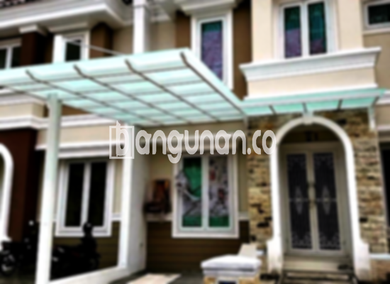

**Jasa Pasang Kanopi Rumah Minimalis di Kelapa Nunggal** – Memiliki area luar rumah yang nyaman dan terlindungi adalah dambaan setiap pemilik properti. Mitra Bangunan di Kelapa Nunggal hadir sebagai solusi bagi Anda yang mencari perlindungan optimal dari cuaca ekstrem, sekaligus meningkatkan estetika bangunan. Kami menawarkan layanan pembuatan dan pemasangan kanopi rumah minimalis dengan harga terjangkau dan kualitas terjamin.

Apakah Anda berencana menambahkan kanopi di teras, garasi, atau area parkir? Beragam pilihan material dan desain siap kami wujudkan sesuai kebutuhan dan anggaran Anda. Dengan kanopi yang tepat, Anda dapat menikmati ruang luar rumah dengan lebih nyaman dan aman.



## Keuntungan Menggunakan Jasa Pasang Kanopi Rumah Minimalis di Kelapa Nunggal

Investasi pada kanopi rumah memberikan banyak manfaat. Berikut ini beberapa keunggulan yang akan Anda dapatkan dengan menggunakan jasa kami di Kelapa Nunggal:

### \- Pilihan Model Kanopi yang Beragam

Kami menyediakan beragam model kanopi rumah yang dapat Anda pilih sesuai selera dan gaya arsitektur bangunan Anda. Dari desain persegi sederhana hingga bentuk yang lebih kompleks, kami siap mewujudkannya. Anda dapat menentukan model yang paling sesuai dengan kebutuhan dan preferensi Anda.

### \- Material Ramah Lingkungan untuk Kanopi Anda

Kami berkomitmen untuk menggunakan material yang ramah lingkungan dalam pembuatan kanopi. Hal ini tidak hanya memberikan manfaat bagi lingkungan, tetapi juga memastikan keamanan dan kesehatan Anda dan keluarga. Material yang kami gunakan juga mudah dibersihkan dan dirawat.

### \- Kanopi yang Tahan Lama dan Kokoh

Kami hanya menggunakan material berkualitas tinggi yang terjamin kekuatannya. Kanopi yang kami pasang dirancang untuk tahan lama dan kokoh, mampu menahan berbagai kondisi cuaca ekstrem. Dengan perawatan yang tepat, kanopi Anda akan tetap berfungsi optimal selama bertahun-tahun.

Anda dapat mengandalkan ketahanan kanopi kami yang dapat bertahan hingga puluhan tahun. Perawatan berkala tentu saja akan memperpanjang usia pakainya dan menjaga kualitasnya tetap terjaga. 

### \- Keamanan Terjamin dengan Kanopi Berkualitas

Kanopi yang kokoh dan terpasang dengan benar memberikan perlindungan ekstra bagi area di bawahnya. Kanopi kami mampu menghalangi paparan sinar matahari langsung dan hujan deras, sehingga Anda dapat menikmati ruang luar rumah dengan lebih aman dan nyaman. 

Dengan kanopi, teras atau garasi Anda akan terlindungi dengan maksimal dari elemen cuaca yang tidak menentu. Keamanan yang terjamin ini akan memberikan ketenangan pikiran bagi Anda dan keluarga.

### \- Harga yang Bersaing untuk Kanopi di Kelapa Nunggal

Kami memahami pentingnya anggaran dalam setiap proyek pembangunan. Kami menawarkan harga yang kompetitif dan transparan untuk semua jenis kanopi rumah minimalis di Kelapa Nunggal. Kami menyediakan solusi yang sesuai dengan anggaran Anda tanpa mengorbankan kualitas.

## Informasi Harga dan Jasa Pemasangan Kanopi Rumah Minimalis di Kelapa Nunggal



Banyak pelanggan di Kelapa Nunggal yang telah mempercayakan kebutuhan kanopi rumah mereka kepada kami. Kanopi dapat diaplikasikan untuk berbagai area, termasuk garasi mobil, tempat parkir, atau sebagai penutup jendela. Pilihan penggunaan kanopi sepenuhnya bergantung pada kebutuhan Anda.

Untuk mendapatkan informasi harga yang akurat sesuai kebutuhan Anda, silakan hubungi tim kami. Kami akan memberikan perkiraan harga berdasarkan jenis material, ukuran, dan kompleksitas desain kanopi yang Anda inginkan.

Harga juga dipengaruhi oleh kualitas material kanopi dan luas area yang akan ditutupi. Kami menawarkan berbagai pilihan material dengan harga yang bervariasi, sehingga Anda dapat memilih yang paling sesuai dengan anggaran Anda.

Bagi Anda yang membutuhkan pemasangan kanopi, kami menyediakan jasa pemasangan profesional yang cepat dan efisien. Tim kami akan memastikan kanopi terpasang dengan benar dan aman, sehingga Anda dapat langsung menikmatinya.

**Ref by:**  [Kanopi Rumah Minimalis Kelapa Nunggal](https://id.wikipedia.org/wiki/Kanopi)

Mitra Bangunan siap menjadi mitra terpercaya Anda dalam menciptakan ruang luar rumah yang nyaman dan terlindungi di Kelapa Nunggal. Hubungi kami sekarang juga melalui tombol WhatsApp atau Telepon di halaman ini untuk konsultasi gratis dan penawaran terbaik!