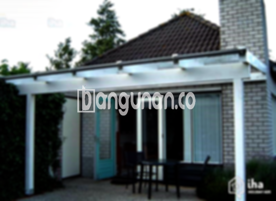

**Jasa Pasang Kanopi Rumah Minimalis di Kemanggisan Jakarta** – Bagi Mitra Bangunan di Kemanggisan Jakarta, memiliki area luar ruangan yang terlindungi dari cuaca merupakan investasi penting untuk kenyamanan dan estetika rumah. Kanopi adalah solusi efektif untuk melindungi teras, garasi, atau area outdoor lainnya dari hujan, panas, dan sinar ultraviolet. Kami menyediakan layanan pemasangan kanopi rumah minimalis dengan kualitas terjamin dan harga yang bersaing.

Kanopi yang dirancang dengan baik tidak hanya memberikan perlindungan, tetapi juga meningkatkan nilai visual rumah Anda. Dengan berbagai pilihan desain dan material, Anda dapat menemukan kanopi yang paling sesuai dengan gaya arsitektur dan preferensi pribadi Anda.



## Keuntungan Menggunakan Jasa Pasang Kanopi Rumah Minimalis di Kemanggisan Jakarta

Ada berbagai manfaat yang bisa Anda dapatkan dengan menggunakan jasa pemasangan kanopi rumah minimalis. Berikut adalah beberapa keuntungan utamanya:

### Pilihan Desain yang Beragam

Kami menawarkan beragam pilihan desain kanopi rumah yang dapat Anda pilih. Mulai dari model sederhana hingga desain yang lebih kompleks dan unik, Anda dapat menemukan kanopi yang sesuai dengan selera dan gaya rumah Anda. Setiap orang memiliki preferensi berbeda, dan Anda dapat mewujudkan desain yang Anda inginkan dengan bantuan tim ahli kami.

### Material Berkualitas dan Ramah Lingkungan

Kami menggunakan material berkualitas tinggi dan ramah lingkungan dalam pembuatan kanopi. Material yang kami gunakan tahan lama, kokoh, dan tidak berbahaya bagi kesehatan Anda maupun lingkungan sekitar. Proses pembuatan yang kami lakukan juga memperhatikan aspek keberlanjutan lingkungan.

### Struktur Kuat dan Tahan Lama

Kanopi yang kami pasang dibuat dengan konstruksi yang kuat dan tahan lama. Material yang kuat dan proses pemasangan yang teliti memastikan kanopi tersebut dapat bertahan selama bertahun-tahun, bahkan dalam kondisi cuaca ekstrem sekalipun. Perawatan yang rutin juga dapat memperpanjang umur pakai kanopi Anda.

### Meningkatkan Keamanan dan Kenyamanan

Kanopi memberikan perlindungan ekstra bagi area di bawahnya, menjadikannya lebih aman dan nyaman untuk digunakan. Kanopi melindungi dari paparan langsung sinar matahari dan hujan, sehingga Anda dapat menikmati area outdoor rumah Anda tanpa khawatir terpapar cuaca buruk.

### Harga Terjangkau dan Bersaing

Kami menawarkan harga yang kompetitif dan terjangkau untuk jasa pemasangan kanopi rumah minimalis di Kemanggisan Jakarta. Kami percaya bahwa setiap orang berhak mendapatkan perlindungan yang berkualitas tanpa harus mengeluarkan biaya yang terlalu mahal. Kami menawarkan berbagai pilihan material dan desain dengan harga yang bervariasi, sehingga Anda dapat menemukan solusi yang sesuai dengan anggaran Anda.

## Harga dan Jasa Pemasangan Kanopi Rumah Minimalis di Kemanggisan Jakarta



Penggunaan kanopi semakin populer di kalangan pemilik rumah di Kemanggisan Jakarta. Banyak orang menyadari manfaat kanopi dalam melindungi berbagai area rumah, seperti garasi, teras, jendela, dan area outdoor lainnya. Pemasangan kanopi juga dapat meningkatkan nilai estetika rumah Anda.

Harga kanopi rumah dapat bervariasi tergantung pada beberapa faktor, seperti jenis material, ukuran, desain, dan tingkat kesulitan pemasangan. Secara umum, harga kanopi rumah minimalis berkisar antara Rp 450.000 hingga Rp 800.000 per meter persegi untuk kualitas sedang. Namun, harga dapat lebih tinggi jika Anda memilih material premium atau desain yang lebih rumit.

Untuk mendapatkan penawaran harga yang akurat dan sesuai dengan kebutuhan Anda, sebaiknya Anda berkonsultasi dengan penyedia jasa pemasangan kanopi profesional. Kami siap memberikan konsultasi gratis dan penawaran harga terbaik untuk proyek kanopi rumah minimalis Anda di Kemanggisan Jakarta.

**Ref by:**  [Kanopi Rumah Minimalis Kemanggisan Jakarta](https://id.wikipedia.org/wiki/Kanopi)

Mitra Bangunan yang ingin meningkatkan kenyamanan dan estetika rumah dengan kanopi berkualitas, jangan ragu untuk menghubungi kami. Kami siap membantu Anda dalam memilih desain, material, dan memastikan pemasangan yang rapi dan profesional di Kemanggisan Jakarta. Hubungi kami melalui tombol WhatsApp atau Telepon yang tersedia di halaman situs kami untuk konsultasi dan penawaran harga terbaik.