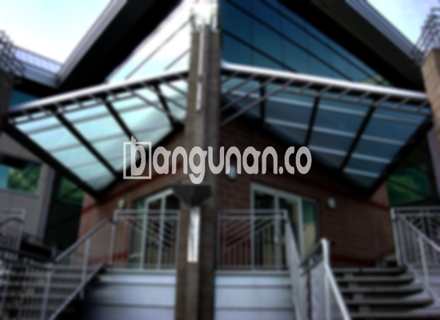

**Jasa Pasang Kanopi Rumah Minimalis di Kemayoran Jakarta** – Mitra Bangunan yang ingin meningkatkan kenyamanan dan estetika rumah di Kemayoran Jakarta, kanopi adalah solusi tepat. Sebagai pelindung efektif dari cuaca ekstrem, kanopi tidak hanya melindungi teras dan garasi, tetapi juga memberikan sentuhan modern pada hunian Anda. Kami menyediakan layanan pembuatan dan pemasangan kanopi berkualitas dengan harga terjangkau.

Ada begitu banyak pilihan model kanopi yang bisa Anda pertimbangkan untuk bangunan Anda. Setiap varian memiliki keunggulan masing-masing, baik dari segi material, kualitas, maupun harga. Memilih kanopi yang tepat akan memberikan manfaat jangka panjang bagi kenyamanan rumah Anda.



## Keunggulan Memilih Jasa Pasang Kanopi Rumah Minimalis di Kemayoran Jakarta

Bagi Anda yang mempertimbangkan pemasangan kanopi untuk rumah atau bangunan komersial, berikut beberapa keunggulan yang bisa Anda dapatkan:

###  Pilihan Model yang Beragam dari Jasa Pasang Kanopi Rumah Minimalis di Kemayoran Jakarta

Kami menawarkan beragam model kanopi yang dapat disesuaikan dengan selera dan kebutuhan Anda. Setiap orang memiliki preferensi tersendiri dalam memilih desain kanopi. Anda dapat memilih dari berbagai bentuk, seperti persegi, persegi panjang, atau bahkan desain khusus sesuai keinginan.

### Material Ramah Lingkungan dari Jasa Pasang Kanopi Rumah Minimalis di Kemayoran Jakarta

Kanopi yang kami gunakan terbuat dari material yang aman dan tidak berbahaya bagi lingkungan. Hal ini menjadikannya pilihan yang bertanggung jawab untuk mempercantik rumah Anda. Kanopi juga mudah dibersihkan, sehingga Anda tidak perlu khawatir tentang perawatan yang rumit.

### Daya Tahan dan Kekuatan dari Jasa Pasang Kanopi Rumah Minimalis di Kemayoran Jakarta

Salah satu keunggulan utama kanopi kami adalah daya tahan dan kekuatannya. Kami hanya menggunakan material berkualitas tinggi yang mampu menahan berbagai kondisi cuaca. Investasi pada kanopi yang kokoh akan memberikan perlindungan jangka panjang untuk properti Anda.

Anda akan merasakan sendiri bahwa kanopi yang kami pasang dapat bertahan hingga bertahun-tahun. Tentu saja, perawatan yang baik juga akan memperpanjang usia pakainya.

### Keamanan Terjamin dari Jasa Pasang Kanopi Rumah Minimalis di Kemayoran Jakarta

Keamanan adalah prioritas utama kami. Kanopi yang kami pasang akan melindungi area di bawahnya dari berbagai elemen cuaca. Dengan memiliki kanopi, Anda dapat menciptakan ruang yang aman dan nyaman untuk bersantai atau menjalankan aktivitas luar ruangan.

Kanopi melindungi dari paparan sinar matahari langsung dan hujan, sehingga Anda dapat menikmati area outdoor rumah Anda tanpa khawatir.

### Harga yang Kompetitif untuk Kanopi Rumah Minimalis di Kemayoran Jakarta

Kami memahami pentingnya anggaran dalam setiap proyek pembangunan. Oleh karena itu, kami menawarkan harga yang kompetitif untuk layanan pemasangan kanopi rumah minimalis di Kemayoran Jakarta. Harga akan bervariasi tergantung pada model kanopi yang Anda pilih dan ukuran area yang akan ditutup.

## Harga dan Jasa Pemasangan Kanopi Rumah Minimalis di Kemayoran Jakarta



Banyak pemilik rumah di Kemayoran Jakarta yang kini menggunakan kanopi untuk berbagai keperluan, mulai dari melindungi garasi mobil hingga menciptakan area parkir yang teduh. Pilihan penggunaan kanopi sangat bergantung pada kebutuhan spesifik Anda.

Untuk informasi lebih rinci mengenai perkiraan biaya, silakan hubungi tim kami. Kami akan dengan senang hati memberikan konsultasi dan penawaran harga yang sesuai dengan kebutuhan Anda.

Selain kualitas material, luas area yang akan dicakup juga memengaruhi harga akhir pemasangan kanopi. Pastikan Anda memilih ukuran yang tepat agar sesuai dengan kebutuhan dan anggaran Anda.

Mempercayakan pemasangan kanopi kepada penyedia jasa profesional akan menghemat waktu dan tenaga Anda. Kami menawarkan layanan pemasangan yang cepat, efisien, dan berkualitas tinggi.

Demikian informasi mengenai Jasa Pasang Kanopi Rumah Minimalis di Kemayoran Jakarta yang dapat kami sampaikan. Mitra Bangunan yang ingin berkonsultasi lebih lanjut atau mendapatkan penawaran harga terbaik, jangan ragu untuk menghubungi kami melalui tombol WhatsApp atau Telepon yang tersedia di halaman ini. Kami siap membantu Anda mewujudkan hunian yang nyaman dan terlindungi.

**Ref by:**  [Kanopi Rumah Minimalis Kemayoran Jakarta](https://id.wikipedia.org/wiki/Kanopi)