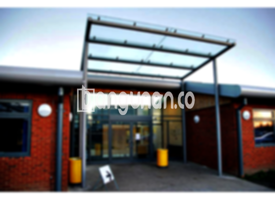

**Jasa Pasang Kanopi Rumah Minimalis di Kembangan Jakarta** – Mitra Bangunan yang ingin melindungi teras atau area parkir dari cuaca ekstrem di Kembangan Jakarta tidak perlu lagi khawatir. Kanopi adalah solusi praktis untuk menciptakan kenyamanan dan estetika hunian Anda. Kami menyediakan jasa pembuatan dan pemasangan kanopi dengan berbagai pilihan material dan desain yang sesuai dengan kebutuhan Anda.

Menggunakan kanopi untuk rumah atau bangunan komersial adalah investasi cerdas. Tersedia beragam model kanopi yang dapat Anda pilih, memastikan ada yang cocok dengan gaya dan anggaran Anda. Baik dari segi bahan, kualitas, maupun harga, setiap kanopi memiliki keunggulannya masing-masing. Pastikan Anda memilih kanopi yang paling ideal untuk properti Anda.



## Keunggulan Menggunakan Jasa Pasang Kanopi Rumah Minimalis di Kembangan Jakarta

Bagi Anda yang mempertimbangkan penggunaan kanopi untuk bangunan Anda, berikut adalah beberapa keunggulan yang bisa Anda dapatkan:

### – Beragam Pilihan Model dari Jasa Pasang Kanopi Rumah Minimalis di Kembangan Jakarta

Salah satu pertimbangan utama saat membeli kanopi adalah model yang tersedia. Kami menawarkan berbagai jenis kanopi rumah yang dapat Anda pilih sesuai dengan preferensi estetika Anda. Setiap orang memiliki selera yang berbeda, dan kami berusaha mengakomodasi semua kebutuhan desain. Anda dapat memilih dari berbagai bentuk, seperti persegi, persegi panjang, dan lain-lain.

### – Material Ramah Lingkungan dari Jasa Pasang Kanopi Rumah Minimalis di Kembangan Jakarta

Kanopi yang kami gunakan terbuat dari material yang tidak berbahaya bagi lingkungan, menjadikannya pilihan yang bertanggung jawab dan berkelanjutan. Penggunaan kanopi akan membantu menciptakan lingkungan yang lebih hijau. Selain itu, kanopi kami mudah dibersihkan dan dirawat, sehingga Anda tidak perlu khawatir tentang kotoran yang menumpuk.

### – Daya Tahan dan Kekuatan Jasa Pasang Kanopi Rumah Minimalis di Kembangan Jakarta

Salah satu keunggulan utama dari kanopi kami adalah daya tahan dan kekuatannya. Kami menggunakan bahan-bahan berkualitas tinggi yang tahan terhadap cuaca ekstrem dan penggunaan jangka panjang. Hal ini menjadikan kanopi sebagai solusi atap yang efisien dan awet. Kanopi kami dapat bertahan selama bertahun-tahun dengan perawatan yang tepat.

Anda dapat membuktikan sendiri kekuatan kanopi rumah yang dapat bertahan hingga puluhan tahun. Perawatan rutin akan memperpanjang umur pakainya dan memastikan kualitasnya tetap terjaga.

### – Keamanan Terjamin dari Jasa Pasang Kanopi Rumah Minimalis di Kembangan Jakarta

Keamanan adalah prioritas utama kami. Kanopi yang kami pasang berfungsi sebagai pelindung yang efektif terhadap berbagai elemen cuaca, seperti sinar matahari dan hujan. Dengan kanopi, area di bawahnya terlindungi dengan baik, memberikan Anda ketenangan pikiran.

Kanopi kami dapat melindungi halaman depan rumah Anda dari paparan langsung sinar matahari dan hujan, menciptakan ruang yang nyaman dan aman. Keamanan yang terjamin ini akan membuat Anda merasa lebih nyaman dan puas dengan investasi Anda.

### – Harga Terjangkau Kanopi Rumah Minimalis di Kembangan Jakarta

Ketika berbicara tentang harga, kanopi rumah kami menawarkan nilai yang sangat baik untuk kualitas yang Anda dapatkan. Meski harga bervariasi tergantung pada jenis kanopi yang dipilih, kami berkomitmen untuk memberikan opsi yang sesuai dengan anggaran Anda. Kami menyarankan Anda untuk memeriksa tabel harga yang tersedia.

## Harga dan Jasa Pemasangan Kanopi Rumah Minimalis di Kembangan Jakarta



Apakah Anda sudah mempertimbangkan untuk memasang kanopi di rumah Anda? Banyak pemilik properti di Kembangan Jakarta yang telah memanfaatkan manfaat dari kanopi. Kanopi dapat diaplikasikan untuk berbagai keperluan, seperti melindungi garasi mobil, area parkir, atau bahkan sebagai penutup jendela. Pemilihan fungsi kanopi sepenuhnya tergantung pada kebutuhan Anda.

Untuk informasi lebih lanjut mengenai harga, silakan lihat tabel yang tersedia. Kami menyediakan jasa pemasangan kanopi profesional di Kembangan Jakarta untuk memastikan pemasangan yang cepat dan efisien. Dengan menggunakan jasa kami, Anda dapat langsung menikmati manfaat kanopi yang telah dipasang dengan sempurna.

Begitulah informasi mengenai Jasa Pasang Kanopi Rumah Minimalis di Kembangan Jakarta yang dapat kami sampaikan. Mitra Bangunan yang sedang mencari solusi perlindungan dan estetika untuk hunian di Kembangan Jakarta, hubungi kami melalui tombol WhatsApp atau Telepon yang tersedia di halaman ini untuk konsultasi dan penawaran terbaik. Semoga informasi ini bermanfaat bagi Anda, dan terima kasih atas perhatiannya.

**Ref by:**  [Kanopi Rumah Minimalis Kembangan Jakarta](https://id.wikipedia.org/wiki/Kanopi)