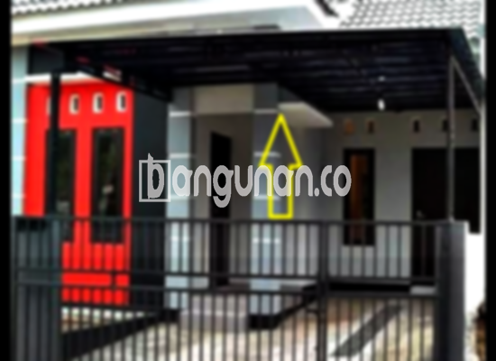

**Jasa Pasang Kanopi Rumah Minimalis di Kemiri Muka Depok** – Memiliki area luar rumah yang teduh dan nyaman adalah impian setiap keluarga. Kanopi hadir sebagai solusi ideal untuk melindungi teras, garasi, atau area terbuka lainnya dari panas matahari dan hujan. Mitra Bangunan di Kemiri Muka Depok menyediakan layanan pemasangan kanopi rumah minimalis dengan kualitas terjamin dan harga yang bersaing.

Kanopi tidak hanya berfungsi sebagai pelindung, tetapi juga dapat mempercantik tampilan fasad rumah Anda. Dengan berbagai pilihan desain dan material, Anda dapat menemukan kanopi yang sesuai dengan gaya arsitektur rumah Anda.



## Keunggulan Memilih Jasa Pasang Kanopi Rumah Minimalis di Kemiri Muka Depok

Jika Anda mempertimbangkan untuk memasang kanopi di rumah Anda di Kemiri Muka Depok, ada beberapa keunggulan yang bisa Anda dapatkan:

### \- Pilihan Desain Kanopi yang Beragam

Kami menawarkan berbagai macam model kanopi rumah yang dapat Anda pilih. Anda dapat menyesuaikan desain kanopi dengan selera pribadi dan gaya arsitektur rumah Anda. Pilihan desain meliputi persegi, persegi panjang, melengkung, dan masih banyak lagi.

### \- Material Berkualitas dan Ramah Lingkungan

Kanopi yang kami gunakan terbuat dari material yang berkualitas tinggi dan ramah lingkungan. Bahan-bahan ini tidak hanya tahan lama, tetapi juga aman bagi kesehatan Anda dan keluarga. Selain itu, material yang digunakan mudah dibersihkan dan dirawat.

### \- Ketahanan dan Kekuatan Terjamin

Salah satu keunggulan utama kanopi yang kami pasang adalah ketahanan dan kekuatannya. Material berkualitas dan proses pemasangan yang tepat memastikan kanopi Anda dapat bertahan lama bahkan dalam kondisi cuaca ekstrem.

Kanopi kami dirancang untuk tahan terhadap angin kencang, hujan deras, dan paparan sinar matahari langsung. Investasi dalam kanopi berkualitas akan membawa manfaat jangka panjang bagi Anda.

### \- Keamanan dan Kenyamanan Optimal

Kanopi memberikan perlindungan optimal terhadap cuaca buruk, sehingga Anda dan keluarga dapat menikmati area luar rumah dengan nyaman. Kanopi melindungi Anda dari sengatan matahari, hujan, dan debu, menciptakan lingkungan yang lebih sehat dan menyenangkan.

Dengan kanopi, Anda dapat menggunakan teras atau garasi Anda sepanjang tahun tanpa khawatir dengan perubahan cuaca.

### \- Solusi Ekonomis untuk Perlindungan Rumah

Kami menawarkan harga yang kompetitif untuk jasa pemasangan kanopi rumah minimalis di Kemiri Muka Depok. Harga kanopi yang kami tawarkan akan disesuaikan dengan jenis material, ukuran, dan desain yang Anda pilih.

## Informasi Harga dan Jasa Pemasangan Kanopi Rumah Minimalis di Kemiri Muka Depok



Banyak pemilik rumah di Kemiri Muka Depok kini memilih untuk memasang kanopi guna meningkatkan kenyamanan dan keamanan hunian mereka. Kanopi dapat diaplikasikan pada berbagai area, mulai dari garasi mobil, area parkir, hingga penutup jendela. Pilihan penggunaan kanopi sangat bergantung pada kebutuhan spesifik Anda.

Untuk mendapatkan informasi lengkap mengenai harga dan jenis kanopi yang sesuai dengan kebutuhan Anda, silakan hubungi tim kami. Kami akan dengan senang hati memberikan konsultasi gratis dan penawaran terbaik.

Memilih penyedia jasa pemasangan kanopi profesional akan memastikan pekerjaan dilakukan dengan cepat, efisien, dan rapi. Dengan begitu, Anda dapat segera menikmati manfaat kanopi baru Anda.

**Ref by:**  [Kanopi Rumah Minimalis Kemiri Muka Depok](https://id.wikipedia.org/wiki/Kanopi)

Mitra Bangunan siap membantu Anda mewujudkan area luar rumah yang nyaman dan terlindungi di Kemiri Muka Depok. Hubungi kami melalui tombol WhatsApp atau Telepon di halaman ini untuk mendapatkan penawaran harga terbaik dan layanan pemasangan kanopi rumah minimalis yang berkualitas.