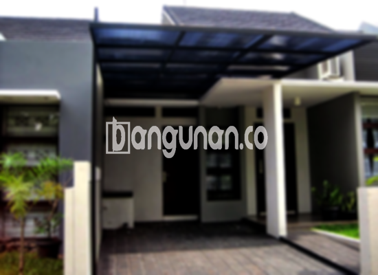

**Jasa Pasang Kanopi Rumah Minimalis di Kemiri Tangerang** – Memiliki kanopi yang kokoh dan estetik adalah investasi penting bagi setiap pemilik rumah di Kemiri Tangerang. Kanopi tidak hanya melindungi teras, garasi, atau area luar ruangan dari cuaca ekstrem, tetapi juga meningkatkan nilai estetika properti Anda. Mitra Bangunan hadir sebagai solusi terpercaya untuk memenuhi kebutuhan kanopi rumah minimalis Anda dengan layanan yang berkualitas dan terjangkau.

Untuk mewujudkan kanopi impian Anda, Anda bisa mempercayakannya pada layanan profesional atau membeli material yang dibutuhkan. Banyak sekali pilihan kanopi rumah yang tersedia, masing-masing dengan keunggulan unik dalam hal material, kualitas, dan harga. Penting untuk memilih kanopi yang paling sesuai dengan kebutuhan dan anggaran Anda.



## Keunggulan Menggunakan Jasa Pasang Kanopi Rumah Minimalis di Kemiri Tangerang

Bagi Anda yang mempertimbangkan penggunaan kanopi untuk properti Anda, berikut adalah beberapa manfaat utama yang bisa Anda peroleh:

### – Beragam Pilihan Model dari Jasa Pasang Kanopi Rumah Minimalis di Kemiri Tangerang

Dalam memilih kanopi, variasi model adalah faktor penting. Anda akan menemukan berbagai desain kanopi rumah yang dapat disesuaikan dengan gaya arsitektur dan preferensi pribadi Anda. Setiap orang memiliki selera yang berbeda dalam menentukan tampilan kanopi ideal untuk rumah mereka. Pilihan model yang tersedia mencakup bentuk persegi, persegi panjang, dan berbagai variasi lainnya.

### – Material Ramah Lingkungan dari Jasa Pasang Kanopi Rumah Minimalis di Kemiri Tangerang

Kanopi yang kami gunakan dibuat dari material yang tidak berbahaya, menjadikannya pilihan yang ramah lingkungan. Penggunaan kanopi berkontribusi pada keberlanjutan lingkungan, terutama karena materialnya mudah dibersihkan dan dirawat.

### – Daya Tahan dan Kekokohan Jasa Pasang Kanopi Rumah Minimalis di Kemiri Tangerang

Salah satu keunggulan utama kanopi kami adalah daya tahan dan kekokohannya. Hal ini dicapai melalui penggunaan material berkualitas tinggi yang dirancang untuk memberikan perlindungan optimal selama bertahun-tahun. Investasi pada kanopi yang kokoh akan menghemat biaya perawatan dan penggantian di masa depan.

Anda dapat mengandalkan kanopi rumah kami untuk bertahan puluhan tahun dengan perawatan yang tepat. Perawatan rutin akan memperpanjang umur dan menjaga kualitas kanopi Anda.

### – Keamanan Terjamin dari Jasa Pasang Kanopi Rumah Minimalis di Kemiri Tangerang

Keamanan adalah prioritas utama. Kanopi yang terpasang dengan benar akan memberikan perlindungan yang signifikan terhadap elemen cuaca seperti sinar matahari dan hujan. Hal ini menciptakan lingkungan yang lebih aman dan nyaman di bawahnya, baik untuk pekarangan depan rumah, teras, maupun area lainnya.

Dengan kanopi, Anda dapat menikmati area luar ruangan Anda tanpa khawatir terpapar cuaca ekstrem. Keamanan yang terjamin akan memberikan ketenangan pikiran bagi Anda dan keluarga.

### – Harga yang Kompetitif untuk Kanopi Rumah Minimalis di Kemiri Tangerang

Selain kualitas yang unggul, kami juga menawarkan harga yang kompetitif untuk kanopi rumah minimalis di Kemiri Tangerang. Harga akan bervariasi tergantung pada jenis dan spesifikasi kanopi yang Anda pilih.

## Harga dan Jasa Pemasangan Kanopi Rumah Minimalis di Kemiri Tangerang



Banyak orang di Kemiri Tangerang yang kini memilih untuk memasang kanopi di rumah mereka. Baik digunakan untuk melindungi garasi mobil, area parkir, atau sebagai penutup jendela, kanopi menawarkan solusi praktis dan estetis. Pemilihan jenis kanopi akan bergantung pada kebutuhan spesifik Anda.

Untuk mendapatkan informasi harga terkini serta penawaran terbaik, silakan hubungi tim kami. Kami akan dengan senang hati membantu Anda memilih kanopi yang sesuai dengan anggaran dan kebutuhan Anda.

Dengan menggunakan jasa pemasangan profesional, Anda dapat memastikan bahwa kanopi terpasang dengan cepat dan efisien. Hal ini akan memungkinkan Anda untuk segera menikmati manfaat dari kanopi baru Anda.

Itulah informasi mengenai Jasa Pasang Kanopi Rumah Minimalis di Kemiri Tangerang yang dapat kami sampaikan. Mitra Bangunan siap membantu Anda mewujudkan hunian yang nyaman dan terlindungi. Hubungi kami melalui tombol WhatsApp atau Telepon di halaman ini untuk konsultasi gratis dan penawaran harga terbaik.

**Ref by:**  [Kanopi Rumah Minimalis Kemiri Tangerang](https://id.wikipedia.org/wiki/Kanopi)