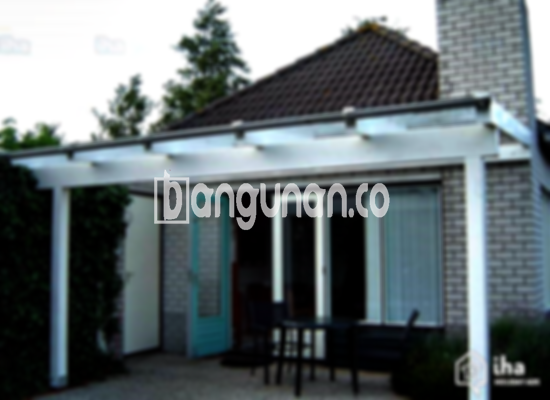

**Jasa Pasang Kanopi Rumah Minimalis di Kenari Jakarta** – Memiliki area luar ruangan yang terlindungi dari cuaca ekstrem adalah kebutuhan penting bagi setiap pemilik rumah di Kenari Jakarta. Mitra Bangunan memahami kebutuhan ini dan hadir sebagai solusi tepat untuk melindungi teras, carport, atau area depan rumah Anda dengan kanopi berkualitas. Kami menyediakan jasa pemasangan kanopi rumah minimalis yang terjangkau dan sesuai dengan gaya arsitektur rumah Anda.

Berbagai jenis kanopi tersedia untuk memenuhi kebutuhan spesifik Anda. Mulai dari kanopi baja ringan yang ekonomis hingga kanopi kaca yang elegan, kami menawarkan beragam pilihan yang dapat Anda sesuaikan dengan preferensi dan anggaran Anda. Memilih kanopi yang tepat akan meningkatkan nilai estetika rumah Anda sekaligus memberikan perlindungan optimal dari panas matahari dan hujan.



## Keuntungan Menggunakan Jasa Pasang Kanopi Rumah Minimalis di Kenari Jakarta

Memilih layanan profesional untuk pemasangan kanopi memberikan banyak keuntungan bagi Anda. Berikut beberapa keunggulan yang dapat Anda peroleh:

### \- Pilihan Model Kanopi yang Beragam

Kami menawarkan beragam model kanopi rumah yang dapat Anda pilih sesuai dengan selera dan desain rumah Anda di Kenari Jakarta. Anda bebas menentukan bentuk, ukuran, dan gaya kanopi yang paling sesuai dengan kebutuhan Anda. Beberapa pilihan populer meliputi kanopi persegi, persegi panjang, lengkung, dan lainnya.

### \- Material Berkualitas dan Ramah Lingkungan

Kami hanya menggunakan material berkualitas tinggi yang tahan lama dan ramah lingkungan untuk pembuatan kanopi. Bahan-bahan ini tidak hanya memberikan perlindungan optimal, tetapi juga aman bagi kesehatan Anda dan keluarga. Selain itu, material yang digunakan mudah dibersihkan dan dirawat.

### \- Konstruksi Kuat dan Tahan Lama

Kanopi yang kami pasang dirancang untuk memiliki kekuatan dan ketahanan yang optimal. Material berkualitas tinggi dikombinasikan dengan teknik pemasangan yang tepat memastikan kanopi Anda dapat bertahan lama bahkan dalam kondisi cuaca yang ekstrem. Anda dapat menikmati perlindungan yang andal selama bertahun-tahun.

### \- Keamanan dan Kenyamanan Terjamin

Kanopi yang terpasang dengan benar memberikan rasa aman dan nyaman bagi Anda dan keluarga. Kanopi melindungi area di bawahnya dari paparan langsung sinar matahari, hujan, dan angin kencang. Dengan demikian, Anda dapat menikmati aktivitas di luar ruangan tanpa khawatir akan cuaca buruk.

### \- Harga Kompetitif dan Transparan

Kami menawarkan harga yang kompetitif dan transparan untuk jasa pemasangan kanopi rumah minimalis di Kenari Jakarta. Anda akan mendapatkan penawaran harga yang jelas dan terperinci sebelum pekerjaan dimulai. Kami juga tidak mengenakan biaya tersembunyi.

## Informasi Harga dan Jasa Pemasangan Kanopi Rumah Minimalis di Kenari Jakarta



Banyak pemilik rumah di Kenari Jakarta yang kini menyadari pentingnya memiliki kanopi sebagai pelengkap rumah. Kanopi dapat digunakan untuk berbagai keperluan, seperti melindungi kendaraan di garasi, menciptakan ruang santai di teras, atau menutupi jendela agar terhindar dari panas dan hujan.

Harga kanopi rumah bervariasi tergantung pada jenis material, ukuran, dan kompleksitas desain. Untuk mendapatkan informasi lebih detail mengenai harga, Anda dapat menghubungi kami. Tim kami akan dengan senang hati memberikan penawaran harga yang sesuai dengan kebutuhan Anda.

Selain harga, penting juga untuk mempertimbangkan kualitas material dan keahlian pemasang. Memilih penyedia jasa pemasangan kanopi yang berpengalaman akan memastikan kanopi Anda terpasang dengan benar dan tahan lama. Kami menawarkan layanan pemasangan profesional yang dilakukan oleh tenaga ahli yang terampil dan berpengalaman.

Dengan kanopi yang tepat, Anda dapat meningkatkan fungsionalitas dan estetika rumah Anda serta menciptakan ruang luar ruangan yang nyaman dan aman. Jangan ragu untuk menghubungi kami untuk konsultasi gratis dan penawaran harga terbaik.

**Ref by:**  [Kanopi Rumah Minimalis Kenari Jakarta](https://id.wikipedia.org/wiki/Kanopi)

Mitra Bangunan siap membantu Anda mewujudkan hunian yang nyaman dan terlindungi dengan kanopi rumah minimalis berkualitas tinggi di Kenari Jakarta. Hubungi kami sekarang juga melalui tombol WhatsApp atau Telepon di halaman ini untuk mendapatkan pelayanan terbaik dan penawaran spesial!