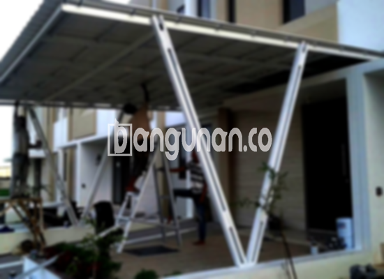

**Jasa Pasang Kanopi Rumah Minimalis di Kencana Bogor** – Kanopi adalah solusi praktis untuk melindungi area luar rumah Anda dari berbagai kondisi cuaca. Mulai dari hujan deras hingga terik matahari, kanopi menjadi pelindung yang efektif untuk teras, garasi, atau carport. Bagi Mitra Bangunan di Kencana Bogor, tidak perlu lagi khawatir mencari tukang yang tepat – Kami hadir untuk menyediakan jasa pemasangan kanopi berkualitas dan terjangkau untuk hunian Anda.

Kanopi tidak hanya berfungsi sebagai pelindung, tetapi juga dapat mempercantik tampilan fasad rumah Anda. Dengan berbagai pilihan desain dan material, Anda dapat memilih kanopi yang sesuai dengan gaya arsitektur rumah Anda.



## Keunggulan Menggunakan Jasa Pasang Kanopi Rumah Minimalis di Kencana Bogor

Ada beberapa keuntungan utama yang dapat Anda peroleh dengan menggunakan jasa pemasangan kanopi untuk properti Anda. Berikut adalah beberapa diantaranya:

### \- Tersedia Pilihan Model yang Beragam

Kami memahami bahwa setiap orang memiliki preferensi desain yang berbeda. Oleh karena itu, kami menyediakan beragam model kanopi rumah yang dapat Anda pilih sesuai dengan selera Anda. Anda dapat memilih dari berbagai bentuk, seperti persegi, persegi panjang, atau desain khusus lainnya.

### \- Material Ramah Lingkungan

Kami hanya menggunakan material yang aman dan ramah lingkungan dalam pembuatan kanopi. Hal ini memastikan bahwa kanopi Anda tidak hanya melindungi rumah Anda, tetapi juga berkontribusi pada kelestarian lingkungan. Material yang digunakan juga mudah dibersihkan, sehingga Anda tidak perlu khawatir tentang perawatan yang rumit.

### \- Daya Tahan dan Kekuatan Terjamin

Salah satu keunggulan utama kanopi yang kami pasang adalah daya tahan dan kekuatannya. Material berkualitas tinggi yang kami gunakan mampu menahan berbagai kondisi cuaca ekstrem dan memberikan perlindungan jangka panjang untuk rumah Anda. Anda dapat menikmati manfaatnya selama bertahun-tahun dengan perawatan yang tepat.

Anda dapat yakin bahwa kanopi rumah yang kami pasang akan bertahan lama. Keawetannya bergantung pada perawatan yang Anda lakukan; dengan pemeliharaan yang baik, kanopi Anda akan tetap berkualitas tinggi untuk waktu yang lama.

### \- Keamanan Optimal

Kanopi memberikan lapisan perlindungan tambahan bagi area di bawahnya. Baik dari sinar matahari yang menyengat maupun hujan yang deras, kanopi menjaga agar area tersebut tetap aman dan nyaman. Dengan demikian, Anda dapat menikmati area luar rumah Anda tanpa khawatir akan perubahan cuaca yang tiba-tiba.

Kanopi kami dirancang untuk memberikan keamanan maksimal. Halaman depan rumah Anda yang terlindungi oleh kanopi akan tetap aman dan nyaman dalam segala kondisi cuaca.

### \- Harga yang Bersahabat

Kami menawarkan harga yang kompetitif dan terjangkau untuk semua layanan pemasangan kanopi kami. Meskipun harga dapat bervariasi tergantung pada jenis kanopi yang Anda pilih, kami berkomitmen untuk memberikan penawaran terbaik yang sesuai dengan anggaran Anda. Kami percaya bahwa setiap orang berhak mendapatkan perlindungan dan kenyamanan tanpa harus mengeluarkan biaya yang mahal.

## Harga dan Jasa Pemasangan Kanopi Rumah Minimalis di Kencana Bogor



Banyak pemilik rumah di Kencana Bogor telah merasakan manfaat memiliki kanopi. Kanopi dapat diaplikasikan untuk berbagai keperluan, seperti melindungi garasi mobil, area parkir, atau bahkan sebagai penutup jendela. Pilihan penggunaan kanopi sangat beragam dan tergantung pada kebutuhan Anda.

Sebagai gambaran, harga kanopi rumah dengan kualitas sedang biasanya berkisar antara Rp 450.000 hingga Rp 800.000. Harga dapat meningkat jika Anda menginginkan material berkualitas premium.

Harga juga dipengaruhi oleh beberapa faktor, termasuk jenis kanopi yang dipilih dan ukuran area yang akan ditutupi. Kami sarankan Anda untuk berkonsultasi dengan tim kami untuk mendapatkan penawaran harga yang paling akurat dan sesuai dengan kebutuhan spesifik Anda.

Bagi Anda yang ingin memasang kanopi di rumah Anda, kami menyarankan untuk menggunakan jasa profesional. Dengan menggunakan jasa pemasangan, Anda dapat menghemat waktu dan tenaga, serta memastikan bahwa kanopi Anda dipasang dengan benar dan aman.

Itulah gambaran umum tentang jasa pasang kanopi rumah minimalis di Kencana Bogor. Jangan ragu untuk menghubungi kami guna mendapatkan layanan dan harga terbaik. Kami siap membantu Anda menciptakan area luar rumah yang nyaman dan terlindungi. Hubungi kami melalui tombol WhatsApp atau Telepon di halaman ini untuk informasi lebih lanjut. Mitra Bangunan berharap dapat segera membantu Anda!

**Ref by:**  [Kanopi Rumah Minimalis Kencana Bogor](https://id.wikipedia.org/wiki/Kanopi)