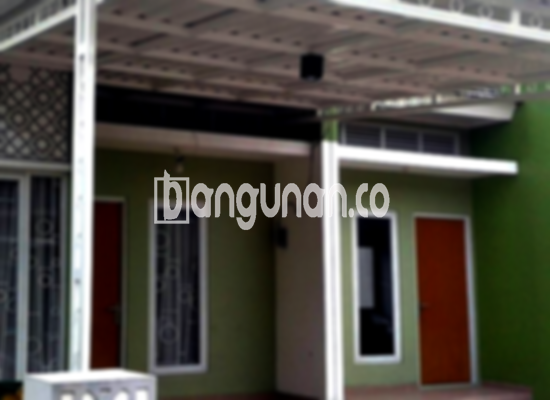

**Jasa Pasang Kanopi Rumah Minimalis di Kendari** – Mencari solusi perlindungan optimal untuk teras atau garasi rumah Anda di Kendari? Kanopi adalah jawaban tepat yang tidak hanya melindungi dari cuaca ekstrem, tetapi juga meningkatkan estetika bangunan. Mitra Bangunan di Kendari memahami betul kebutuhan akan kanopi berkualitas dengan harga terjangkau. Kami hadir sebagai penyedia jasa pemasangan kanopi rumah minimalis yang terpercaya.

Keberadaan kanopi rumah kini semakin penting, memberikan kenyamanan dan keamanan bagi properti Anda. Pemilihan model dan bahan kanopi yang tepat akan menentukan efektivitas perlindungan dan tampilan visual rumah Anda. Ada banyak pilihan yang tersedia, dan kami siap membantu Anda menentukan yang paling sesuai.



## Keunggulan Menggunakan Jasa Pasang Kanopi Rumah Minimalis di Kendari

Banyak manfaat yang akan Anda peroleh dengan memasang kanopi di rumah Anda. Berikut beberapa keunggulan yang dapat Anda rasakan:

### \- Beragam Pilihan Model Kanopi Rumah Minimalis di Kendari

Kami menawarkan beragam model kanopi rumah yang dapat Anda pilih sesuai dengan preferensi dan gaya arsitektur rumah Anda. Tersedia berbagai bentuk, mulai dari persegi, persegi panjang, hingga desain khusus yang unik. Anda dapat menyesuaikan pilihan agar sesuai dengan selera pribadi dan kebutuhan fungsional.

### \- Material Ramah Lingkungan untuk Kanopi Kendari

Kami mengutamakan penggunaan material yang ramah lingkungan dalam pembuatan kanopi. Bahan-bahan yang kami gunakan aman dan tidak berbahaya, sehingga berkontribusi pada lingkungan yang lebih sehat. Selain itu, material kanopi kami juga mudah dibersihkan dan dirawat.

### \- Ketahanan dan Kekuatan Terjamin

Kanopi yang kami pasang terbuat dari material berkualitas tinggi, menjamin kekuatan dan ketahanan terhadap cuaca ekstrem. Konstruksi yang kokoh memastikan kanopi dapat bertahan lama tanpa perlu sering diperbaiki. Anda dapat mengandalkan kanopi kami untuk melindungi properti Anda selama bertahun-tahun.

Anda akan merasakan sendiri kualitas dan ketahanan kanopi rumah yang kami pasang, yang dirancang untuk bertahan puluhan tahun. Perawatan rutin akan semakin memperpanjang umur pakainya.

### \- Keamanan dan Kenyamanan Optimal

Kanopi memberikan perlindungan ekstra terhadap area di bawahnya, melindungi Anda dari paparan langsung sinar matahari dan hujan. Hal ini menciptakan lingkungan yang lebih nyaman dan aman untuk berkumpul bersama keluarga atau melakukan aktivitas lain di luar ruangan.

Sebagai contoh, kanopi melindungi teras dari hujan deras atau sengatan matahari yang terik. Dengan demikian, area di bawah kanopi tetap nyaman untuk digunakan dalam berbagai kondisi cuaca.

### \- Investasi Terjangkau untuk Kenyamanan Jangka Panjang

Kami menawarkan solusi kanopi rumah minimalis dengan harga yang kompetitif. Kami percaya bahwa kualitas tidak harus mahal. Dengan harga yang terjangkau, Anda dapat menikmati kenyamanan dan perlindungan yang optimal untuk rumah Anda.

## Informasi Harga dan Jasa Pemasangan Kanopi Rumah Minimalis di Kendari



Banyak warga Kendari yang telah merasakan manfaat memiliki kanopi di rumah mereka, baik untuk garasi mobil, tempat parkir, atau sebagai pelindung jendela. Pemanfaatan kanopi bergantung pada kebutuhan spesifik Anda.

Untuk mendapatkan informasi harga terkini dan penawaran terbaik, silakan hubungi tim kami. Kami akan dengan senang hati memberikan konsultasi dan membantu Anda memilih kanopi yang paling sesuai dengan anggaran dan kebutuhan Anda.

Harga kanopi rumah juga dipengaruhi oleh beberapa faktor, seperti kualitas material, ukuran, dan kompleksitas desain. Semakin berkualitas material yang digunakan, semakin tinggi pula harganya. Selain itu, semakin besar ukuran kanopi yang dibutuhkan, semakin mahal biayanya. Pastikan Anda memilih ukuran yang sesuai dengan area yang ingin Anda lindungi.

Untuk Anda yang ingin memasang kanopi di Kendari, kami merekomendasikan untuk menggunakan jasa pemasangan profesional. Dengan bantuan tenaga ahli, pemasangan kanopi akan lebih cepat, rapi, dan efisien. Anda dapat langsung menikmati manfaat dari kanopi yang telah terpasang dengan sempurna.

**Ref by:**  [Kanopi Rumah Minimalis Kendari](https://id.wikipedia.org/wiki/Kanopi)

Demikian informasi mengenai jasa pasang kanopi rumah minimalis di Kendari. Mitra Bangunan siap membantu Anda mewujudkan kenyamanan dan keindahan hunian Anda. Jangan ragu untuk menghubungi kami melalui tombol WhatsApp atau Telepon di halaman ini untuk mendapatkan pelayanan dan harga terbaik.