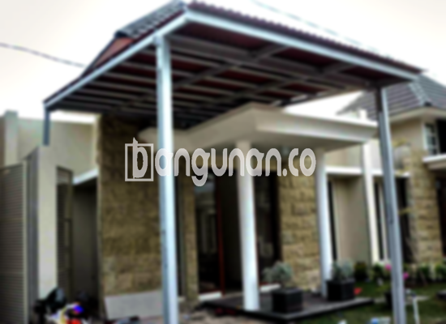

**Jasa Pasang Kanopi Rumah Minimalis di Kepanjen** – Mencari solusi perlindungan optimal untuk teras, garasi, atau area luar rumah Anda di Kepanjen? Kanopi adalah pilihan tepat untuk menghalau terik matahari dan hujan, sehingga Mitra Bangunan di Kepanjen dapat menikmati ruang luar dengan nyaman. Kami menyediakan jasa pembuatan dan pemasangan kanopi berkualitas dengan harga terjangkau.

Memilih kanopi yang tepat untuk rumah Anda memerlukan pertimbangan matang. Ada banyak opsi yang tersedia, masing-masing dengan keunggulan dan kekurangannya. Kami siap membantu Anda dalam memilih kanopi yang sesuai dengan kebutuhan dan anggaran Anda.



## Keuntungan Menggunakan Jasa Pasang Kanopi Rumah Minimalis di Kepanjen

Memilih layanan profesional untuk pemasangan kanopi menawarkan sejumlah keuntungan signifikan bagi Anda. Berikut adalah beberapa di antaranya:

### – Pilihan Model yang Beragam untuk Jasa Pasang Kanopi Rumah Minimalis di Kepanjen

Model kanopi sangat beragam, memungkinkan Anda menyesuaikan desain dengan gaya arsitektur rumah Anda. Apakah Anda menginginkan kanopi persegi, persegi panjang, atau dengan desain khusus, kami dapat mewujudkannya. Anda dapat memilih model yang paling sesuai dengan preferensi pribadi Anda.

### – Material Ramah Lingkungan dari Jasa Pasang Kanopi Rumah Minimalis di Kepanjen

Kami menggunakan material yang ramah lingkungan dalam pembuatan kanopi. Hal ini memastikan bahwa produk kami tidak hanya berkualitas, tetapi juga berkontribusi pada kelestarian lingkungan. Material yang digunakan juga mudah dibersihkan, sehingga perawatannya sangat praktis bagi Anda.

### – Daya Tahan dan Kekuatan Terjamin dari Jasa Pasang Kanopi Rumah Minimalis di Kepanjen

Kanopi yang kami pasang dibuat dengan material berkualitas tinggi, memastikan ketahanan dan kekuatan yang optimal. Konstruksi yang kokoh mampu bertahan terhadap berbagai kondisi cuaca ekstrem. Anda dapat mengandalkan kanopi kami untuk melindungi properti Anda selama bertahun-tahun.

Dengan perawatan yang tepat, kanopi ini bahkan dapat bertahan puluhan tahun. Investasi pada kanopi berkualitas adalah solusi jangka panjang yang menguntungkan.

### – Keamanan yang Optimal dari Jasa Pasang Kanopi Rumah Minimalis di Kepanjen

Kanopi memberikan lapisan perlindungan tambahan bagi area di bawahnya. Baik itu melindungi dari panas matahari yang menyengat, hujan deras, atau benda-benda yang jatuh, kanopi meningkatkan keamanan dan kenyamanan ruang luar Anda. Dengan kanopi, Anda dapat menikmati area luar rumah dengan lebih tenang dan tenang.

### – Harga yang Kompetitif untuk Kanopi Rumah Minimalis di Kepanjen

Kami menawarkan harga yang kompetitif untuk semua layanan pemasangan kanopi. Meski demikian, harga selalu bergantung pada jenis material dan kompleksitas desain yang dipilih. Kami berkomitmen untuk memberikan solusi yang terjangkau tanpa mengorbankan kualitas.

## Informasi Harga dan Jasa Pemasangan Kanopi Rumah Minimalis di Kepanjen



Banyak pemilik rumah di Kepanjen yang kini mengaplikasikan kanopi sebagai pelengkap bangunan mereka. Mulai dari melindungi garasi mobil, area parkir, hingga menutupi jendela, fungsi kanopi sangat beragam dan disesuaikan dengan kebutuhan spesifik Anda.

Harga kanopi rumah bervariasi, tergantung pada kualitas material dan desain yang dipilih. Untuk material standar, perkiraan biayanya mulai dari Rp 450.000 hingga Rp 800.000. Harga ini dapat lebih tinggi jika Anda memilih material premium yang menawarkan kualitas dan daya tahan yang lebih unggul.

Selain kualitas material, ukuran kanopi juga memengaruhi harga. Semakin luas area yang perlu ditutupi, semakin tinggi pula biaya yang dibutuhkan. Pastikan Anda mengukur area dengan tepat dan berkonsultasi dengan kami untuk mendapatkan estimasi harga yang akurat.

Jika Anda membutuhkan pemasangan kanopi untuk bangunan komersial, kami juga menyediakan layanan profesional. Tim ahli kami akan memastikan pemasangan dilakukan dengan cepat, efisien, dan sesuai standar keamanan.

Itulah informasi penting mengenai Jasa Pasang Kanopi Rumah Minimalis di Kepanjen yang dapat kami sampaikan. Mitra Bangunan yang sedang mencari solusi perlindungan optimal untuk rumah Anda, jangan ragu untuk menghubungi kami melalui tombol WhatsApp atau Telepon yang tersedia di halaman ini untuk mendapatkan layanan dan penawaran terbaik. Kami siap membantu Anda mewujudkan hunian yang nyaman dan terlindungi.

**Ref by:**  [Kanopi Rumah Minimalis Kepanjen](https://id.wikipedia.org/wiki/Kanopi)