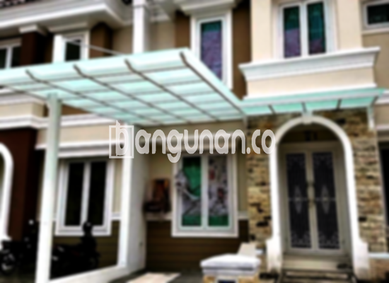

**Jasa Pasang Kanopi Rumah Minimalis di Klari Karawang** – Memiliki area luar rumah yang nyaman dan terlindungi dari cuaca ekstrem adalah dambaan setiap pemilik properti di Klari Karawang. Mitra Bangunan memahami betul kebutuhan ini, dan kami hadir sebagai solusi tepat untuk menciptakan ruang outdoor yang fungsional dan estetis melalui pemasangan kanopi berkualitas. Kami melayani pembuatan dan pemasangan kanopi untuk berbagai kebutuhan, mulai dari perlindungan teras dan carport, hingga mempercantik tampilan fasad rumah Anda.

Kanopi hadir dalam beragam material, memungkinkan Anda memilih yang paling sesuai dengan gaya arsitektur rumah dan anggaran yang tersedia. Beberapa opsi populer meliputi kanopi baja ringan yang praktis dan ekonomis, serta kanopi besi hollo yang menawarkan kekuatan dan desain yang beragam. Selain itu, tersedia pula kanopi kaca untuk tampilan modern dan elegan, serta kanopi polycarbonate yang memberikan pencahayaan alami sekaligus perlindungan dari sinar UV.

Bagi Anda yang memiliki bisnis atau usaha di Klari Karawang, kanopi juga sangat bermanfaat untuk melindungi area depan ruko dari panas matahari dan hujan, menciptakan lingkungan yang nyaman bagi pelanggan dan karyawan. Kanopi juga dapat meningkatkan nilai estetika bangunan Anda, memberikan kesan profesional dan menarik.



## Informasi Harga Kanopi Rumah Minimalis di Klari Karawang

Merencanakan anggaran untuk pemasangan kanopi adalah langkah penting dalam proyek renovasi atau pembangunan rumah Anda. Sebelum membuat keputusan pembelian, ada baiknya Anda memahami faktor-faktor yang memengaruhi harga kanopi rumah di Klari Karawang. Dengan memahami hal ini, Anda dapat membuat pilihan yang tepat sesuai dengan kebutuhan dan kemampuan finansial Anda.

Berikut beberapa faktor utama yang perlu Anda pertimbangkan:

### \- Jenis Bahan Kanopi yang Dipilih

Pemilihan material akan berdampak signifikan pada harga kanopi. Berbagai opsi, seperti besi, baja ringan, kaca, dan polycarbonate, memiliki karakteristik dan rentang harga yang berbeda. Kami siap membantu Anda memilih bahan yang paling sesuai dengan kebutuhan dan anggaran Anda.

### \- Desain dan Model Kanopi

Model kanopi yang Anda pilih juga akan memengaruhi biayanya. Desain yang lebih kompleks atau memerlukan konstruksi khusus tentu akan lebih mahal dibandingkan model yang sederhana. Tim kami siap memberikan konsultasi untuk membantu Anda menentukan desain yang sesuai dengan gaya rumah Anda.

### \- Luas Area yang Akan Ditutupi Kanopi

Ukuran kanopi merupakan faktor penentu utama dalam perhitungan harga. Semakin luas area yang perlu ditutupi, semakin banyak material yang dibutuhkan, dan semakin tinggi biayanya. Penting untuk melakukan pengukuran yang akurat sebelum melakukan pemesanan.

Untuk informasi harga yang lebih detail dan spesifik, silakan melihat tabel harga yang tersedia  atau hubungi tim kami untuk mendapatkan penawaran khusus.

## Pilihan Variasi Kanopi Rumah Minimalis di Klari Karawang

**Ref by:**  [Kanopi Rumah Minimalis Klari Karawang](https://id.wikipedia.org/wiki/Kanopi)

Kami menyediakan beragam pilihan kanopi rumah minimalis di Klari Karawang untuk memenuhi berbagai selera dan kebutuhan Anda. Salah satu material yang sangat direkomendasikan adalah kanopi baja ringan. Material ini menawarkan kombinasi ideal antara kekuatan, durabilitas, dan harga yang terjangkau.

### \- Keunggulan Kekuatan dan Ketahanan

Kanopi baja ringan dikenal karena kekuatannya yang luar biasa, mampu menahan beban angin kencang dan cuaca ekstrem lainnya. Dengan memilih kanopi baja ringan, Anda dapat yakin bahwa investasi Anda akan bertahan lama dan memberikan perlindungan optimal bagi rumah Anda.

### \- Fleksibilitas Desain yang Tinggi

Baja ringan sangat mudah dibentuk dan dimodifikasi, memungkinkan kami untuk menciptakan berbagai desain kanopi yang sesuai dengan preferensi Anda. Baik Anda menginginkan kanopi dengan bentuk sederhana atau desain yang lebih unik dan artistik, kami dapat mewujudkannya.

### \- Tingkat Keamanan yang Terjamin

Selain kuat dan tahan lama, kanopi baja ringan juga menawarkan tingkat keamanan yang tinggi. Material ini tidak mudah rusak atau pecah, sehingga meminimalkan risiko cedera akibat terjatuhnya bagian-bagian kanopi.

Dengan mempertimbangkan keunggulan-keunggulan tersebut, kanopi baja ringan menjadi pilihan yang sangat tepat bagi Anda yang mencari solusi perlindungan yang handal dan estetis untuk rumah Anda di Klari Karawang.

Mitra Bangunan siap membantu Anda mewujudkan hunian yang nyaman dan terlindungi dengan layanan pemasangan kanopi berkualitas. Jangan ragu untuk menghubungi kami melalui tombol WhatsApp atau Telepon di halaman ini untuk konsultasi gratis dan penawaran terbaik.

