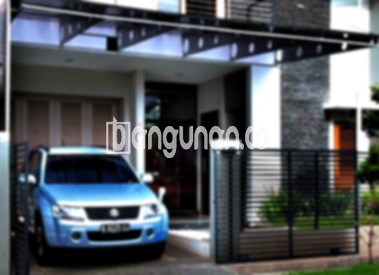

**Jasa Pasang Kanopi Rumah Minimalis di Klaten** – Mencari solusi perlindungan optimal untuk teras atau garasi rumah Anda di Klaten? Kanopi adalah jawaban tepat yang tidak hanya melindungi dari cuaca ekstrem, tetapi juga meningkatkan estetika hunian. Mitra Bangunan hadir sebagai penyedia jasa pemasangan kanopi berkualitas dan terjangkau, siap membantu mewujudkan kenyamanan rumah impian Anda.

Kanopi tersedia dalam beragam material, termasuk baja ringan dan besi hollo. Anda dapat memilih jenis kanopi yang paling sesuai dengan kebutuhan dan preferensi desain. Setiap material memiliki karakteristik unik yang menawarkan keunggulan tersendiri.

Bagi Anda yang membutuhkan kanopi untuk bangunan komersial, misalnya ruko, manfaat yang diperoleh sangatlah banyak. Salah satunya adalah perlindungan dari paparan langsung sinar matahari dan hujan lebat. Kanopi juga memberikan fungsi tambahan yang sangat bermanfaat bagi properti Anda.



## Harga Kanopi Rumah Minimalis di Klaten

Apakah Anda berencana memasang kanopi untuk rumah Anda? Sebelum melakukan pemesanan, penting untuk memahami kisaran harga kanopi terlebih dahulu. Dengan begitu, Anda dapat mempertimbangkan berbagai pilihan dan memilih kanopi yang paling sesuai dengan anggaran dan harapan Anda.

Harga kanopi dipengaruhi oleh beberapa faktor penting, di antaranya:

### - Material yang Digunakan oleh Jasa Pasang Kanopi Rumah Minimalis di Klaten

Pilihan material menjadi pertimbangan utama dalam memilih kanopi. Terdapat berbagai jenis material yang tersedia, seperti besi, baja ringan, dan lainnya. Anda dapat memilih jenis material yang paling cocok untuk rumah Anda. Setiap material menawarkan harga yang berbeda-beda.

### - Model Kanopi dari Jasa Pasang Kanopi Rumah Minimalis di Klaten

Model kanopi juga berperan penting dalam menentukan harga. Anda dapat memilih model yang sesuai dengan selera Anda, dengan beragam pilihan desain yang tersedia. Jika Anda membutuhkan inspirasi, Anda dapat mencari referensi di internet atau sumber lainnya.

### - Ukuran Kanopi

Selain jenis dan material, luas kanopi yang dibutuhkan juga memengaruhi harga. Setiap properti memiliki kebutuhan ukuran kanopi yang berbeda. Oleh karena itu, penting untuk melakukan pengukuran yang tepat untuk menentukan luas kanopi yang ideal. 

Dengan mempertimbangkan faktor-faktor tersebut, Anda akan dapat menemukan kanopi yang sesuai dengan kebutuhan dan anggaran Anda. Semakin tinggi kualitas material dan desain yang dipilih, semakin tinggi pula harga yang ditawarkan. 

## Rekomendasi Macam Kanopi Rumah Minimalis di Klaten



Bagi Anda yang ingin memasang kanopi untuk ruko atau bangunan komersial lainnya di Klaten, terdapat berbagai model kanopi yang bisa Anda pilih. Salah satu jenis kanopi yang sangat direkomendasikan adalah kanopi berbahan baja ringan. Material ini menawarkan keunggulan yang signifikan dibandingkan material lainnya. Berikut adalah beberapa keunggulannya:

### - Ketahanan yang Menjadi Keunggulan Utama

Setiap orang yang membeli kanopi tentu mengharapkan kekuatan dan daya tahan yang optimal. Kanopi yang terbuat dari bahan galvalum dikenal memiliki kualitas yang sangat baik. Kekuatannya terjamin dan tahan lama, sehingga memberikan perlindungan jangka panjang.

Banyak pelanggan yang telah membuktikan kekuatan kanopi berbahan baja ringan. Bahkan, kanopi ini dapat bertahan selama puluhan tahun dengan perawatan yang tepat.

### - Variasi Model yang Luas dari Jasa Pasang Kanopi Rumah Minimalis di Klaten

Bagi Anda yang ingin mempercantik tampilan rumah, Anda dapat memilih beragam model kanopi yang tersedia. Kanopi berbahan galvalum menawarkan fleksibilitas desain yang tinggi, sehingga Anda dapat menemukan model yang sesuai dengan gaya arsitektur rumah Anda. Keunggulan ini menjadikan kanopi galvalum sangat diminati.

### - Tingkat Keamanan yang Lebih Baik dari Jasa Pasang Kanopi Rumah Minimalis di Klaten

Bahan galvalum memiliki tingkat kekokohan yang tinggi, sehingga memberikan keamanan yang optimal. Anda dapat merasa tenang karena kanopi Anda tahan terhadap berbagai kondisi cuaca ekstrem. Risiko kerusakan atau roboh diminimalkan dengan penggunaan kanopi baja ringan.

Bagi Anda yang mencari kanopi untuk rumah di Klaten, kanopi yang terbuat dari bahan galvalum merupakan pilihan yang sangat efektif. Banyak keunggulan yang dapat Anda peroleh dengan menggunakan jenis kanopi ini.

**Ref by:**  [Kanopi Rumah Minimalis Klaten](https://id.wikipedia.org/wiki/Kanopi)

Demikian informasi yang dapat Kami sampaikan mengenai Jasa Pasang Kanopi Rumah Minimalis di Klaten. Untuk pemesanan dan konsultasi lebih lanjut, jangan ragu untuk menghubungi Kami melalui tombol WhatsApp atau Telepon yang tersedia di halaman ini. Mitra Bangunan siap membantu Anda mewujudkan kanopi impian Anda.