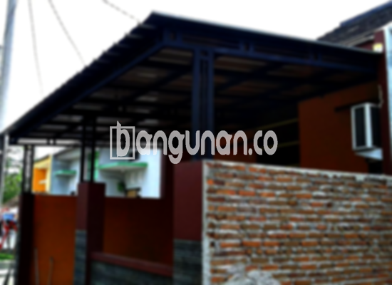

**Jasa Pasang Kanopi Rumah Minimalis di Klender Jakarta** – Memiliki area luar rumah yang nyaman dan terlindungi adalah impian setiap warga Klender Jakarta. Kanopi menjadi solusi praktis untuk menciptakan kenyamanan tersebut, melindungi dari panas matahari dan hujan. Mitra Bangunan di Klender Jakarta tidak perlu lagi khawatir mencari solusi terbaik untuk perlindungan area terbuka rumah Anda. Kami melayani pembuatan dan pemasangan kanopi berkualitas dengan harga terjangkau.

Kanopi hadir dalam berbagai jenis, termasuk kanopi galvalum dan kanopi besi hollo. Anda dapat memilih material yang paling sesuai dengan kebutuhan dan anggaran Anda. Masing-masing jenis kanopi menawarkan keunggulan dan kekurangan tersendiri, yang menjadikannya memiliki karakteristik unik.

Bagi Anda yang berencana memasang kanopi di hunian, terdapat beragam manfaat yang bisa Anda peroleh. Selain melindungi dari cuaca ekstrem, kanopi juga dapat meningkatkan nilai estetika rumah Anda. 



## Harga Kanopi Rumah Minimalis di Klender Jakarta

Tertarik untuk memasang kanopi di rumah Anda? Sebelum membuat keputusan, penting untuk memahami kisaran harga kanopi rumah terlebih dahulu. Dengan begitu, Anda dapat membandingkan berbagai opsi dan memilih kanopi yang paling sesuai dengan anggaran dan preferensi Anda.

Harga kanopi ditentukan oleh beberapa faktor utama, di antaranya:

### - Bahan yang Digunakan oleh Jasa Pasang Kanopi Rumah Minimalis di Klender Jakarta

Pilihan material merupakan pertimbangan penting dalam memilih kanopi. Material yang umum digunakan meliputi besi, baja ringan, dan lain sebagainya. Anda dapat memilih jenis material yang paling sesuai dengan kebutuhan dan anggaran Anda. Setiap material memiliki harga yang berbeda-beda.

### - Model Kanopi dari Jasa Pasang Kanopi Rumah Minimalis di Klender Jakarta

Desain atau model kanopi juga memengaruhi harga. Anda memiliki kebebasan untuk memilih model yang paling Anda sukai, dengan berbagai pilihan yang tersedia. Jika Anda masih bingung, Anda dapat mencari referensi desain di internet atau sumber lainnya.

### - Ukuran Kanopi

Selain model dan bahan, ukuran kanopi juga perlu diperhatikan. Setiap rumah memiliki kebutuhan ukuran kanopi yang berbeda. Pastikan Anda melakukan pengukuran yang akurat untuk menentukan panjang dan lebar kanopi yang dibutuhkan.

Dengan mempertimbangkan faktor-faktor tersebut, Anda akan mendapatkan kanopi yang sesuai dengan keinginan Anda. Perlu diingat bahwa kualitas yang lebih baik umumnya akan seiring dengan harga yang lebih tinggi. Informasi lebih lanjut mengenai harga dapat Anda peroleh dengan menghubungi tim kami.

## Rekomendasi Ragam Kanopi Rumah Minimalis di Klender Jakarta



Jika Anda sedang mempertimbangkan untuk memasang kanopi di rumah, ada banyak pilihan yang tersedia. Salah satu pilihan yang sangat direkomendasikan adalah kanopi berbahan baja ringan. Jenis kanopi ini memiliki beberapa keunggulan dibandingkan material lainnya. Berikut adalah beberapa keunggulannya:

### - Keawetan yang Menjadi Prioritas Utama

Ketika membeli kanopi, kekuatan dan daya tahannya adalah faktor penting yang perlu dipertimbangkan. Kanopi yang terbuat dari baja ringan dikenal akan kualitasnya yang sangat baik. Kekuatannya terjamin dan tahan lama.

Banyak orang telah membuktikan keawetan kanopi baja ringan. Bahkan, kanopi berbahan galvalum dapat bertahan puluhan tahun tanpa kehilangan kekokohannya.

### - Banyak Pilihan Model dari Jasa Pasang Kanopi Rumah Minimalis di Klender Jakarta

Bagi Anda yang ingin mempercantik tampilan rumah, kanopi baja ringan menawarkan berbagai pilihan model yang menarik. Keunggulan ini menjadikannya pilihan populer bagi banyak orang.

### - Keamanan Tingkat Tinggi dari Jasa Pasang Kanopi Rumah Minimalis di Klender Jakarta

Baja ringan adalah material yang memiliki tingkat kekokohan yang tinggi, sehingga keamanannya tidak perlu diragukan lagi. Anda dapat merasa aman dan nyaman jika menggunakan kanopi baja ringan. Risiko kerusakan atau roboh sangat minim jika Anda memilih material yang satu ini. 

Untuk Anda yang ingin memasang kanopi di gedung atau area komersial, kanopi baja ringan adalah pilihan yang tepat. Banyak keunggulan yang dapat Anda peroleh jika menggunakan jenis kanopi ini.

Semoga informasi mengenai Jasa Pasang Kanopi Rumah Minimalis di Klender Jakarta ini bermanfaat bagi Anda. Mitra Bangunan siap membantu Anda mewujudkan kenyamanan dan perlindungan optimal untuk rumah Anda. Silakan hubungi kami melalui tombol WhatsApp atau Telepon di halaman ini untuk konsultasi dan pemesanan.

**Ref by:**  [Kanopi Rumah Minimalis Klender Jakarta](https://id.wikipedia.org/wiki/Kanopi)