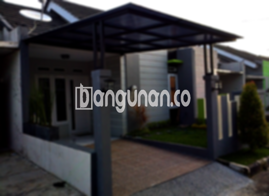

**Jasa Pasang Kanopi Rumah Minimalis di Koja Jakarta** – Apakah Anda sedang merencanakan perlindungan optimal untuk teras atau garasi rumah Anda di Koja Jakarta? Kanopi adalah solusi tepat untuk melindungi halaman rumah dari sengatan panas matahari dan guyuran hujan. Dengan kanopi, Anda dapat menikmati ruang terbuka yang nyaman sepanjang tahun. Mitra Bangunan hadir sebagai penyedia jasa pemasangan kanopi yang terpercaya di Koja Jakarta.

Kanopi tersedia dalam beragam material, termasuk baja ringan dan besi hollo. Pemilihan material akan sangat memengaruhi tampilan dan kekuatan kanopi Anda. Setiap jenis material kanopi memiliki keunggulan dan kekurangan yang perlu Anda pertimbangkan.



Selain melindungi dari cuaca, kanopi juga berperan penting dalam meningkatkan estetika rumah Anda. Dengan desain yang tepat, kanopi dapat menjadi elemen dekoratif yang mempercantik tampilan fasad rumah Anda di Koja Jakarta.

## Harga Kanopi Rumah Minimalis di Koja Jakarta

Apakah Anda berencana untuk memasang kanopi di rumah Anda? Sebelum melakukan pemesanan, penting untuk memahami estimasi harga kanopi terlebih dahulu. Dengan memahami kisaran harga, Anda dapat membuat anggaran yang lebih realistis dan memilih kanopi yang sesuai dengan kebutuhan dan kemampuan finansial Anda. Anda dapat membandingkan berbagai opsi kanopi untuk menemukan yang paling tepat.

Harga kanopi dipengaruhi oleh beberapa faktor utama, di antaranya:

### – Material yang Digunakan

Material merupakan salah satu faktor penentu harga kanopi. Ada beragam pilihan material yang tersedia, seperti besi, baja ringan, dan polycarbonate. Setiap material memiliki karakteristik dan harga yang berbeda. Anda dapat memilih material yang paling sesuai dengan anggaran dan preferensi estetika Anda.

### – Model Kanopi

Model kanopi juga berperan dalam menentukan harga. Tersedia berbagai model kanopi, mulai dari yang sederhana hingga yang kompleks. Model yang lebih rumit biasanya akan membutuhkan biaya yang lebih tinggi. Anda dapat memilih model yang sesuai dengan gaya arsitektur rumah Anda.

### – Luas Kanopi

Luas kanopi juga memengaruhi harga. Semakin luas kanopi yang Anda butuhkan, semakin tinggi pula biayanya. Pastikan untuk mengukur area yang akan ditutupi kanopi secara akurat sebelum melakukan pemesanan.



Dengan mempertimbangkan faktor-faktor tersebut, Anda dapat memperkirakan biaya yang dibutuhkan untuk memasang kanopi di rumah Anda. Untuk informasi harga yang lebih detail, silahkan konsultasikan dengan tim kami.

## Pilihan Jenis Kanopi Rumah Minimalis di Koja Jakarta

Untuk Anda yang berencana memasang kanopi untuk rumah, terdapat berbagai pilihan model yang dapat Anda pertimbangkan. Salah satu pilihan yang populer adalah kanopi berbahan baja ringan. Kanopi baja ringan menawarkan sejumlah keunggulan dibandingkan material lainnya. Berikut beberapa kelebihan yang dapat Anda nikmati:

### – Kekuatan dan Kekokohan yang Terjamin

Prioritas utama dalam memilih kanopi adalah kekuatannya. Kanopi yang terbuat dari baja ringan dikenal memiliki kualitas yang sangat baik dan terjamin kekokohannya. Investasi pada kanopi baja ringan berarti Anda berinvestasi pada perlindungan jangka panjang untuk rumah Anda.

Banyak pengguna telah membuktikan kekokohan kanopi baja ringan, bahkan mampu bertahan selama bertahun-tahun tanpa perlu perbaikan besar. 

### – Desain yang Variatif

Kanopi baja ringan tersedia dalam berbagai desain dan model yang dapat disesuaikan dengan gaya rumah Anda. Anda dapat memilih dari berbagai pilihan warna, bentuk, dan ukuran untuk menciptakan kanopi yang sempurna. Keberagaman desain ini memungkinkan Anda untuk mengekspresikan kreativitas Anda.

### – Keamanan yang Optimal

Baja ringan merupakan material yang kuat dan tahan lama, sehingga menawarkan keamanan yang optimal. Anda dapat merasa tenang karena kanopi baja ringan Anda akan melindungi Anda dari berbagai risiko. Kemungkinan kerusakan atau roboh sangat kecil jika Anda memilih kanopi baja ringan yang berkualitas.

**Ref by:**  [Kanopi Rumah Minimalis Koja Jakarta](https://id.wikipedia.org/wiki/Kanopi)

Memilih kanopi yang tepat akan memberikan manfaat jangka panjang bagi Anda dan keluarga. Dengan kanopi yang kuat, aman, dan estetik, Anda dapat menikmati ruang terbuka yang nyaman dan terlindungi di rumah Anda di Koja Jakarta. Mitra Bangunan siap membantu Anda menemukan solusi kanopi terbaik untuk kebutuhan Anda. Hubungi kami melalui tombol WhatsApp atau Telepon di halaman ini untuk konsultasi dan pemesanan. Jangan ragu untuk menghubungi kami, dan kami akan memberi Anda penawaran terbaik.