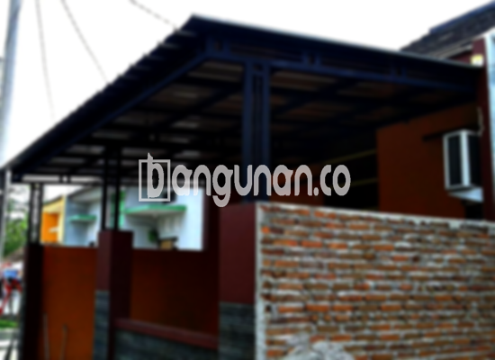

**Jasa Pasang Kanopi Rumah Minimalis di Kosambi Tangerang** – Apakah Anda sedang merencanakan mempercantik tampilan rumah dengan kanopi? Kanopi adalah elemen penting yang tidak hanya memberikan perlindungan dari cuaca, tetapi juga menambah nilai estetika pada bangunan Anda. Bagi Mitra Bangunan di Kosambi Tangerang, kami hadir sebagai solusi untuk mewujudkan kanopi impian Anda, dengan layanan pemasangan yang profesional dan harga yang kompetitif.

Kanopi hadir dalam berbagai material, seperti galvalum dan besi hollo, masing-masing menawarkan keunggulan unik. Pemilihan material yang tepat akan menentukan tampilan, kekuatan, dan daya tahan kanopi Anda.

Memiliki kanopi pada rumah Anda memberikan banyak keuntungan, mulai dari melindungi area luar ruangan dari panas matahari dan hujan, hingga meningkatkan kenyamanan dan memperindah tampilan properti Anda. Kanopi juga memberikan manfaat lain yang signifikan bagi rumah Anda.



## Harga Kanopi Rumah Minimalis di Kosambi Tangerang

Tertarik untuk memesan kanopi berkualitas untuk rumah Anda? Sebelum membuat keputusan, penting untuk memahami kisaran harga kanopi rumah terlebih dahulu. Anda bisa membandingkan berbagai opsi agar mendapatkan kanopi yang sesuai dengan anggaran dan kebutuhan Anda.

Harga kanopi dipengaruhi oleh beberapa faktor utama, di antaranya:

### – Material yang Digunakan oleh Jasa Pasang Kanopi Rumah Minimalis di Kosambi Tangerang

Material merupakan pertimbangan penting dalam memilih kanopi yang Anda inginkan. Tersedia beragam pilihan material seperti besi, baja ringan, dan lainnya. Anda dapat menentukan jenis kanopi yang paling sesuai dengan preferensi Anda. Perlu diingat bahwa setiap material memiliki tingkatan harga yang berbeda-beda.

### – Model Kanopi dari Jasa Pasang Kanopi Rumah Minimalis di Kosambi Tangerang

Model kanopi juga memengaruhi harga yang perlu Anda keluarkan. Anda dapat memilih desain yang paling sesuai dengan gaya arsitektur rumah Anda. Terdapat banyak pilihan model yang tersedia, dan Anda bisa mencari referensi di berbagai sumber untuk menemukan desain favorit Anda.

### – Ukuran Kanopi

Selain model dan material, Anda juga perlu mempertimbangkan ukuran kanopi yang dibutuhkan. Setiap rumah memiliki kebutuhan ukuran kanopi yang berbeda. Pastikan untuk melakukan pengukuran yang akurat sebelum memesan kanopi agar sesuai dengan area yang diinginkan.

Dengan memahami faktor-faktor ini, Anda dapat menemukan kanopi yang sesuai dengan anggaran dan harapan Anda. Semakin berkualitas material dan desainnya, umumnya harga kanopi akan semakin kompetitif. Untuk informasi harga terbaru, silakan hubungi tim kami.

## Saran Variasi Kanopi Rumah Minimalis di Kosambi Tangerang



Bagi Anda yang ingin mempercantik tampilan rumah dengan kanopi, ada banyak pilihan yang bisa Anda pertimbangkan. Salah satu pilihan yang tepat adalah kanopi berbahan baja ringan. Jenis kanopi ini menawarkan keunggulan tersendiri dibandingkan material lainnya. Berikut adalah beberapa kelebihan yang bisa Anda dapatkan:

### – Kekuatan dan Ketahanan yang Optimal

Salah satu hal yang paling penting ketika memilih kanopi adalah kekuatannya. Kanopi yang terbuat dari baja ringan dikenal memiliki kualitas yang sangat baik. Kekuatannya terjamin dan tahan lama, menjadikannya investasi yang bijaksana untuk rumah Anda.

Banyak orang telah membuktikan ketahanan kanopi berbahan baja ringan. Bahkan, dapat bertahan puluhan tahun tanpa kehilangan kekuatannya.

### – Pilihan Model yang Beragam dari Jasa Pasang Kanopi Rumah Minimalis di Kosambi Tangerang

Anda yang menginginkan desain unik untuk kanopi rumah, baja ringan menawarkan berbagai pilihan model yang menarik. Kelebihan ini memungkinkan Anda untuk menyesuaikan kanopi dengan gaya arsitektur rumah Anda.

### – Keamanan yang Terjamin dari Jasa Pasang Kanopi Rumah Minimalis di Kosambi Tangerang

Baja ringan adalah material yang memiliki tingkat kekokohan tinggi, sehingga keamanannya tidak perlu diragukan lagi. Anda akan mendapatkan perlindungan maksimal jika menggunakan kanopi baja ringan. Risiko kerusakan atau roboh sangat minimal dengan penggunaan material ini.

Selain baja ringan, kanopi berbahan galvalum juga menjadi pilihan menarik bagi Anda. Material ini menawarkan banyak kelebihan yang bermanfaat bagi rumah Anda.

**Ref by:**  [Kanopi Rumah Minimalis Kosambi Tangerang](https://id.wikipedia.org/wiki/Kanopi)

Itulah informasi yang dapat kami sampaikan mengenai Jasa Pasang Kanopi Rumah Minimalis di Kosambi Tangerang. Mitra Bangunan siap membantu Anda dalam mewujudkan kanopi impian untuk rumah Anda. Jangan ragu untuk menghubungi kami melalui tombol WhatsApp atau Telepon di halaman ini untuk konsultasi dan pemesanan. Kami berharap informasi ini bermanfaat bagi Anda, dan terima kasih atas perhatiannya.