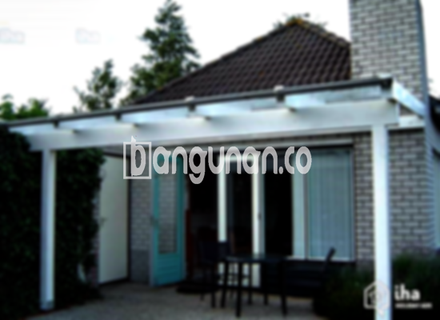

**Jasa Pasang Kanopi Rumah Minimalis di Kota Bambu Jakarta** – Apakah Anda sedang mempertimbangkan untuk memasang kanopi guna melindungi teras, garasi, atau jendela rumah Anda di Kota Bambu Jakarta? Mitra Bangunan, kanopi merupakan solusi efektif untuk memberikan perlindungan dari teriknya matahari dan guyuran hujan. Dengan memilih kanopi yang tepat, Anda dapat menciptakan ruang outdoor yang lebih nyaman dan meningkatkan nilai estetika bangunan Anda. Kami hadir sebagai mitra terpercaya untuk memenuhi semua kebutuhan kanopi Anda.

Kanopi tersedia dalam berbagai pilihan material seperti baja ringan dan besi hollo. Material yang dipilih tentu akan memengaruhi tampilan visual, kekuatan struktur, dan biaya yang dibutuhkan. Setiap jenis material memiliki keunggulan dan kekurangan masing-masing yang dapat disesuaikan dengan preferensi dan anggaran Anda. 

Memiliki kanopi di properti Anda memberikan sejumlah manfaat yang signifikan. Selain melindungi dari elemen cuaca ekstrem, kanopi juga dapat mempercantik tampilan bangunan dan menambah nilai investasi properti Anda. 



## Harga Kanopi Rumah Minimalis di Kota Bambu Jakarta

Sebelum Anda memutuskan untuk membeli kanopi untuk rumah di Kota Bambu Jakarta, alangkah baiknya memahami terlebih dahulu bagaimana kisaran harga yang berlaku. Memahami harga akan membantu Anda dalam membuat perencanaan anggaran yang lebih efektif dan memilih kanopi yang sesuai dengan kemampuan finansial Anda. Anda dapat membandingkan harga dari berbagai penyedia jasa agar mendapatkan penawaran terbaik.

Harga kanopi dipengaruhi oleh beberapa faktor yang perlu Anda pertimbangkan, antara lain:

### – Jenis Material yang Digunakan

Pemilihan material menjadi salah satu aspek krusial dalam menentukan harga kanopi. Material seperti besi, baja ringan, dan polycarbonate memiliki rentang harga yang berbeda. Anda dapat memilih material yang paling sesuai dengan kebutuhan dan preferensi Anda.

### – Desain dan Model Kanopi

Model kanopi yang Anda pilih juga akan memengaruhi harga. Model yang lebih rumit dengan detail desain yang unik biasanya akan lebih mahal daripada model sederhana. Pilihlah model yang sesuai dengan gaya arsitektur rumah Anda dan anggaran yang telah Anda siapkan.

### – Ukuran dan Luas Area Kanopi

Ukuran dan luas area yang akan ditutupi oleh kanopi juga merupakan faktor penting dalam penentuan harga. Semakin luas area yang perlu ditutupi, semakin banyak material yang dibutuhkan, dan semakin tinggi pula biayanya. Pastikan Anda mengukur area dengan akurat sebelum memesan kanopi.

Dengan mempertimbangkan faktor-faktor ini secara cermat, Anda akan dapat memperkirakan biaya yang dibutuhkan dan memilih kanopi yang paling sesuai dengan kebutuhan dan anggaran Anda di Kota Bambu Jakarta.

## Saran Tipe Kanopi Rumah Minimalis di Kota Bambu Jakarta



Bagi Anda yang berencana untuk memasang kanopi pada rumah, ruko, atau bangunan komersial lainnya di Kota Bambu Jakarta, kami merekomendasikan kanopi berbahan baja ringan sebagai pilihan terbaik. Material ini menawarkan berbagai keunggulan yang menjadikannya sangat populer di kalangan konsumen.

### – Keawetan dan Ketahanan yang Luar Biasa

Keawetan adalah salah satu faktor utama yang perlu dipertimbangkan dalam memilih kanopi. Kanopi berbahan galvalum, yaitu baja ringan yang dilapisi dengan lapisan anti karat, memiliki kualitas yang sangat baik dan tahan terhadap korosi. Hal ini menjamin kanopi Anda akan awet dan tahan lama meskipun terpapar cuaca ekstrem.

Banyak pelanggan kami di Kota Bambu Jakarta yang telah membuktikan sendiri keawetan kanopi berbahan baja ringan. Bahkan, beberapa kanopi yang kami pasang lebih dari satu dekade lalu masih dalam kondisi yang sangat baik.

### – Variasi Model yang Sangat Beragam

Kanopi berbahan baja ringan menawarkan fleksibilitas desain yang tinggi. Anda dapat memilih dari berbagai model dan gaya yang tersedia, mulai dari desain yang sederhana dan minimalis hingga desain yang lebih kompleks dan artistik. Dengan demikian, Anda dapat menciptakan kanopi yang benar-benar sesuai dengan selera dan gaya arsitektur bangunan Anda.

### – Tingkat Keamanan yang Terjamin

Selain kuat dan tahan lama, kanopi berbahan baja ringan juga sangat aman. Material ini memiliki kekuatan tarik yang tinggi dan mampu menahan beban angin kencang atau bahkan beban berat lainnya. Anda dapat merasa tenang dan nyaman karena kanopi tidak akan mudah roboh atau rusak.

Kami menyediakan beragam pilihan model kanopi baja ringan yang dapat disesuaikan dengan kebutuhan Anda. Tim profesional kami siap membantu Anda memilih desain yang paling tepat untuk bangunan Anda di Kota Bambu Jakarta dan memberikan konsultasi secara gratis.

Dengan mempertimbangkan keawetan, variasi model, dan keamanan yang ditawarkan, kanopi berbahan baja ringan jelas merupakan pilihan terbaik untuk investasi jangka panjang.

**Ref by:**  [Kanopi Rumah Minimalis Kota Bambu Jakarta](https://id.wikipedia.org/wiki/Kanopi)

Mitra Bangunan yang sedang mencari jasa pemasangan kanopi berkualitas di Kota Bambu Jakarta, jangan ragu untuk menghubungi kami melalui tombol WhatsApp atau Telepon yang tersedia pada halaman ini. Kami siap melayani Anda dengan sepenuh hati dan memberikan solusi kanopi yang sempurna untuk kebutuhan Anda. Kami berjanji untuk memberikan layanan terbaik dan hasil yang memuaskan.