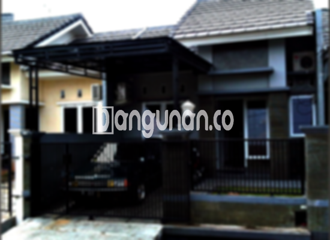

**Jasa Pasang Kanopi Rumah Minimalis di Kotabaru Karawang** – Apakah Mitra Bangunan sedang merencanakan untuk meningkatkan tampilan dan fungsi area luar rumah di Kotabaru Karawang? Kanopi adalah solusi ideal untuk menciptakan ruang yang nyaman dan terlindungi, baik untuk teras depan, garasi, atau area komersial seperti ruko. Kami hadir sebagai penyedia jasa pemasangan kanopi minimalis yang berkualitas dan terjangkau di Kotabaru Karawang, siap membantu Anda mewujudkan hunian impian.

Kanopi hadir dalam beragam material, seperti galvalum dan besi hollo, masing-masing dengan kelebihan dan kekurangannya tersendiri. Pilihan material akan bergantung pada preferensi estetika, anggaran, dan kebutuhan fungsional Anda.

Memiliki kanopi tak hanya memperindah tampilan bangunan, tetapi juga memberikan banyak manfaat praktis. 



## Harga Kanopi Rumah Minimalis di Kotabaru Karawang

Tertarik untuk memasang kanopi di rumah Anda? Sebelum membuat keputusan, penting untuk memahami perkiraan biaya yang dibutuhkan. Informasi mengenai harga kanopi rumah akan membantu Anda merencanakan anggaran dengan lebih efektif. Anda dapat membandingkan berbagai opsi dan memilih kanopi yang paling sesuai dengan kebutuhan dan anggaran Anda.

Harga kanopi ditentukan oleh beberapa faktor utama, termasuk:

### - Bahan yang Digunakan oleh Jasa Pasang Kanopi Rumah Minimalis di Kotabaru Karawang

Pemilihan material adalah aspek krusial dalam menentukan kualitas dan harga kanopi. Beberapa material umum yang digunakan antara lain besi, baja ringan, dan polycarbonate. Setiap material memiliki karakteristik dan rentang harga yang berbeda. Anda dapat memilih material yang paling sesuai dengan preferensi estetika, anggaran, dan kebutuhan fungsional bangunan Anda.

### - Model Kanopi dari Jasa Pasang Kanopi Rumah Minimalis di Kotabaru Karawang

Desain dan model kanopi juga memengaruhi harga. Kami menawarkan berbagai pilihan model kanopi minimalis yang dapat disesuaikan dengan gaya arsitektur rumah Anda. Semakin kompleks desainnya, biasanya semakin tinggi pula biayanya. Anda dapat menelusuri berbagai referensi model kanopi di internet atau berkonsultasi dengan tim kami untuk mendapatkan saran terbaik.

### - Luas Area yang Ditutupi Kanopi

Ukuran kanopi juga memainkan peran penting dalam menentukan biaya. Semakin luas area yang perlu ditutupi, semakin banyak material yang dibutuhkan dan semakin tinggi pula biaya yang dikeluarkan. Oleh karena itu, sebelum memesan kanopi, pastikan Anda mengukur area yang ingin ditutupi dengan akurat.

Setelah mempertimbangkan faktor-faktor di atas, Anda akan memiliki gambaran yang lebih jelas mengenai perkiraan biaya pemasangan kanopi. Untuk informasi harga yang lebih detail, silakan lihat tabel harga yang tersedia  atau hubungi tim kami untuk mendapatkan penawaran khusus.

## Rekomendasi Variasi Kanopi Rumah Minimalis di Kotabaru Karawang

**Ref by:**  [Kanopi Rumah Minimalis Kotabaru Karawang](https://id.wikipedia.org/wiki/Kanopi)

Sebagai panduan bagi Anda, berikut adalah beberapa jenis kanopi rumah minimalis yang populer dan bisa Anda pertimbangkan:

### - Kanopi Baja Ringan: Kokoh dan Tahan Lama

Kanopi baja ringan adalah pilihan yang sangat populer karena kekuatan dan daya tahannya yang luar biasa. Material ini tahan terhadap karat dan cuaca ekstrem, sehingga cocok untuk iklim tropis seperti di Kotabaru Karawang. Kanopi baja ringan juga relatif ringan, sehingga pemasangannya lebih mudah dan cepat.

Baja ringan menawarkan tingkat kekokohan yang tinggi dan mampu bertahan dalam kondisi cuaca yang beragam selama bertahun-tahun.

### - Kanopi Galvalum: Pilihan Ekonomis dan Praktis

Kanopi galvalum adalah alternatif yang lebih terjangkau dibandingkan baja ringan. Material ini juga memiliki ketahanan yang baik terhadap karat dan korosi. Kanopi galvalum cocok untuk aplikasi yang membutuhkan solusi yang ekonomis dan efisien.

Anda dapat memilih dari berbagai bentuk dan ukuran kanopi galvalum untuk menyesuaikan dengan kebutuhan Anda.

### - Kanopi Polycarbonate: Estetis dan Fungsional

Kanopi polycarbonate menawarkan kombinasi antara estetika dan fungsionalitas. Material ini tembus cahaya, sehingga tetap memungkinkan cahaya alami masuk ke dalam ruangan. Kanopi polycarbonate juga ringan, kuat, dan tahan terhadap benturan.

Kanopi polycarbonate ideal untuk area yang membutuhkan pencahayaan alami, seperti teras atau halaman belakang rumah.

Memilih jenis kanopi yang tepat akan sangat memengaruhi tampilan dan fungsi area luar rumah Anda. Pastikan Anda mempertimbangkan kebutuhan, anggaran, dan preferensi estetika Anda sebelum membuat keputusan.

Apakah Anda sudah menemukan jenis kanopi yang sesuai dengan kebutuhan di Kotabaru Karawang? Jangan ragu untuk menghubungi kami untuk mendapatkan konsultasi gratis dan penawaran terbaik. Mitra Bangunan di Kotabaru Karawang, kami siap membantu Anda menciptakan ruang luar yang nyaman dan terlindungi dengan kanopi berkualitas tinggi! Hubungi kami melalui tombol WhatsApp atau Telepon yang tersedia di halaman ini. 